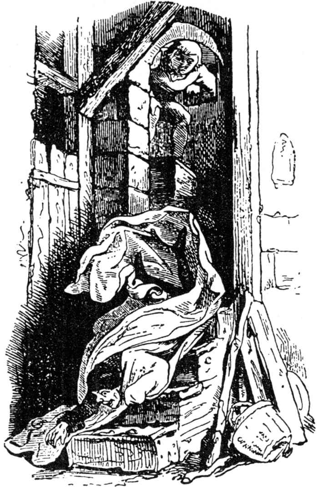
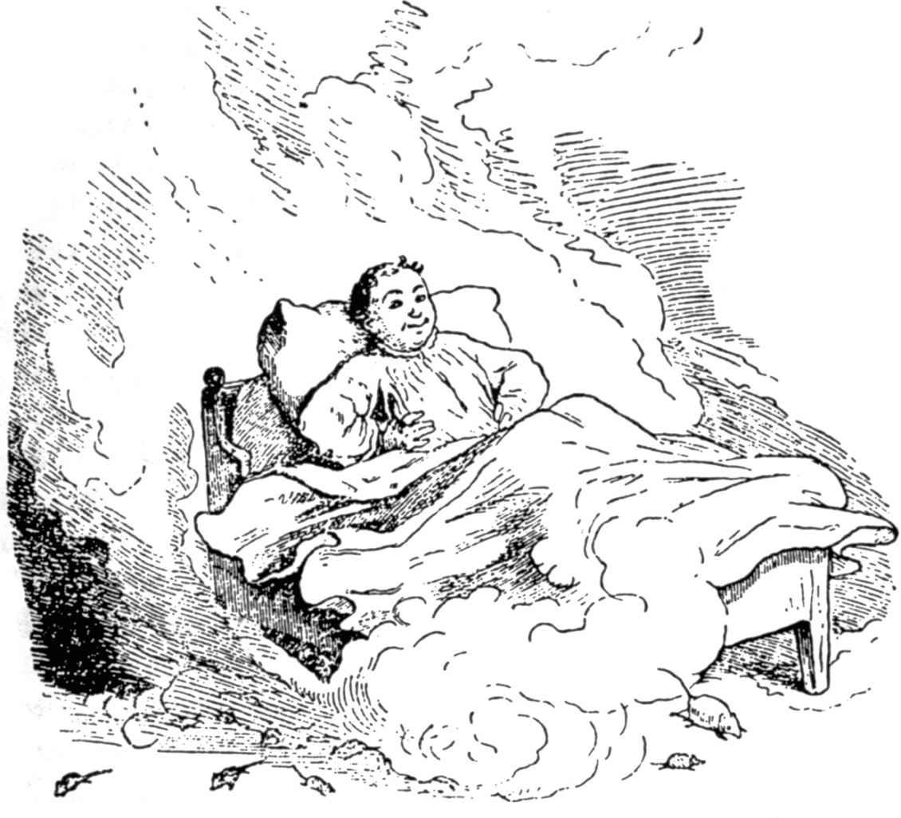

# 学习害怕的故事

有一位父亲，他有两个儿子，大儿子聪明而又伶俐，什么事都能应付自如，可是小儿子呢却很笨，什么都不懂，什么都学不会，大家一见了他，就说：“这孩子还真够他父亲操心的呢！”

如果要做什么事情，那么无论什么时候总得让大儿子去做；可是，如果父亲叫他晚上或者深夜外出取点什么东西，要路过教堂的墓地或者甚至路过让人害怕的地方时，他就说：“哦，不行，父亲，我不去，上那儿去我会发抖的！”因为他害怕走夜路。

有时候，晚上围着火堆听故事，讲到让人害怕的地方时，听的人有时就会说：“哦，吓得发抖了！”

可是那个小儿子则坐在角落里不耐烦了，他虽然听了，却不明白这是怎么回事。“他们老是说害怕！害怕！我就一点都不害怕；这一定又是一个编造出来的故事，我一点儿都不懂。”

这期间出现了这么一件事，有一次父亲对他说：“听着，你这呆在角落里的小子，你长得又高又结实，也该学点什么了，你要挣钱养活自己了。你瞧瞧，你哥哥多么肯花力气，可是你呢，简直不可救药。”

“唉，父亲，”他回答说，“我也很想学点什么；不过，要学的话，我想就让我学害怕吧，这方面的东西我还一点都不懂呢。”

老大听了这些话，不由得笑了起来，心里想：“我的天啊，我的弟弟真是个大傻瓜，他这么傻，一辈子将一事无成，俗话说：什么样的人，从小就看得出。”

父亲叹了口气说：“你就是学会了害怕，可是要你挣钱养活自己，还是不行的。”

这事儿发生后不久，教堂司事来他们家作客，于是父亲就向他诉苦说：他的小儿子糟透了，一无所知，什么事都不会，什么事都不学，“您想想，当我问起他，想怎样挣钱生活时，他却说他先要学习害怕。”

“如果没有其他问题，”教堂司事回答说，“这件事在我那儿可以学会；你就把他交给我吧，我会教好他的。”

父亲听了很高兴，因为他想：“这孩子这下可以有点儿管束了。”

教堂司事就这样把他带回家去了，他首先得打钟。

两天以后，教堂司事在半夜里叫醒他，让他起来到教堂钟楼上去打钟。“你就会学会什么是害怕了，”他想，一边悄悄地先走了。

当那孩子走到钟楼上，转过身来想抓钟绳时，忽然看到在楼梯上面，有一个白色的身影面对着出声孔站着。

“谁在那里？”他叫道，可是那身影没有回答，而且一动也不动。

“你说话呀，”这孩子大声喊道，“快走开，半夜三更的在这里又没有事可做。”

可是那教堂司事仍然一动不动地站着，想以此来让这孩子觉得，他是一个鬼。

可是这孩子又一次喊了起来：“你在那里想干什么？如果你是一个诚实的人，你说话呀，不然的话我就把你从楼梯上扔下去。”

教堂司事想：“情况不会像他说的那么糟的，”他仍然一声不吭地站着，活像一块石头。

这时那孩子第三次喊了起来，结果还是没用，于是他就冲上去，一脚把这个鬼从楼梯上踢了下去，使它摔到十级台阶下面，躺在一个角落里爬不起来了。然后他打了钟，不声不响地回到房间里睡觉去了。他躺在床上，一会儿就睡着了。

教堂司事的妻子等了她丈夫好长时间，可是左等右等都不见他回来，最后她感到害怕起来，把那孩子叫醒问他道：“我丈夫现在在哪儿，你知道吗？”

“不知道，”这孩子回答说，“不过，刚才楼梯上有一个人面对出声孔站着，我问他话他不回答，叫他走他又不肯走，因此我就把他当作坏蛋一脚踢到楼梯下面去了。您快去瞧瞧，看他是不是还在那儿，这件事真对不起。”

教堂司事的妻子一听连忙找她丈夫去了，她看到丈夫正躺在角落里呻吟呢，他跌断了一条腿。

她把他背起来，然后吵吵嚷嚷地跑到孩子的父亲那里。“您的儿子，”她叫道，“闯大祸了，他把我的丈夫从楼梯上踢了下来，摔断了一条腿，这下可怎么好哟：我们家出了个废人。”

父亲大吃一惊，赶忙跑到儿子那里，痛骂起他来：“你竟然干出这种丧尽天良的恶作剧，你一定是中邪了。”

“父亲，”他回答说，“您听我说，这完全不是我的过错。半夜三更的他站在那里，就像一个存心做坏事的人。我不知道他是谁，我向他喊了三次，要他说话或者离开。”

“唉，”父亲说，“有你这么个儿子真倒霉，你给我滚，别让我再见到你。”

“是，父亲，很乐意，不过得等到天亮，到时候我想出去学习害怕，这样我就会掌握一种可以养活自己的本领了。”

“你想学什么就学什么，”父亲说，“对我来说都无所谓。这里是五十塔勒，你拿去走远一点，别告诉别人你是从什么地方来的，谁是你的父亲，因为有你这么个儿子，我感到害臊。”

“好吧，父亲，随您的便，如果您没其他要求的话，这点我会注意的。”

天亮的时候，男孩把五十塔勒装进口袋，走出教堂来到公路上，他一边走一边不停地咕哝道：“要是我能发抖多好啊，要是我能害怕多好啊！”

这时，正好有一个人走到他面前，听到了男孩这些自言自语的话。当他们俩走了一段路，可以看到一个绞刑架时，那人便对他说：“你瞧，那儿是棵吊着七个人的树，现在那些人还在随风飘动，你坐到这棵树下，等到夜幕降临时，你就能学会害怕的。”

“除此之外没有别的话，”男孩回答说，“这是很容易做到的；如果我真的这么快学会害怕，那么我这五十塔勒就应该归你。好吧，你明天早上再来找我。”

男孩说完就朝绞刑架走去，坐在那下面等待夜晚来临。

等着等着，他感到身上冷起来了，他点了一堆火；可是半夜里刮起了大风，冷得不得了，尽管坐在火堆边也不觉得暖和。风儿似乎在把吊死的人互相碰撞着，使他们不停地晃来晃去，于是他想道：“你坐在树下的火堆旁还觉得冷，那么他们呆在上面更觉得冷，更要来回动个不停了。”

他出于同情，把梯子靠到树上，爬上去把那七个绞死的人一个一个地解开，全放到了地上。他捅了捅火，又吹了一下，然后把他们围成一个圈子，想使他们暖和起来。可是他们坐在那里一动都不动，而火呢，又快要烧到他们的衣服了。

这时，男孩说道：“你们注意了，不然的话我再把你们吊上去。”

可是，死人什么也听不懂，一声不吭，任凭他们的破衣烂衫让火烧着。

这下男孩可火了，叫道：“要是你们还不放在心上，那么我就帮不上你们的忙了，我也不想烧死你们，”于是，他又把他们一个一个地吊了上去。吊完后，他才坐到火堆边，不一会儿就睡着了。

第二天早晨，那人来到他的面前，想要五十塔勒，说道：“现在你知道，什么是害怕了吧？”

“不知道，”他回答说，“我怎么会知道呢？这些吊在上面的人一个个都不声不响，简直笨极了，眼巴巴地让身上那几片破布烧着都不动。”

那人发现，他今天无论如何都得不到那五十塔勒，于是就走了，一边走一边说：“这么一个人我还从来没有遇到过呢。”

男孩又接着赶他的路，他一边走嘴里又一边自言自语道：“唉，要是我能害怕多好呀！唉，我能发抖多好啊！”

一位走在他后面的马车夫听到他说的话，问道：“你是谁？”

“我不知道。”男孩回答说。

马车夫又接着问：“你从什么地方来？”

“我不知道。”

“你父亲是谁？”

“这我不能告诉你。”

“你叽里咕噜地说什么呀？”

“唉，”男孩回答说，“我想学害怕，可是没有人能教我。”

“别说蠢话，”马车夫说，“过来，跟我走，我倒想瞧瞧，我能不能教会你。”

男孩跟他一起走了。傍晚时分，他们来到一家客栈，想在那里过夜。走进客房时，男孩又大声嚷嚷起来：“要是我能害怕多好啊！要是我能发抖多好啊！”

客栈老板听到这话笑了，说道：“如果你对这个有兴趣，这儿倒是有个合适的地方。”

“哦，别说了，”老板娘说，“已经有好几个好奇的人丢了性命，你这对漂亮的眼睛如果再也见不到天日，那真是太可惜，太遗憾了。”

可是男孩说：“既然这事这么难，我倒想试试，所以我就得住到那边去。”

他一个劲儿缠住客栈老板，直到老板说出，离这儿不远有一个魔鬼猖獗的城堡，只要他在里面呆上三夜，那么他就一定会学会什么是害怕。国王曾经答应，谁敢这样做了，他就把他的女儿许配给他做妻子，那真是天底下最漂亮的女孩子。城堡里面还有大量的珍宝，都由许多恶魔守护着，他们为所欲为，什么事都干得出来。已经有许多人进去过，可是从没有人能再出来。

第二天早上，男孩来到国王面前说：“如果你允许，那么我就要在那魔鬼出没的城堡里呆上三天。”

国王打量了他一下，对他有了好感，说道：“你还可以要求得到三样东西，不过一定是要没有生命的东西，你可以把它们带进城堡。”

男孩回答说：“那么我就要一把火、一台车床和一台带有刀具的刨工台。”

国王让他把这些东西在白天就拿进城堡去。

夜幕将要降临的时候，男孩来到城堡里，在一间小房间里点起一把通亮的火，把带有刀具的刨工台放到火堆边，然后坐到车床上。

“唉，要是我能害怕多好啊！”他说，“可是在这里，看来我还是学不会的。”

将近半夜的时候，他想捅一捅火；他吹了一下火，这时从角落里突然发出一个声音来：“哎哟，喵！我们怎么这么冷呀！”

“你们这些笨蛋，”男孩叫道，“喊什么呀？如果你们冷，那么就过来，坐到火边来暖和暖和。”

按照他说的，有两只大黑猫果真猛地跳了过去，分别坐到他的两边，用它们那闪闪发亮的眼睛贪婪地注视着他。过了一会儿，当它们暖和了以后说道：“伙计，我们要一起玩牌吗？”

“为什么不呢？”他回答说，“不过你们先把你们的爪子伸出来让我看看。”

于是，它们伸出了各自的利爪。

“唉，”他说，“你们的指甲怎么这么长呀！等一下，我先得给你们剪一剪。”说着，他便一把抓着它们，把它们放到刨工台上，用螺丝把它们的爪子拧紧。

“打牌的兴趣我没有了，”他叫道，“而对你们我要严密地监视，”它们被夹死了，接着便被扔到城堡外面的河里去了。

可是，当男孩重新安静下来，又想坐到火堆边时，从所有的旮旮旯旯里出来了一群群的黑猫和黑狗，而且越来越多，多得使他都无处安身，它们令人厌恶地叫着，一步步朝火堆逼近，它们把火扯来扯去，想扑灭它。

这一场面他满不在乎地注视了片刻，不过他终于还是发火了，抓住刨刀叫道：“滚，你们这些无赖，”他一边喊一边朝它们砍去。它们一部分逃走了，一部分被打死了，被他扔到了外面的池塘里。

他又回到房里，重新把火星吹得燃烧起来，身体又暖和了。当他坐下后，眼睛困得似乎再也睁不开了，他很想睡觉，这时不由得朝四下望了一眼，发现角落里有一张大床，“这床对我正合适，”他说，然后便躺到上面去了。

可是，当他正想合上眼睛时，那张床忽地自己动了起来，在整个城堡里绕着圈子行驶。“很好，”他说，“太好了。”

床继续行驶着，仿佛有六匹马在拉似的，它跨过门槛，越过阶梯，上上下下，一下子快了！快了！一会儿又翻了，翻了个底朝天，活像是有一座山压在他身上。可是，他把被子和枕头扔到空中，从里面爬了出来：“现在谁还会有兴趣坐车，”说着，他便在火堆旁躺下，一直睡到天明。

第二天早上国王来了，他看到男孩躺在地上，还以为鬼怪已经把他杀了，他已经死了呢。于是国王说：“这么漂亮的人死了，真可惜。”

男孩听见这话，一下子坐了起来，说：“离死还差得远呢！”

国王非常惊奇，可是也很高兴，问他这一夜是怎么过来的。

“过得很好，”男孩回答说，“既然一夜过来了，那么还有两夜也会过去的。”

当他来到客栈老板那里时，客栈老板两只眼睛瞪得大大的。“我没想到，”他说，“还能见到你活着；现在你可学会什么是害怕了吧？”

“没有，”男孩说，“全都是白费力气，要是有一个人能告诉我这事儿就好了！”

第二天晚上，他又来到古老的城堡里，他朝火堆边一坐，又开始念叨他那陈词滥调来：“要是我能害怕多好啊！”

深更半夜的时候，传来一阵嘈杂声和轰隆声，开始还很弱，接着越来越响，后来又轻了一点，最后有一个少了一半的人大叫着从烟囱里飞落下来，掉在他的跟前。“喂！”他叫道，“这还是一半的声音，太少了。”

接着，噪声又重新响了起来，喧闹声、吼叫声经久不息，另外半个人降临了。“等着瞧，”他说，“我先要替你把火再吹得旺一些。”

他这么说，也这么干了，然后又朝四周望了一眼，这时两个半个的人凑到了一起，于是便有一个令人生畏的人坐到了男孩的座位上。

“这可不行，”男孩说，“这张长凳是我的。”

那人想把他挤走，可是男孩并没有让他给挤倒，反而使劲把他给推开，自己重新又坐到了位子上。

这当儿有更多的人降临了，一个接着一个跳了下来，他们取来九条死人的腿和两只骷髅头，放好后便玩起九柱戏游戏来。

男孩兴趣也上来了，问道：“你们听着，我可以同你们一道玩吗？”

“可以，如果你有钱的话。”

“钱有的是，”他回答说，“不过，你们的球不怎么圆。”说着，他拿起骷髅头放到车床上，把它们车得圆圆的。

“瞧，现在它们会很好使的，”他说，“哈哈！痛痛快快地玩吧！”他们一起玩了起来，结果他输了一点钱；可是这时打了十二点，一切都从他眼前消失了。他重新躺下，安静地睡着了。

第二天早上国王来探听情况。“这回你是怎么度过的？”他问。

“我玩九柱戏了，”男孩回答说，“而且还输了两个赫勒。”

> **注 1**　德国古代的一种钱币。

“你不害怕吗？”

“啊，哪儿的话，”他说，“我玩得可痛快呢。要是我知道什么是害怕，那多好啊！”

第三天晚上，男孩又坐到长凳上，怏怏不乐地说：“要是我能害怕多好啊！”

夜深人静时，来了六个大汉，只见他们抬进来一口棺材。这时，男孩便说道：“哈哈，这一定是我那个两天前死去的表弟了，”他挥了挥手叫道：“过来，表弟，过来！”

那伙人把棺材放到地上，而他却走过去，揭开棺材盖儿：里面躺着一个死人。他摸了一下死人的脸，这张脸像冰一样凉。

“等着瞧，”他说，“我要让你热起来，”说着，他走到火堆旁，烤了烤手，然后把双手放到死人的脸上，可是那死人的脸仍然是冰凉的；于是，他干脆把死人抱出棺材，坐到火堆旁，把死人放到自己的膝盖上，替他搓起胳膊来，想用这个办法让他的血液重新流动。

当这个办法也无济于事时，他又产生了一个念头：“如果两个人睡在一张床上，这样他就会暖和了。”

他把死人抱到床上，替他盖上被子，然后自己在他边上躺下。过了一会儿，那死人果然热了起来，并且开始动了。这时，男孩说：“你瞧，表弟，要不是我，你就不会暖和了！”

可是，那死人却抬起身子叫道：“现在我要掐死你。”

“什么，”男孩说，“你就这样谢我吗？你应该马上再回到你的棺材里去，”说完，他抱起死人，重新把他放到棺材里，把盖子盖上了；这时，那六个人走过去，抬起棺材又走了。

“我不想学习害怕了，”男孩说，“在这里我是一辈子也学不会害怕的。”

正在这时候，走进一个人来，这人的个儿比所有的人都要高大，看上去非常厉害；不过，他年纪也很大，长着一脸长长的白胡子。

“哦，你这个小家伙，”他大声说道，“现在我马上就会让你学会什么叫害怕，因为你就要死了。”

“别这么快让我死，”男孩回答说，“如果我该死了，那么我也得在场呀。”

“我现在就要收拾你了，”那恶鬼说。

“慢点儿，慢点儿，你不要占这么多的地方；我也同你一样强壮，也许还要强壮呢。”

“让我们等着瞧吧，”那老头儿说，“如果你真的比我强壮，那么我就让你走；过来，我们现在试一试。”说着，他便带他穿过黑洞洞的过道，来到一个锻炉边，拿起一把斧子，一斧子把一个铁砧砍倒在地上。

“这个我会干得更好，”男孩说；于是，他走到另一个铁砧边；那老头儿站到他旁边，想看个究竟，可他的白胡子挂得老长老长的。这时，男孩抓起斧子朝铁砧砍去，一斧子下去把老头儿的白胡子也砍进去了。

“这下是我抓住你了。”男孩说，“现在我要你死。”接着，他抓起一根铁棒，使劲朝那老头儿身上打去，直到他苦苦哀求说，他要是停止打他，他就给他一大笔财富。

男孩把斧子拔出来，放了他。老头儿带他又回到城堡，在一个地窖里把三只装满金子的箱子告诉了他。

“这些金子，”老头儿说，“一部分是给穷人的，一部分是给国王的，还有一部分是给你的。”

这时，时钟打了十二下，那魔鬼消失了，于是男孩四周一片漆黑。

“我一定能从这儿走出去，”男孩说，他在地窖里摸索，找到了去房间的路，他在那儿的火堆边躺下睡了。

第二天早上国王来了，说：“这下你一定学会什么是害怕了吧？”

“不，”男孩回答说，“这到底是怎么回事？我那死去的表弟来过，还来过一个长胡子的人，他把地窖里许多钱都告诉了我，可是什么是害怕，谁也没有告诉过我。”

国王说：“你拯救了这座城堡，应该和我女儿结婚了。”

“这当然是最好的事了，”他回答说，“可是，我还不明白什么是害怕呀。”

这时，金子被人抬了上来，婚礼也举行过了，可是这年轻的国王，尽管他非常爱他的妻子，尽管他非常快活，但嘴里仍然一个劲儿地说：“要是我能发抖多好啊，要是我能害怕多好啊。”

这终于使他的妻子也感到恼火了，她的侍女说：“我有一个会让他发抖的办法。”

她走出屋子，来到流经花园的小河边上，让人捕好满满一桶鱼。到了晚上，当年轻的国王睡着时，公主便狠狠心揭去盖在他身上的被子，然后把鱼连同满满一桶冰凉的水倒在他的身上，于是那些小鱼在他身上乱蹦乱跳。

这时，他一下子惊醒了，大声喊道：“啊，我怎么发抖了，我怎么发抖了，亲爱的夫人！不错，我现在知道什么是发抖了。”

（裴胜利译）
