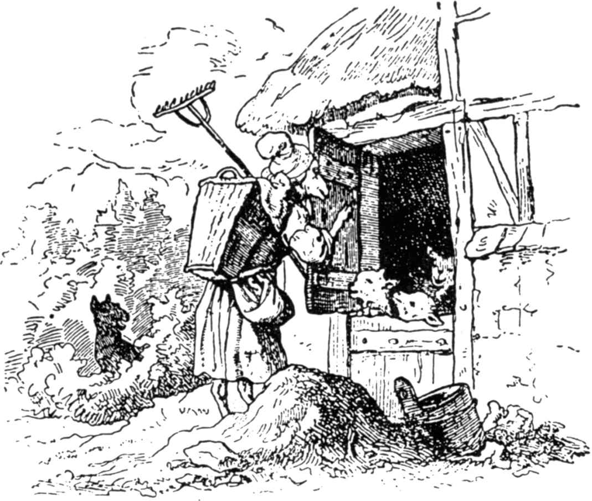
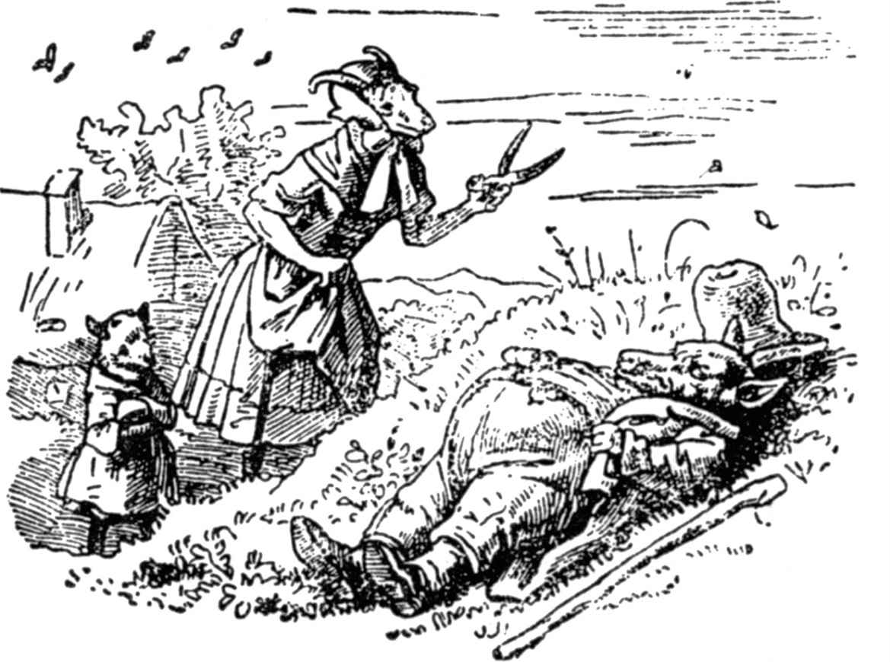

# 狼和七只小山羊

从前有只老母山羊，她有七只小山羊，她喜爱小羊们，就像母亲喜爱自己的孩子。一天她要到森林里去为他们弄点吃的，就把他们七个叫到跟前，说：

“亲爱的孩子们，我要到森林里去，你们要小心恶狼！如果他进了屋，就会把你们连皮带毛一古脑儿吞下。这恶棍经常伪装，可你们只要听他的粗嗓门，看他的黑脚掌，就可以立刻把他认出来了。”

小山羊们说：“亲爱的妈妈，我们会很当心的。你不用担心，去吧。”

老母山羊轻声嘀咕着就安心出门去了。不久，有谁来敲门，叫道：

“开门吧，亲爱的孩子们。你们的妈妈回来了，给你们每个人都带了好吃的东西。”

但是小山羊们一听那粗嗓门，就知道是狼。

“我们不开门，”他们叫道，“你不是我们的妈妈，她的嗓音柔和可亲，可你的嗓门粗，你是狼。”

于是狼走了，到一个杂货商人那儿买了一大块粉团，他吃后，嗓门就变细了。他回来又敲敲门，叫道：

“开门吧，亲爱的孩子们。你们的母亲回来了，给你们每个都带了吃的东西。”

但狼把一只黑爪子放在窗栏上，小山羊们看见了，就叫道：

“我们不开门。我们的妈妈没有像你这样的黑脚，你是狼。”

于是狼跑到一个面包师那儿，说：“我碰伤了脚，请给我一点生面团敷在脚上。”面包师把生面团敷在他脚上，他奔到磨坊主那儿说：“请在我的脚上撒些白面粉。”

磨坊主想：“这狼大概要骗什么人了。”于是拒绝了他。

但狼说：“如果你不给我撒粉，我就吃了你。”

磨坊主很害怕，帮他把爪子弄白了。不错，人都是那样的。

现在这恶棍第三次走到门前，敲敲门说：

“开开门，孩子们。你们亲爱的妈妈回来了，从森林里给你们每个都带东西来了。”

小山羊们叫道：“先给我们看看你的脚，这样我们可以知道你是不是我们亲爱的妈妈。”

狼把爪子放在窗栏上，他们一见是白的，就相信他说的全是真话，便开了门。

唉！可进来的是谁呢，是狼。他们怕极了，都想东躲西藏。第一个跳到桌子下，第二个跳到床上，第三个躲进烤炉里，第四个跑进厨房，第五个藏进橱里，第六个躲进洗手盆，第七个藏进墙上挂钟的钟壳里。但除了一只山羊外，其余的都给他找到吃掉了。他一个接一个地吞咽，只有躲在钟壳里的那个最小的没有找到。他满意地吃完后，就溜走了。他躺在外面草地上的一棵树下，睡起大觉来。

不久，母山羊从森林里回来了。哦！她见到了多么可怕的情景啊！屋门大开，桌子、椅子、长凳都翻倒在地，洗手盆也碎成几片，床上的被子和枕头都扔在床外。她里里外外地找孩子们，但哪儿也找不到，她一个个地叫他们的名字，但没一个答应。最后，她叫到最小的孩子的名字时，一个细小的嗓门应道：

“亲爱的妈妈，我藏在这儿钟壳里呢。”

母山羊把他抱出来，他就告诉娘狼来过，把其余的山羊都吃了。

你们可以想象，母山羊怎样为自己可怜的孩子痛哭了。

最后，她悲伤地走出去，最小的山羊跟在她身边。他们到了草地上，看见狼躺在一棵树旁打鼾，连树枝都震动起来。他们细细地从各方面打量狼，清楚地看见他那胀鼓鼓的肚子里有东西在蠕动，在推撞。

“啊，上帝！”母山羊想，“他当晚饭吃下的我可怜的孩子们还活着，这可能吗？”

母山羊叫最小的孩子到家里去拿剪刀和针线。然后她在大恶狼的肚皮上剪了一个洞，她刚剪好，一只山羊头就从洞里探了出来，再剪下去，一只接一只，先后跳了出来，六只都活着，连一点损伤都没有，因为狼太贪婪，把小羊整只整只囫囵吞下。这是一件叫人高兴的事儿。小羊们搂抱着他们亲爱的母亲接吻，高兴得蹦蹦跳跳，像裁缝在婚礼上那样跳跃。最后母山羊说：

> **注 1**　德国古代俗话说，裁缝身子轻巧，容易跳跃。

“孩子们，去拿些大石头来，趁这头恶狼还在熟睡，我们把他的肚子填满。”

于是七只小山羊很快搬来大堆石头，尽可能快地把石头塞进狼的肚子里，直塞到再也撑不下。老母羊迅速地把它缝好，而狼竟没感觉到，也没动一下。

最后，狼醒了，站起来，因为胃里装满石头，弄得他口很渴，就想到井边饮水。但是他一动，石头就在身体里来回滚动，发出哐哐的响声。于是他叫道：

“在我的肚子里叮叮咚咚的

究竟是什么东西？

我以为是六只小山羊，

可原来是大石头的声响。”

狼走到井边，想俯下身子饮水，可沉重的石头把他拽下井去，他就像一条可怜虫那样淹死了。

七只小山羊看见发生的这一切，都又跳又叫：“恶狼死了！恶狼死了！”他们和他们的妈妈都兴奋地围在井边，手舞足蹈起来。

（施种译）
