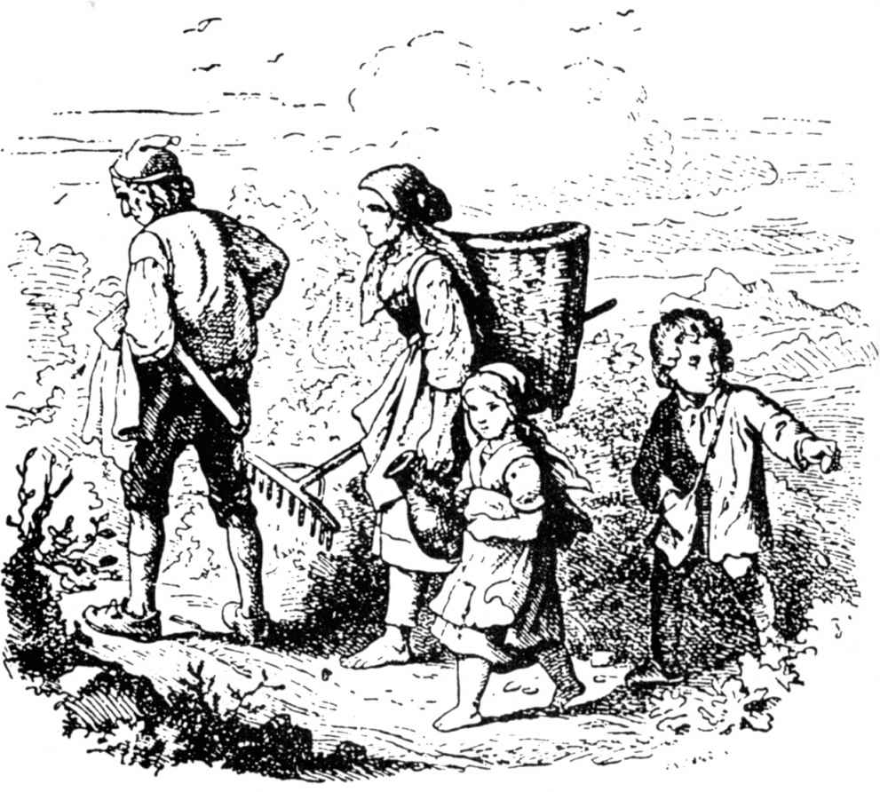
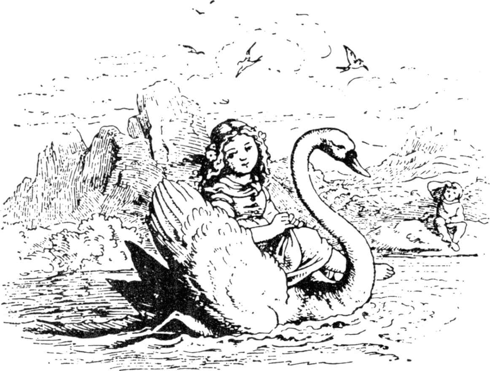

# 汉塞尔和格蕾特尔

在一个大森林前面住着一个贫穷的樵夫和他的后妻，前妻留下两个孩子，男孩叫汉塞尔，女孩叫格蕾特尔。他一直很穷，缺吃少穿，一次发生饥荒，樵夫连日常的面包都挣不到了。

一天晚上，他躺在床上苦思冥想，辗转反侧，愁得睡不着觉，他叹口气，对妻子说：“我们可怎么办呢？我们连自己都没吃的，拿什么来养活可怜的孩子呢？”

“我对你说，丈夫，”女人答道，“明天一早，我们把孩子们带到森林里最茂密的地方，生起一堆火，再给他们一人一小块面包，然后我们就回来干活，让他们单独呆在那儿，他们找不到回家的路，我们就可以摆脱他们了。”

“不行，妻子，”男人说，“这个我不干，我从来没想过要把孩子们扔在森林里不管，野兽很快会来把他们撕成碎片的。”

“你真傻！”她说，“不这样，我们四个人都要饿死，你不如立刻刨几块木板做几口棺材。”

她吵得他表示同意才安静下来。“但我还是为可怜的孩子们感到悲伤。”男人说。

两个孩子因为肚子饿都没睡着，他们听见了继母对父亲说的那些话。

格蕾特尔痛苦地哭着对汉塞尔说：“我们完了！”

“别哭，格蕾特尔！”汉塞尔说，“别难过，我想个办法。”

等大人们都睡着了，他起来穿好上衣，打开楼下的门，溜了出去。月光皎洁，屋子周围的白色小卵石像新造的银币一样闪闪发光。汉塞尔俯下身子，在上衣口袋里尽量装小卵石，直等到装满。

随后他回来，对格蕾特尔说：“别着急，亲爱的小妹妹，尽管安心地睡吧，上帝不会抛弃我们的。”说完他又上了床。

天刚蒙蒙亮，太阳还没出来，继母就来把两个孩子叫醒：“起来，你们这些懒骨头，我们要到森林里去砍木柴。”

她给两人一人一小块面包：“这是你们的午饭，记住，别先吃掉，不然你们没有别的吃了。”

格蕾特尔把面包统统放到围裙里，因为汉塞尔的口袋里装着小石子，他们就一块去森林了。

他们走了一阵，汉塞尔停下来回头看看老家，他不停地这样停下来回头望望。

他父亲问：“汉塞尔，你停下来朝后看什么？小心，快点走。”

“噢，爸爸！”汉塞尔说，“我在看我的小白猫，它坐在屋顶上，想和我道别呢。”

“小傻瓜！这不是猫，这是早上的太阳照在烟囱上。”女人说。

其实汉塞尔没有看小猫，他每停下一次，就从口袋里掏出一颗发光的小卵石扔在地上。他们到了森林中央，他们的父亲说：

“孩子们，去捡些木柴来，我给你们生个火，免得你们挨冻。”

汉塞尔和格蕾特尔把树枝捡在一起，堆成一个小山。他们把这堆树枝点燃了，等树枝燃烧起来，女人说：“我们去砍木柴，孩子们，你们就在火堆旁躺下休息一下，我们砍好了会再来叫你们的。”

汉塞尔和格蕾特尔坐在火堆旁，午饭时分到了，他们就吃那一小块面包，他们以为父亲就在近旁，因为他们听见斧子砍柴声。其实那不是斧子声，而是男人把一根树枝缚在一棵枯树上，风吹这根树枝它就晃来晃去打在树身上，发出咚咚的声音。他们坐得很久，感到累了，眼皮越来越沉，很快就睡着了。

他们最后醒来时，天已黑了。格蕾特尔哭了：“我们怎么走出森林啊？”

汉塞尔却安慰她说：“等一下，格蕾特尔，等月亮出来了，我们就会看到我撒下的那些小石子，它们会给我们指明回家的道路。”

满月出来了，汉塞尔拉着小妹妹的手，沿着像新铸造的银币般的小卵石指示的路途回家，他们走啊走的，走了整整一夜，天破晓时，又来到了父亲的茅屋前。

他们敲敲门，女人来开门，见到汉塞尔和格蕾特尔就说：“你们这些坏东西，干吗在森林里睡得这么久？我们还以为你们不打算再回来了。”

可他们的父亲很高兴，因为让他们独自留在森林里，他心里难受。

不久后，到处发生灾荒，他们又变得一无所有。孩子们听到继母晚上在床上对父亲说：“我们除了半个面包外，所有的东西都吃光了，以后我们什么也没有了。孩子们必须走，我们把他们带到森林更远的地方，这样他们就找不到回家的路了，除此以外没有别的办法。”

男人不忍心，他想了想说：“你还是和你的孩子们分吃最后一个面包的好。”

但他说的话女人一句也不听，她责备他、骂他，一个人干了第一回，就会干出第二回来。因为他第一次让过步，第二次也无法坚持了。当时，孩子们都醒着，把两人的谈话都听去了。

大人们一睡着，汉塞尔又起来，想和上回那样，出去再捡些小卵石，但那女人把门锁上了，他就出不去。他还是安慰小妹妹：

“别哭，格蕾特尔，尽管安心睡吧。亲爱的上帝会帮助我们的。”

下一天清早，女人来催孩子们起身，给他们两人一人一块面包，但这块面包比上次的还小。去森林的路上，汉塞尔扯碎口袋里的面包，时不时地停下脚步，把面包屑撒在地上。

“汉塞尔，你停下来回头看什么呀？走你的路吧。”父亲说。

“我在看坐在屋顶上的小鸽子，它想和我道别呢。”汉塞尔答道。

“小傻瓜！”女人说，“那不是你的鸽子，是早上的太阳照在上面烟囱上。”

然而，汉塞尔时不时地把面包屑都撒在地上。女人把孩子们领到森林的更深处，这地方他们从没来过。他们又生了一大堆火，女人就说：

“孩子们，你们就坐在这儿吧，如果累了，就躺下稍稍睡一会，我们去森林里砍柴，晚上我们砍好了，就来带你们回去。”

吃午饭时，格蕾特尔把面包分给汉塞尔吃，因为他的面包都撒在路上了，随后他们睡着了，夜深以后，可没人来领可怜的孩子们回家。

他们醒来时，天色已经漆黑，汉塞尔安慰小妹妹说：“等一等，格蕾特尔，等月亮出来了，我们就可以看到我撒在路上的面包屑，它们会给我们指出回家去的路。”

月亮出来了，他们就出发，但他们找不到面包屑，因为森林和田野的上千只鸟儿飞来把面包屑啄掉了。

汉塞尔对格蕾特尔说：“我们一会儿就会找到路的。”

可他们找不到，他们走了整整一晚上，第二天从早到晚又走了一天，还是没走出林子。

他们肚子很饿，因为除了长在地上的几只浆果外，没别的东西吃。他们累得腿再也抬不动了，就躺在一棵树下进入了梦乡。

早上醒来，离开父亲的那座茅屋后已是第三个早上了，他们又开始走，可越来越远地走进森林的深处，如果没人能很快地救他们，那他们肯定完了。

中午，他们看到一只美丽的、雪白的小鸟栖息在一根树枝上，叫得婉转悠扬，引得他们站停了细听。鸟唱完了，就拍着翅膀，在他们前面飞。他们跟着鸟来到一间小屋前，鸟就停在屋顶上。

他们越走越近，发现小房子是用面包做的，屋顶是用蛋糕盖的，窗子是用透明的糖做的。

“这东西对我们正好，”汉塞尔说，“我们要好好吃上一顿，我吃一块屋顶，格蕾特尔，你吃一块窗子吧，这尝起来一定很甜。”

汉塞尔伸直身子去把屋顶掀下一块来吃，格蕾特尔走到窗子那儿轻啃窗子。屋里传出一个微弱的声音：

“啃，啃，啃，

谁在啃我的窗子和屋顶？”

孩子们答道：

“风，风，

天上来的孩童。”

他们又继续啃，毫不顾忌。汉塞尔觉得屋顶味道不错，他就敲下一大块来吃，格蕾特尔从窗上拆下一整块圆玻璃，坐在地上吃得很舒畅。

门一下打开了，一个年纪很老的妇人，拄着拐杖，蹒跚地从屋里出来。

汉塞尔和格蕾特尔怕得要命，他们手上拿着的东西都掉到了地上。

可是老妇人颤巍巍地说：“哎唷，亲爱的孩子们，谁把你们带来这儿的？尽管进屋来和我呆在一块吧，你们不会受苦的。”

她拉着他们的手，把他们带到小屋里，他们面前放着许多好吃的东西：牛奶和糖煎饼、苹果和胡桃。吃完这些，她就带他们到两张漂亮的铺着白被单的小床前，汉塞尔和格蕾特尔躺到床上，感到好像到了天上。

虽然这老妇人外表显得很和善，其实她是一个凶恶的巫婆，她一直在暗中观察孩子们，她所以造这所面包房子，为的是引诱孩子们来这儿。小孩子一旦落进她手里，她就会把他弄死煮来吃，并认为这是一顿美餐。巫婆们的眼睛都是血红的，看不到很远的地方，但有动物一般敏锐的嗅觉，如有人走来，能觉察出人的气息。

汉塞尔和格蕾特尔一来，她就狠毒地笑着，轻蔑地冷笑道：“我抓到了他们，他们再也逃不掉了。”

她一早起床，孩子们还没醒，她看着他们熟睡中的安详神态和胖嘟嘟的玫瑰色的面颊，便喃喃自语：“他们一定美味可口。”她伸出瘦棱棱的手抓住汉塞尔，把他带到一只小马棚里，就用一扇铁格子门把他关起来，他大声叫喊，但毫无用处。然后她走到格蕾特尔那儿，把她摇醒，叫道：“起来，懒骨头，去打点水来，给你哥哥煮些好吃的，他在外边马棚里，要把他养养胖，等他身体肥壮，我就要吃了他。”

格蕾特尔开始痛哭了，但这毫无用处，她只得听从巫婆的命令。为可怜的汉塞尔烧煮最丰盛的食物，而格蕾特尔只有螃蟹壳吃。

巫婆每天早晨悄悄地走到马棚去，喊道：“汉塞尔，伸出你的手指来，让我摸摸你是不是很快长肥了。”

但汉塞尔把一根小骨头伸出来，老妇人眼睛昏花看不清，以为那是他的手指，她对他没发胖感到很吃惊。

四个星期过去了，汉塞尔仍然很瘦，她变得不耐烦，再也等不及了。

“喂，格蕾特尔，”她喊道，“快去打水来。不管他是肥是瘦，明天我把汉塞尔宰了煮来吃。”

他的可怜的小妹妹多悲伤啊。她边担水，眼泪边从她的双颊上像小溪一样地淌下来！

“亲爱的上帝，救救我们吧！”她哭喊着，“如果森林里的野兽吞食了我们，我们至少也死在一起。”

“你不用哀叫，这对你毫无用处。”老妇人说。

一清早，格蕾特尔就出去给水壶添水，她生了火，把水壶放在上面。

“我们先烤，”老巫婆说，“我把烤炉加热了，又揉了一些生面团。”

她把可怜的格蕾特尔推到喷出火焰来的炉子边：“爬进去看看是否够热了，这样我们把面包放进去。”

她想等格蕾特尔爬进去时，就关上炉门烤死她。然后把她也吃了。

但格蕾特尔看穿了她的用意，就说：“我不知道应该怎么办，我怎么能进去呢？”

“蠢鹅！”巫婆骂着，“炉口开得这么大，你先瞧瞧我怎么进去的。”

她蹒跚着走到炉边，把头伸进炉子里，可格蕾特尔用力一推，把巫婆正好推进去，于是她关上铁门，插上闩。

“噢！噢！”巫婆开始尖声号叫，非常吓人，可格蕾特尔跑开了，让这个罪恶的巫婆给悲惨地烧死。

格蕾特尔飞快地跑去找汉塞尔，打开马棚门喊：“汉塞尔，我们得救了，老巫婆死了。”

汉塞尔等门一开，像一只小鸟从笼子里跳出来。他们有多高兴呀，他们扑在对方的脖颈上，互相亲吻，快活得跳起来。

他们不用再害怕，就走进巫婆的屋子，发现四个屋角里，都是装满了珍珠和宝石的箱子。

“这些东西比小卵石好多了，”汉塞尔边说边往口袋里装。

格蕾特尔说：“我也拿些带回家。”她也在围裙里装些珠宝。

“我们现在得走了，”汉塞尔说，“这样我们可走出这座巫婆住的林子。”

他们走了几小时，来到一条大河跟前。

“我们过不去了，”汉塞尔说，“我没见到有可走的跳板和桥。”

“也没船，”格蕾特尔应道，“不过有一只白鸭子在游，如果我请它帮忙，它就会帮助我们摆渡过去的。”

于是她叫道：

“小鸭子，小鸭子，

格蕾特尔和汉塞尔站在这儿，

没有桥，没有船，

请用你的白背驮我们到对岸！”

鸭子游过来，汉塞尔坐在它背上，叫他妹妹坐在他身边。

“不，”格蕾特尔说，“这样鸭子会感到太重了，它可以把我们一个一个渡过去。”

这善良的鸭子就这么做了，他们平安地渡过河去，又走了一会儿，而这林子对他们来说越来越熟悉，最后他们见到了远处父亲的茅屋，他们开始奔跑，冲进屋里，抱住父亲的脖子。那人自从把孩子们遗弃在森林后，就没快活过，同时他妻子也死了。

格蕾特尔抖抖围裙，珍珠和宝石都滚落到房间地上，汉塞尔也从口袋里拿出一把把珠宝。

他们的苦难生活结束了，他们快快活活地生活在一起。我的童话也讲完了，那儿有只老鼠在跑，谁抓住它，就可以用它的皮子做一顶老大老大的皮帽子。

（施种译）
