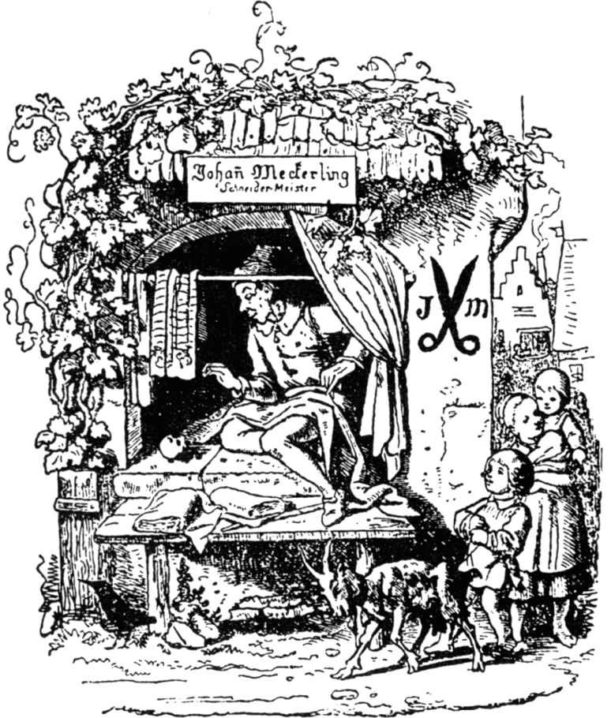

# 勇敢的小裁缝

一个夏天的早上，有个小裁缝坐在窗边的桌子旁。他心里快活，正用尽全力在缝衣。一个农妇走在街上，叫着：“好果酱！好果酱！”

小裁缝听上去觉得不错，他把柔嫩的脸伸出窗外，叫道：“上这儿来推销吧，亲爱的大娘。”

那女人走上三个台阶到裁缝那里，手里挽着一只沉重的篮子，当他的面打开所有的瓶瓶罐罐。他细细地把它们看一看，又举起来嗅一嗅，最后说：“这果酱很好，给我称四罗特，亲爱的大娘，如果称四分之一磅，也可以。”

这女人一直想多卖多挣一点，把他要的给了他。但很不愉快，唠唠叨叨地出门去了。

“我有这果酱实在造化不浅，”小裁缝叫道，“它会给我力量和使我身强力壮。”他从橱里拿出面包，切了一整片面包，把果酱涂在上面。“这一口吃上去一定很甜，”他说道，“但吃以前，先把那件短上衣缝好。”

他把面包放在一边，就又缝制衣服了，他快活得针脚越缝越长。甜果酱的味道一直升腾到墙边，苍蝇成群结队地歇着，它们是给引来的，一堆一堆地停在果酱上。

“啊，谁请你们来的？”小裁缝叫道，把那些不速之客赶跑。但是苍蝇们听不懂他的语言，它们并不是那么容易就能赶走的，而是成群结队地来得比先前更多。最后，小裁缝终于不耐烦了，他抓住一块抹布，叫道：“等一等，我会给你们颜色瞧！”他一边说一边毫不留情地向它们打去。他缩回手一数，发现苍蝇死了不少于七只，一只只都伸直了腿。“你就是这样的一个大好佬？”他说着，很钦佩自己的勇气。“全城都应该知道这件事。”

他匆匆剪下一长条布，缝成带子，上面绣了很大的字母：“一下子打死七个！”“唉咿，什么全城！”他接着说，“应该让全世界都知道。”他的心像羊尾巴一样欢快地摆动着。

裁缝把布带系在腰上，想立即出发到世界上去，他感到自己的工场对他的勇气来说，显得太小了。出发前，他先在屋子里巡视一遍，看看有什么东西可随身带着。他只找到一块藏得很久的乳酪，他就把它放进口袋。他在门口见到一只鸟绕在一片藤蔓上，他随手把鸟拿来放进装乳酪的口袋，然后便雄赳赳地走到大路上，心情愉快，举止轻松，一点也不疲倦。大路延伸到一座山上，他到达山顶时，发现一个巨人坐在那儿，正十分从容地掉过头来。

小裁缝鼓起勇气，走到他跟前，招呼他说：

“你好，伙计，我想你坐在这儿在观察这宽广的世界吧。我也正想去那儿试试运气呢，你有兴趣和我一起去吗？”

巨人轻蔑地看看裁缝，说：“你这小子！你这可怜的家伙！”

“也许是这样，”裁缝答道，解开上衣给巨人看他的腰带。“你可以念一念，就知道我是什么人了。”

巨人念腰带上的字：“一下子打死七个！”他以为裁缝打死的是人，这使他有点佩服这个小家伙了。然而，他还是认为该先考验考验他，他拿起一块石头捏紧，直捏得石头里滴出水来。

“你跟着试一试，”他说，“如果你有力气的话。”

“就这么一点儿吗？”小裁缝说，“哈，这在我们看来，简直是儿戏。”

他把手伸进口袋，拿出一块软乳酪，他捏得汁水都流了出来。“是吗，”小裁缝说，“这不是比你要强些？”

巨人不知该说什么好，但还是不相信这个小家伙。

巨人又捡起一块石头，把它扔得很高，人们几乎看不见它。

“哈，你这个侏儒，你跟着试试看。”

“扔得很好！”裁缝说，“可石头还是落回到地面上来，我现在扔一块给你看看，它不再回到地面。”

说着，他就把手伸进口袋，把鸟拿出来抛向空中。鸟因为得到自由而很快乐，立即冲向天空，一会儿不见了。

“你认为怎么样，伙计？”裁缝问道。

“你扔得不错，可我们得看看你是不是能搬运重东西。”巨人说。

他把小裁缝带到一棵巨大的橡树旁，大橡树倒在地上。

巨人说：“如果你真的强壮，帮我把这棵大树搬出森林去。”

“我很乐意，”裁缝回答说，“你只要把树干扛在肩上，我扛树枝和树蓬，这是最重的了。”

巨人把树干放到肩上，裁缝坐在树枝上，巨人没法回头看，他等于要扛整棵树，外加裁缝的重量。裁缝坐在树蓬上，很快活，兴致很好，吹着口哨《三个裁缝骑马出城门》，好像扛树是儿戏似的。

巨人扛树走了一段路，他再也走不动了，就叫道：“你听好，我要把树放下了。”

裁缝敏捷地跳到地上，用双臂抱住树，好像他一直在扛似的。他对巨人说：“你虽然个儿大，可连一棵树也扛不动。”

他们又走了一段路，来到一棵樱桃树前，巨人抓住樱桃树树冠，那上面的樱桃已经熟了，他把树枝弯下来，放在裁缝的手里，让他摘来吃。而巨人一松手，裁缝因为体弱而拉不住，树枝一弹回去，把裁缝一起抛向空中，等他又落到地上时，竟没受伤，巨人问：“怎么回事？你竟然没有力气抓住一棵小树的树蓬？”

“这不是缺少力气，”小裁缝答道，“你以为一下子打死七个的人连这点力气都没有吗？我跳过树木是因为猎人在灌木树下开枪。如果你有这本领，也像我一样跳一下吧。”

巨人试了一下，但他无法从树上跳过去，而给挂在树枝间了。于是，小裁缝在这方面也占了上风。

巨人说：“如果你确实是这样一个勇敢的人，那跟我到我们的洞穴里来，和我们过一个晚上。”

小裁缝很乐意，就和他一块去了。他们到达山洞时，发现另外几个巨人正围着火堆坐着，每人手里拿着一只烤羊在吃。小裁缝环顾四周，想道：“这里倒是比我的工场宽敞多了。”

巨人把他带到一张床前，叫他躺下，好好睡一觉。那张床对小裁缝来说太大了，所以他没躺下，而是爬到一个角落里。半夜，巨人以为小裁缝睡得正香，他爬起来，拿了根很大的铁棒，一下打在床中央，以为他结果了这只“蚱蜢”。一清早，巨人们来到森林里，把小裁缝忘得一干二净，而他一下子却出现在他们面前，十分欢乐，雄视阔步。他们胆战心惊，害怕他会打死他们，都急急忙忙地逃走了。

小裁缝又出发了，继续往前赶路。他走了一长段路后，来到了王宫的庭院里，他累得倒在草地上睡着了。他躺下睡觉时，人们都围拢来从各方面细细看他，他们见到了他腰带上的字：“一下子打死七个”。“啊！”他们惊呼道，“这个伟大的战争英雄为何在和平时期来这儿？他一定慓悍强壮。”

他们把这一切去报告了国王，他们一致认为，如果战争爆发，这个人一定举足轻重，而且派得上用场，无论如何不应该让他走。国王认为这个建议很好，他派一个廷臣去等裁缝醒后，请他在军界工作。廷臣等裁缝睁开了双眼，伸了懒腰，就问他是不是愿干这样的工作。

“我正是为这个目的来这儿的，”裁缝说，“我很乐意为国王效劳。”

于是他受到了盛大的接待，并给他安排了一个特殊的寓所。而士兵们都怨恨他，希望离他远远的。“如果我们和他吵架，他动手干，一下子打死七个，”他们彼此议论，“那会闹出什么事来啊？”因此他们作出一个决定，一块到国王那儿去集体辞职。“我们无法，”他们说，“和一个一下子打死七个的人和睦相处。”

这使国王很伤心，为了一个人将失去他所有的忠诚下属，他希望自己再也不要看见裁缝，准备让他自己走。但他不敢驱逐裁缝，怕他会把自己连同他的臣民都杀了，而且夺取他的王位。他把这问题考虑了很久，最后终于想到一个办法。他派个人去找裁缝，并让人告诉他，因为他是那么伟大的一个战争英雄，他想请求他做一件事。就是在他王国的森林里住着两个巨人，他们掳掠、奸淫、杀人、放火，无恶不作。没人敢接近他们，不然就要冒生命危险。如果他能征服并杀死这两个巨人，他就可以把自己的独生女儿给他做妻子，并把半个王国作为陪嫁，他也愿派一百名骑兵协助他。

“给像你这样的人这么多保证，”裁缝想，“一位美丽的公主和半个王国并不是一个人天天能够盼得到的东西。”“好吧，”他答道，“我会迅速降服巨人的，而且用不着一百个骑兵。一下子打死七个的人不必怕两个巨人。”小裁缝立刻出发了，一百个骑兵陪伴着他，他来到森林旁边时，他对他的陪同说：“你们只需呆在这儿，我会一个人去结果那两个巨人。”

于是他消失在森林中，他东张西望。一会儿，他就看见两个巨人在树下熟睡、打鼾。他们的鼾声大得使树枝都上下摆动着。聪明的小裁缝口袋里装满了石头，往树上爬，他爬到一半时，在一根树枝上一滑，正好坐在睡着的巨人上面，他朝一个巨人的胸口上扔一块又一块的石头。

那巨人久久没有反应，最后终于醒了，推推他同伴，说：“你打我干什么？”

“你在做梦，”另一个说，“我没打你，”他们又睡了，裁缝又扔一块石头打另一个巨人。“这是什么？”他喊道，“你为什么用石头扔我？”

“我没扔东西啊。”第一个巨人气冲冲地答道。

他们吵了一会，因为很疲倦，他们又把眼睛合上了。

小裁缝又开始他的把戏，他找出一块最大的石头，用尽全力朝第一个巨人的胸脯扔去。

“太可恶了，”那巨人像疯子一样地跳了起来。他把同伴使劲地推在树上，因为用力过猛，树身都颤抖了。另一个也这样报复。两人怒火中烧，各自把树拔起来，互相对打，直打得两败俱伤，都倒在地上死去。

这时小裁缝从他坐的树枝上跳下。“太幸运了，”他说，“他们没拔起我坐的那棵树，不然我就像松鼠一样要跳到另一棵树上，我们可都是敏捷的人。”他拔出剑，在两个巨人的胸口都戳了两三刀。然后他跑出去，找到骑兵说：“事情干完了。我给他们俩都来了致命的两下，这事干起来真不容易，他们窘迫时拔起树来防卫，但是对付我这样一个一下子打死七个的人是没用的。”

“你没受伤吗？”骑兵们问道。

“事情很顺利，”裁缝答道，“连我的一根头发也没伤着。”

骑兵们不相信，就骑马进森林察看，巨人们倒在血泊中，旁边是一些连根拔起的树。

小裁缝现在向国王索取答应给他的报酬，而国王很后悔答应了他，又想出一个计策来摆脱他。

“我把女儿和半个王国给你以前，你还得干一个壮举。森林里有一只老是搞巨大破坏的独角兽，你必须逮住它。”国王说。

“一只独角兽和两个巨人比起来，我更加不怕。一下子打死七个是我的风格。”他带了一根绳子和一把斧头，来到森林里，再次叫他的随从们等在外面。他没找多久，独角兽就来了，直向裁缝冲去，似乎要用角把他戳穿。“慢点，慢点，”裁缝叫道，“别冲得这么快。”他站着不动，直等到独角兽离他很近，他才敏捷地闪到树后。独角兽使劲冲到树上，角牢牢地插到了树干里，它再也无力把角拔出来，于是它动不了了。“现在我抓到了牺牲品，”裁缝从树后走出来，他先把绳子系在独角兽的脖颈上，然后用斧子把角从树里砍出来。他弄好这些后，把它带到了国王那里。

国王仍然没有把答应的报酬给他，而向他又提出了第三个要求。裁缝结婚前，必须把林子里一头专搞大破坏的野猪逮住，猎人们可以帮助他。

“乐意效劳，”裁缝说，“这只是小孩子玩的把戏。”

他没有把猎人们带进森林里，他们也巴不得，因为他们不止一次地和野猪打过交道，再也没有兴趣和野猪交战了。野猪一看见裁缝，就口吐白沫，咬牙切齿地扑向他，想把他推到地上，但敏捷的英雄一下冲进近旁的小教堂里，他立即又从窗口跳出去，野猪跟着裁缝冲出去，裁缝在教堂外跳跃着，他飞快地把教堂门关上；狂怒的野猪被关在里面，于是又逮住了这只发怒的野兽，它太笨重，无法从窗口跳出去，小裁缝叫猎人们来亲自瞧瞧这只俘获到的凶兽。

英雄到国王那儿，不管国王是否乐意，都得履行诺言，于是国王把女儿和半个王国都给了他。如果他知道站在面前的人只是个裁缝，而不是战争英雄，他决不会这么答应的。婚礼隆重举行，但大家并不怎么高兴，因为一个裁缝居然成了国王。

过了一些时候，年轻的王后夜晚听到她丈夫在睡梦中说：“学徒，把短上衣给我做一做，把裤子补一补，要不，我就敲掉你的饭碗。”于是她发现了年轻丈夫的出身。第二天早上她向国王抱怨，求他不要让她再和一个裁缝生活在一起。

国王安慰她说：“今晚，把你的卧室门打开，我的仆人们守在外面，他一入睡，他们就进来，把他捆起来，放到一只船上，而这条船会把他带到遥远的地方。”

公主对此很满意，但国王的武士都听见了这一切，他们和年轻的主人很要好，把整个阴谋都告诉了他。

“我会破坏他们的计划。”小裁缝说。

晚上，他像往常一样和妻子去睡觉，她以为他睡着了，就起床开门，随后又上了床。小裁缝假装熟睡着，用清晰的声音喊道：“学徒，给我把短上衣做好，把裤子补一补，要不，我就敲掉你的饭碗！我曾经一下子打死七个，杀过两个巨人，逮住过独角兽，擒获过野猪，难道我还怕那些守在门外的人吗？”

他们听见裁缝说这些话，便惊慌失措，像一群野兽在后面追赶他们一样地逃了出去，他们没一个人再敢冒险了。

于是小裁缝做了国王，直到他去世。

（施种译）
