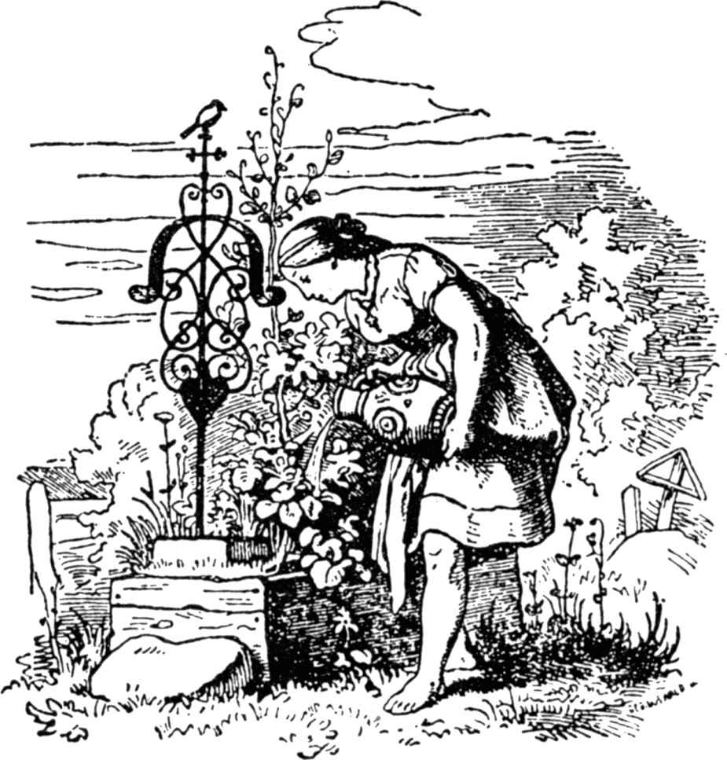
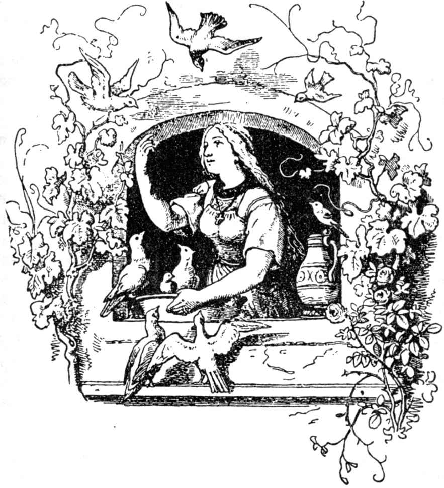

# 灰姑娘

从前有个有钱人，他的妻子病了。她感到自己快要死了的时候，便把自己的独生小女儿叫到床前，对她说：“亲爱的孩子，你要虔诚、善良，这样，亲爱的上帝会一直帮助你，而我愿意从天上向下望着你，常在你的身边。”说完，她就闭上了眼睛咽了气。这姑娘每天出门到母亲坟上大哭一场，为人一直虔诚、善良。当冬天来到的时候，白雪皑皑，下得坟上好像罩了一层白布。春天的太阳重又把那层白雪融化，这时，孩子的父亲已经娶了一个后妻。

这位后妻带着前夫所生的两个女儿改嫁过来了。她们的容貌又美又白，而她们的内心又毒又黑。对这个可怜的继女来说，一段艰难的时光来临了。

“难道让这个蠢货呆在我们的房间里不成！”她们说，“谁想吃面包，谁就得干活。你这个厨房丫头赶快出去干活吧。”她们拿走了她的漂亮的衣服，给她穿件旧的灰罩衣和一双木拖鞋。

“瞧这骄傲的公主和她的一身打扮啊！”她们叫，她们笑，领她进入厨房。她在那儿必须从早到晚干重活，天没亮就起身，拎水，生火，煮饭，洗衣。除这以外，那两个妹妹想出种种恶作剧来欺侮她，嘲笑她，故意把豌豆和扁豆撒在灰里，要她坐下来把豆子一粒粒拣出来。晚上，她干得累了，不再有床给她睡，她只能躺在灶边的灰堆里。因为她外貌一直灰不溜儿，肮脏异常，因此她们就叫她灰姑娘。

且说那位父亲有一次想去望弥撒，他问后妻带来的两个女儿，他应该带点什么东西回来给她们。

“漂亮的衣服，”一个说；“珍珠和宝石，”另一个说。

“可是你，灰姑娘，”他说，“你想要什么？”

“爹，我要的是你在回家路上撞到你帽上来的第一根树枝，请你给我折下带给我。”

于是他为两个继女买了漂亮的衣服、珍珠和宝石；他在回家的路上，骑马穿过一个绿色丛林时，一根榛树枝轻轻擦过他的身子，把他的帽子碰落在地上。这样，他就把那根树枝折下带回家。到家时，他把两个继女所希望得到的东西交给了她们，也把那根榛树枝交给了灰姑娘。

灰姑娘向父亲表示了谢意，就去她母亲坟上，把树枝栽在上面，大哭了一场，哭得泪水掉到坟上，并浇湿了榛树枝。于是这根树枝栽活了，长大起来，成了一株美丽的树。灰姑娘一日三次来到树下，哭哭啼啼，祈求上帝，每回都有一只小白鸟飞到那树上，只要她说出一个希望，那只小鸟便把她希望的东西扔给她。

有一次，国王举行一个盛大的婚礼宴会，这宴会要持续三天，国内所有年轻、漂亮的仕女都受到邀请，国王打算为自己的儿子物色未来的新娘。这两个异母妹妹也算是上等少女，她们听说自己也受邀参加宴会，便把灰姑娘叫到跟前说：“你给我们梳头发，给我们刷鞋子，把腰带上的扣子装装紧，我们要到王宫里去参加盛大的宴会。”

灰姑娘只得依从她们，但是她哭起来，因为她也希望去参加那儿的舞会，她请求继母允许她去。

“你，灰姑娘，”继母说，“浑身上下是灰尘和肮脏，也要去参加舞会？你没有像样的衣服和鞋子也想跳舞？”

但是由于灰姑娘的一再恳求，继母终于开口说：“我有一钵头扁豆已经撒在灰里，如果你能在两小时内重新把它们拣出来，那么就可以一起去。”

于是灰姑娘穿过后门，走进花园，大声叫道：“你们这些乖巧的小鸽子，你们这些小斑鸠，你们天空下所有的小鸟儿，都来这儿帮我捡扁豆：

好的捡进钵头，

坏的吞进你们的咽喉。”

这时有两只小白鸽来到厨房的窗台上，跟在小鸽子后面的是一些小斑鸠，最后天空下唧唧喳喳蜂拥着飞来了成群结队的小鸟，全都围在灰堆边。小鸽子点了点头，开始哔剥哔剥、哔剥哔剥地啄起扁豆。其余的鸟儿也随后哔剥哔剥、哔剥哔剥地把所有的好扁豆啄进了那个钵头。一小时刚过，它们已经结束了工作，所有的鸟儿重又飞出去了。

于是灰姑娘把一钵头扁豆递给继母，心里很高兴，以为这下子一定会允许她去参加宴会了。

可是那继母说：“不，灰姑娘，你没有像样的衣服，你不能去参加舞会，你这副样子只会给人笑话。”

灰姑娘一听哭了，她继母便说：“如果你能够在一小时内把我满满的两钵头扁豆从灰堆中捡得干干净净，那么你可以一起去，”她一边说，一边心里想：“这一点她决不会做得到。”

继母把两钵头扁豆倒进灰里，灰姑娘走出后门，来到花园，大声叫道：

“你们这些乖巧的小鸽子，你们这些小斑鸠，你们所有天空下的小鸟，都来帮我捡扁豆：

好的捡进钵头，

坏的吞进你们的咽喉。”

这时两只小白鸽飞进厨房的窗台，随后来的是小斑鸠，最后在天空下唧唧喳喳蜂拥着飞来了成群结队的小鸟。它们全都围在灰堆四周。小鸽子点了点小头，开始哔剥哔剥、哔剥哔剥地啄扁豆，其余的鸟儿也哔剥哔剥、哔剥哔剥地啄了起来，把所有的好扁豆全都捡进钵头。半个钟点还没过去，它们已经把扁豆啄完了，又一次飞了出去。

灰姑娘把钵头端给继母，以为这会儿准能让她去参加舞会了。可是继母说：“这一切都帮不了你忙，你不能一起去，因为你没有像样的衣服，你不可以跳舞；要不，我们不得不因你而丢脸。”说完，她就转过身去不再理睬灰姑娘。她赶紧带上自己的两个骄傲的女儿离开了。

当屋里再没有别人的时候，灰姑娘走到母亲坟上的榛树下号啕起来：

“你摇摇，你抖抖，小榛树，

把金银丝编织的衣鞋扔给我。”

这时有一只鸟儿给她扔下一件金银丝编织的衣服和一双用真丝和银丝刺绣的缎子鞋。她匆匆忙忙穿起衣鞋，便去参加舞会了。她的继母和两个异母妹妹都认不出她了，她们以为她一定是外国的一位公主，她穿了金银丝编织的衣服有多漂亮啊。她们压根儿没想到她就是灰姑娘，她们还以为灰姑娘仍坐在家里的脏物中间，从灰堆里找扁豆。

可王子向着她走过去，握住她的手和她跳起舞来。王子再也不愿和别的人跳舞了，这就是说，他挽住她不肯放手，要是有别的人过来邀请她跳舞，王子便说：“这是我的舞伴。”

他们一直跳到晚上，她想回家去了。可王子说：“我也一起走，我陪你去。”因为他想看看，这是谁家的姑娘。可她最后从他身边溜走，跳进鸽子棚。这位王子在一旁等待，直到灰姑娘的父亲回来，王子对她的父亲说，那位外国的公主跳进了鸽棚。

父亲心里想：“难道是灰姑娘不成，”他吩咐人把斧头和锄头拿来，他拿这些工具把鸽棚劈成两半，但是鸽棚里没有人。

当那个继母和两个异母妹妹回到家里时，灰姑娘已经穿了脏衣服躺在灰堆里，一盏昏黄的油灯在灶龛里点燃。原来灰姑娘钻进鸽棚以后，很快便在棚后面跳下地，奔到那株小榛树那儿，脱下漂亮的衣鞋放在坟上，鸟儿重新把衣鞋取走，接着她穿起灰色的旧罩衫，坐在厨房的灰堆里。

下一天，当宴会重又开始时，父亲和继母以及两个异母妹妹又离家走了，灰姑娘跑到榛树那儿说：

“你摇摇，你抖抖，小榛树，

把金银丝编织的衣鞋扔给我。”

于是鸟儿扔下比上一天更加华贵的衣服。灰姑娘穿了这套衣服在舞会上重新出现时，人人都对她的艳丽感到惊讶。

王子已经在等待着她的到来，一见面便挽住她的手，只愿跟她跳舞，不再和别的姑娘跳。要是有人前来请她跳舞，王子便说：“这是我的舞伴。”

到了黄昏时分，姑娘想离开，王子便跟着她，要看她走进谁家的屋子。但是灰姑娘跑得很快，把他甩掉了。她跑进自家屋后的花园，那儿有株美丽的大树，树上挂满金灿灿的梨子，灰姑娘爬上树，像松鼠那样敏捷地在树枝间窜来窜去。王子可不知道她躲到哪儿去了。王子等在那儿，直到她的父亲到来。

王子说：“那个陌生姑娘从我身边逃走了，我相信她跳到梨树上去了。”

父亲想：“这难道是灰姑娘不成。”他派人去拿斧子来把树砍倒，但是树上已经没有人了。

继母和两个妹妹来到厨房时，灰姑娘已经躺在灰堆上，如同平日一样。原来她刚才从梨树的另一边跳下地，又一次把那些华贵的衣鞋交给了小榛树上的鸟儿，穿上了自己的灰罩衫。

第三天，父亲、继母和两个异母妹妹离家时，灰姑娘又跑到母亲坟上，对小榛树说：

“你摇摇，你抖抖，小榛树，

把金银丝编织的衣鞋扔给我。”

于是那鸟儿扔给她一件豪华的、闪闪发亮的衣服，仿佛从来没有一件衣服有这般高贵；鸟儿又扔给她一双纯金做的鞋子。她穿了这些衣鞋去参加舞会时，大家见了她都惊奇得谁也不知道该说什么才好。王子只和她一人跳舞，如果有人邀请她跳舞，王子说：“这是我的舞伴。”

到了黄昏时分，灰姑娘又想离开了，王子决意要送送她。可她很快地又从他身边溜走了，他想跟也跟不上。但这会儿王子用了一条妙计，他让人在每级台阶上统统涂上柏油；这样一来，姑娘左脚上的金鞋在匆忙的奔逃中粘在石级上了。王子把这只鞋子捡起来，这鞋是那么精致、小巧，用纯金做成。

第二天早上王子拿了这只鞋子跑去找那个姑娘的父亲，对他说：“除了正好穿得上这只金鞋子的姑娘以外，我不要别的姑娘做我的妻子。”

这时那两个异母妹妹非常高兴，因为她们都有一双好看的脚。那个大的带着鞋子进房间试穿，她的母亲站在一旁。可这位姑娘的足趾大，没法穿进去，这只鞋对她来说太小了。于是她母亲递一把刀子给她说：“把足趾削削小。如果你当了王后，你就用不到走路了。”

姑娘把足趾削小，硬把脚塞进鞋子；她忍着痛，出去见王子。王子把她当作自己的新娘，扶她上马，便和她骑马走了。但他们回王宫时非得打灰姑娘母亲的坟前经过不可。那儿有两只小鸽子歇在小榛树上叫道：

“你瞧瞧，你瞧瞧，

血在鞋中淌；

鞋子太小了，

真正的新娘还在家。”

于是王子瞧她的一双脚，看见血从鞋里往外涌。他拨转马头，把假新娘送回家去，说：这不是真正的新娘。那个年岁小一点的妹妹也要试穿那只鞋。她拿鞋进房间试穿起来，幸好脚趾都能进去，但她的脚后跟太大了。她母亲递给她一把刀，说：“在后跟上削掉一块，要是你当了王后，那就用不到走路了。”

姑娘果真在脚后跟上削掉一块，硬把脚塞进鞋里，她忍住痛出去见王子，王子把她当作新娘扶她上马，带着她骑马走了。他们在经过那株小榛树时，那两只小鸽子歇在树上高声叫道：

“你瞧瞧，你瞧瞧，

血在鞋中淌；

鞋子太小了，

真正的新娘还在家。”

王子低头看她的脚，只见血从她的鞋里似泉往外涌，把她的一双白袜子全染红了。于是他又拨转马头，把这个假新娘送回家。

“这也不是真正的新娘，”他说，“你们没有别的女儿了吗？”

“没有了，”灰姑娘的父亲说，“只有我已故的妻子留下一个矮小、迟钝的灰姑娘；这姑娘不可能是新娘。”

王子说，应该把这个姑娘送来看看，可那个继母回答说：“啊，不，这姑娘太脏了，实在见不得人。”

但王子一定要见她，他们不得不把灰姑娘叫来。先让她洗洗手，洗洗脸，然后让她去见王子。她向王子弯腰行礼，王子把金鞋递给她，姑娘坐在一张小凳上，把脚从沉重的木拖鞋里脱出来，伸进金鞋，这鞋仿佛就是为她的脚浇铸的，非常合适。她站起身来，王子端详她的脸，认出她就是曾经跟他跳过舞的漂亮姑娘，便惊叫起来：“这是真正的新娘！”

继母和两个异母妹妹大吃一惊，恼恨得脸色变得煞白；但王子却扶灰姑娘上马，带着她走了。他们经过小榛树时，两只小白鸽叫道：

“你瞧瞧，你瞧瞧，

鞋里没血淌；

鞋子不太小，

真正的新娘娶回家。”

鸽子叫过以后，便从树上飞下来，停在灰姑娘的两个肩上，一只在右边，一只在左边，它们一直歇着不走。

王子的婚礼将要举行时，那两个虚伪的异母妹妹前来奉承讨好，想和王后共享幸福。一对新人前往教堂时，那个年长的妹妹走在右边，那个年幼的妹妹走在左边：两只鸽子啄去她们每人一只眼睛。婚礼举行后，一对新人走出教堂时，年长的走在左边，年幼的走在右边：两只鸽子又把她们的另一只眼睛啄去。因为她们为人恶毒和虚伪，所以受到瞎眼一辈子的惩罚。

（施种译）
