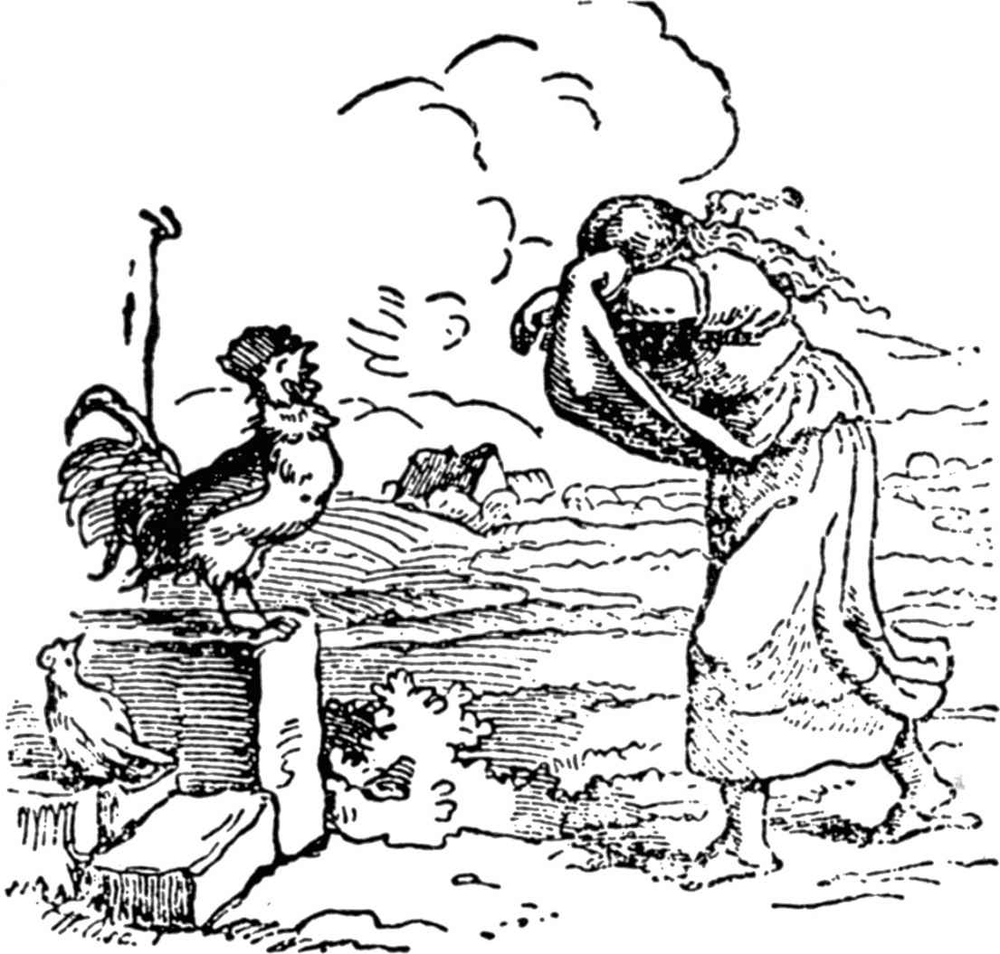

# 风雪婆婆

> **注 1**　根据德国赫根州的传说，天上下雪，是风雪婆婆在铺床。

从前，一个寡妇有两个女儿，一个又美丽又勤劳，另一个又难看又懒惰。但她很喜欢那个又丑又懒的女儿，因为这个是她亲生女儿。另一个粗活重活，样样都得干，她是家里的“灰姑娘”。可怜的姑娘每天坐在大街上的一个井旁，纺纱纺到手指都淌血。

一天，她的卷筒上沾上了血，她俯下身子在井旁用水冲洗，但卷筒从她手里滑落到井里了。她哭着，跑去向继母诉说自己的不幸。

她的继母恶狠狠地、毫不留情地责骂她，最后她说：“你让卷筒掉进水里，你得下去把它取出来。”

少女走到井旁，不知该怎么办，她惊恐地跳入水中，想去捞卷筒。

她失去了知觉，醒来后发现自己在一个鲜花点缀的美丽的草地上，阳光明媚，鲜花满地，不下数千种。她走啊走，来到一个放满了面包的烤炉边，面包喊叫道：“啊，把我拿出来，把我拿出来，不然我要烤焦了！我已经烤得太过头了！”

于是她走过去，用面包铲把它们一个一个铲出来。

她又继续往前走，来到一棵树边，树上长满苹果，苹果叫她：“哦，快把我摇下来，快把我摇下来，我们一个个都熟了！”

她就摇摇树，苹果像下雨一般落下来，她摇到树上连一个苹果也没有才罢手，她把苹果捡成一堆，就走了。

最后她来到一座小屋跟前，屋里有一个老妇人在向外张望。她露出很大的牙齿，姑娘感到害怕，想逃走。

但老妇人叫住她说：“你怕什么，亲爱的孩子？留在我这儿吧，如果你愿意把一切家务干好，那对你有好处。不过你铺我的床要注意，把被子抖松，抖得羽毛飞起来，这样世界上就会下雪。我是风雪婆婆。”

因为老妇人讲话很和气，她下了决心，同意留下来帮助干家务。

她干任何事都能使老妇人满意，她使劲地拍松被褥枕头，羽毛像雪片一样满天飞。她过着愉快的生活，没人训斥责骂她，每天都有丰盛的食物，烤的、煮的都有。

她和风雪婆婆同住一段时间后，感到很悲伤。起先她不知道是怎么回事，后来发现自己是在想家。虽然这儿比家中好上几千倍，但她还是渴望回去。

最后她对老妇人说：“虽然我在家过的是苦难日子，我在这儿也一直很幸福，但我不能久留，还是想回家去。”

风雪婆婆说：“我很高兴你提出要回家，你对我一直这么忠心，我亲自带你回去。”

她拉着姑娘的手，带她到大门口，大门开着，少女正好站在门下，一阵暴雨般的金子洒到她身上，她一直站着，于是她从头到脚挂满了金子。

“这是给你的报酬，因为你这样勤劳。”风雪婆婆说。她还归还姑娘那只掉落到井里的卷筒。

于是大门关上了，少女发现自己来到上面的世界里，就在她继母屋子附近。

她进了院子，公鸡坐在井边叫道：

“喔喔喔，

咱们的金少女回家啰！”

她到继母那儿，因为她身上挂满金子，便受到她继母和妹妹的热情接待。姑娘把自己遇到的一切情况都说了，继母听说她是怎样得到这笔巨大的财富的，她也要为自己丑陋、懒惰的女儿创造同样的幸福。于是她叫小女儿坐在井边纺纱，不过要使卷筒沾上血，她就用荆棘刺破自己的手指，使血染红卷筒，然后把卷筒扔进水里，自己下井去找。她像她的姐姐那样，发现自己在同一块美丽的草地上，沿着同一条小路走着。

她也来到一个面包炉旁，面包又叫道：“把我拿出来，把我拿出来，不然我要烤焦了！”

然而懒姑娘说：“难道让我弄脏手指不成！”就走开了。

不久她又来到苹果树前，苹果树叫道：“摇摇我，摇摇我！我们苹果都熟了！”

“这可真是件好差事，”她答道，“说不定你们哪个会掉在我头上，我才不干呢。”她又往前走了。

她来到风雪婆婆的房子前，一点也不怕她的大牙齿，因为她已经听说过了，她立刻住到老妇人那里帮她干活。第一天，她很卖力，很勤奋，风雪婆婆要她干什么，她就干什么。因为她一心想着风雪婆婆会给她许多金子。到了第二天，她的懒病又犯了，第三天更加懒，早上都不想起床了，也不去给风雪婆婆铺床，像应该干的那样，也不抖松被子和枕头，使羽绒飞扬。

风雪婆婆渐渐对她不耐烦了，就把她打发回家。

懒姑娘巴不得回家，认为一场金雨就要下来了。

风雪婆婆把她带到大门口，当她站在门下，一大锅柏油像暴雨般地洒下来，而不是金子。

“这是对你干的活的报酬。”风雪婆婆说，随即在她背后把门关上。

懒姑娘回了家，身上沾满了柏油，井上的公鸡见了她，便叫道：

“喔喔喔，

咱们的脏姑娘回家啰！”

她沾满一身柏油，怎么也洗不掉，一辈子都这样。

（施种译）
