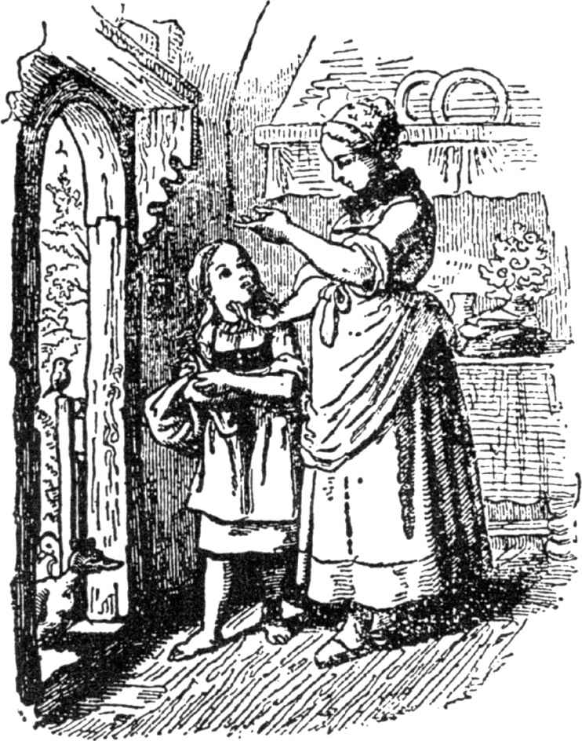
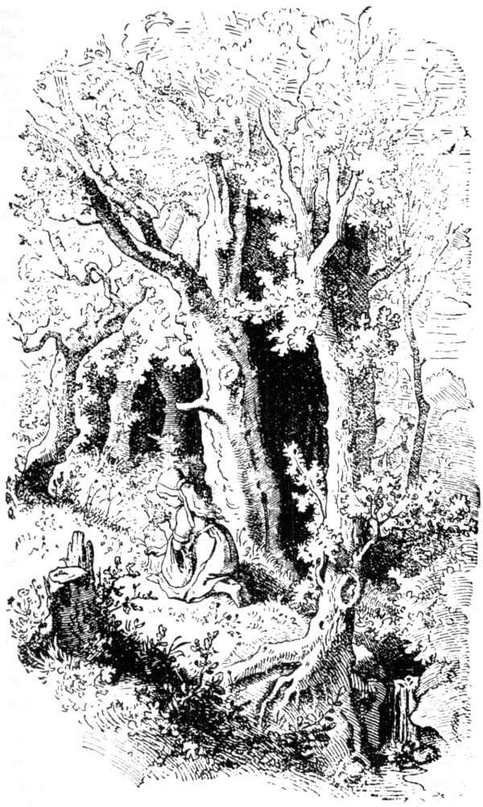
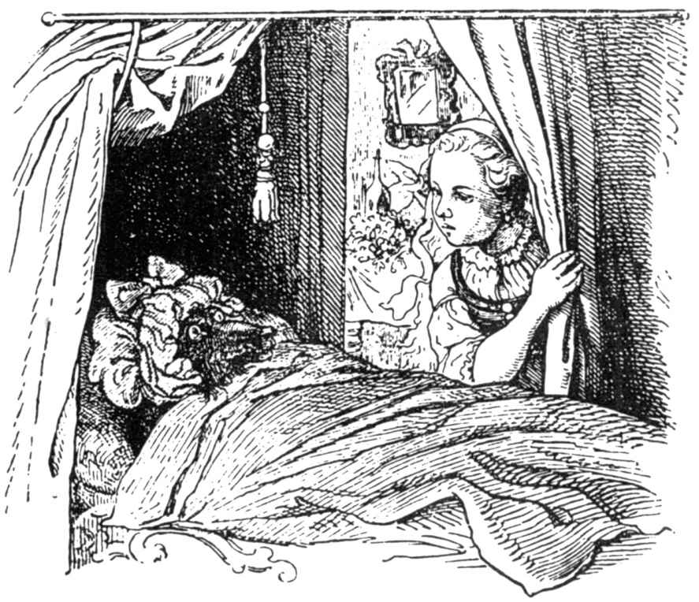

# 小红帽

从前有一个惹人喜爱的小姑娘，只要谁看到她，就会喜欢她，但是最喜欢她的是她的奶奶。奶奶压根儿不知道该送这孩子什么东西。

有一次奶奶送给她一顶用红天鹅绒做的小帽子。因为这顶小帽子戴在她头上正合适，所以她不愿再戴别的帽子，她的名字就此叫小红帽。

有一天，她的母亲对她说：“小红帽，来吧，这里有一块蛋糕和一瓶葡萄酒，你拿去给奶奶；奶奶病了，身体虚弱，她要靠这点补补身子，借以恢复健康。趁早晨天气还凉快，你就去。你到外面去，千万要小心，规规矩矩走，别离开大路，要不，你会摔跤，打碎酒瓶，这样你奶奶啥也拿不到了。如果你进了她的房间，别忘了说声‘早上好’，别先向屋角里东张西望。”

“一切我会当心的，”小红帽对母亲说，并和母亲拥抱告别。奶奶住在村外森林里，离村子有半小时路程。小红帽进了森林，碰到一头狼。可小红帽不知道这是一只多么凶残的野兽，所以她毫不在乎。

“你好，小红帽，”狼说。

“非常感谢，狼。”

“你这么早，上哪儿，小红帽？”

“上奶奶那儿去。”

“你围裙里带着什么东西？”

“蛋糕和葡萄酒。蛋糕我们是昨天烤的，因为奶奶病了，身体虚弱，这些食品对她有益处，可以补身子。”

“小红帽，你奶奶住在哪儿啊？”

“住在森林里，离这儿还有一刻钟的路。那儿有三株大橡树，树下是她的屋子，楼下尽是胡桃灌木丛，这你以后会知道，”小红帽说。

狼心里暗自思忖：“这个粉嫩的小东西，实在是块肥肉，味道要比奶奶好吃，得用诡计把这一老一少一网打尽。”

狼在小红帽身边走了一阵，然后开口说：“小红帽，四周都是美丽的鲜花，你干吗不向四周瞧瞧呢？我相信，你压根儿没听见过小鸟儿悦耳动听的歌声吧？你只顾自己走路，像去上学那样，其实外边森林里多有趣呀。”

小红帽睁大眼睛，看到太阳的光线怎样穿过树木空隙，不停地摇曳，四周长满美丽的花草。

她想：“如果我给奶奶带一束鲜花去，这也会使她高兴的；今儿天还早，我定能及时赶到她那儿。”

她离开大路，转入森林，寻找鲜花。她每采到一朵花，就认为，再远一点的地方有更加美丽的鲜花，她就向那儿奔去，这样，她就越来越深入到森林里边。但是那条狼却走直路，向奶奶的屋子渐渐接近，到了那儿，它敲敲屋门。

奶奶问：“外边是谁啊？”

“小红帽，给你送蛋糕和葡萄酒来，请把门儿打开。”

“你只要按一下门把手就行，”奶奶叫道，“我身子太弱了，起也起不来。”

狼按了一下门把手，门开了，狼二话没说，径直来到奶奶的床边，一口把她吞了。随后它穿起奶奶的衣服，戴起她的软边帽，躺在她床上，把窗帘拉上。

小红帽找鲜花到处乱跑，她采集到许许多多，连她一个人也拿不动了。她忽然想起奶奶，便赶紧去她那儿。她见小屋的门开着，心里感到奇怪。她走进房间，觉得里面有点异常，她想：“啊哟，我的上帝啊，今天我干吗这样提心吊胆，我平时是多么高兴地待在奶奶这儿的！”

她大声叫道：“早上好，”可没有回答。

她随后走到床那儿，把窗帘撩到一边；床上躺着奶奶，帽子一直遮到脸上，样儿十分奇特。

“啊唷，奶奶，你怎么会有这么大的耳朵？”

“这样我听你说话比较清楚。”

“啊唷，奶奶，你怎么会有这么大的眼睛？”

“这样我看起你来比较清楚。”

“啊唷，奶奶，你怎么会有这么大的一双手？”

“这样我抓起你来比较利索。”

“可是，奶奶，你怎么会有这么可怕的大嘴巴？”

“这样我吃起你来比较便当。”

狼刚讲完这句话，就从床上一跃而起，吞下了这个可怜的小红帽。

狼满足了自己的食欲以后，重又躺到床上，睡着了，鼾声大作。猎人正好打这屋前经过，想道：“屋里老太怎么这样打鼾，我得进去看看，是不是她身子不舒服。”

他就走进房间，来到床前，他见狼躺在床上。

“我在这儿总算把你找到了，你这个犯罪的老手，”他说，“我找你已经找了好久啦。”

他举枪瞄准，但又忽然想起，狼可能已经把老太吞吃了，也许还能救救她，先别开枪，他拿把剪刀把沉睡着的狼的肚皮剖开，剪了几刀，看见小红帽闪着亮光，再剪几刀，姑娘从狼肚里跳出来叫道：“啊，我多么害怕，在狼的肚子里有多暗！”

接着老奶奶也活着出来了，几乎快断气了。小红帽很快捡来一些大石块，填进狼的肚子里，狼从梦中醒来，要想立即逃跑，但是它肚里的石块分量很重，它立即倒在地上死了。

这样，三个人都很高兴；猎人把狼皮剥下，带回家去，奶奶吃了小红帽带来的蛋糕和葡萄酒，重又恢复了健康。可小红帽想道：“如果母亲不允许的话，你一辈子也不要一个人离开大路，进入森林。”

也有人这样讲，一次，小红帽再给奶奶送蛋糕去，另外一只狼对她说，要她离开大路，到森林里去。可小红帽谨慎小心了，她径自走自己的路，并告诉奶奶，她碰到一只狼，狼向她问好，但她从狼的眼里窥见了凶光：“要不是在四通八达的大路上，它早就把我吃掉了。”

“来吧，”奶奶说，“我们把门关上，使它无法进来。”

不久以后，狼来敲门了，大声说：“开门，奶奶，我是小红帽，我给你带来了蛋糕。”

她们默不作声，没有把门打开。于是这头灰狼绕着屋子走几圈，最后跳上屋顶等待，想等小红帽傍晚回家去时，尾随着她，在暗处把她吃掉。

但是奶奶注意到恶狼肚里的坏念头。奶奶屋前刚好有个大石槽，奶奶对小红帽说：“小红帽，拿个桶，拎点水来倒在石槽里，昨天我煮过腊肠，你把腊肠水倒在这个石槽里。”

小红帽拎了一桶又一桶，直到大石槽完全装满水。腊肠的香味冲进了狼的鼻子，它向下闻闻嗅嗅，东窥西瞧，最后使劲伸长脖子，脚站不稳，开始从屋顶上往下滑；这样，它从屋顶正好滑进大石槽里淹死了。

小红帽快快活活地回家去，从此再没有狼伤害她了。

（施种译）
