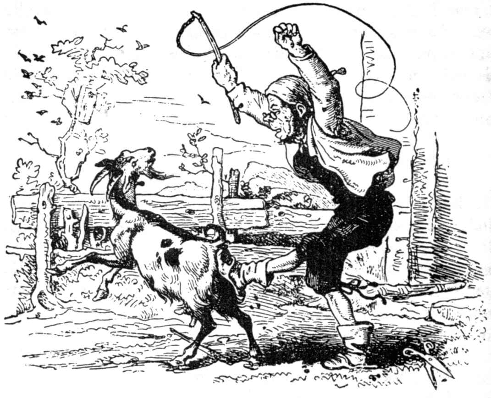
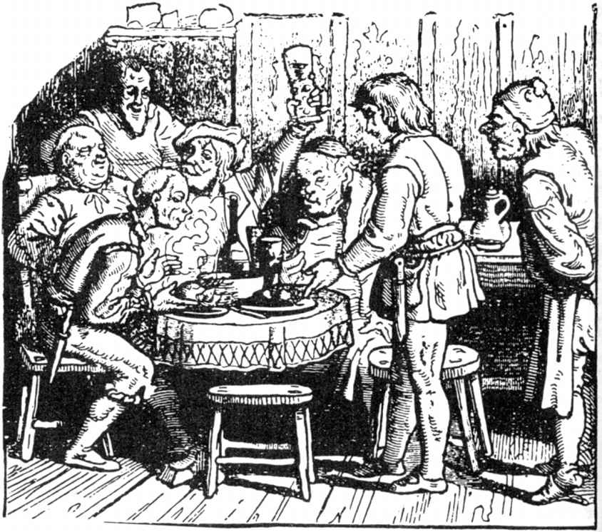
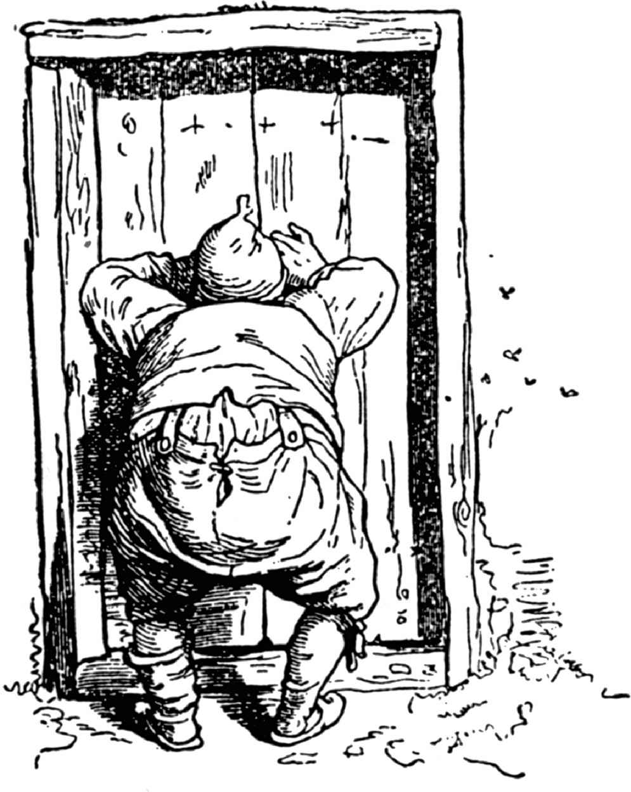
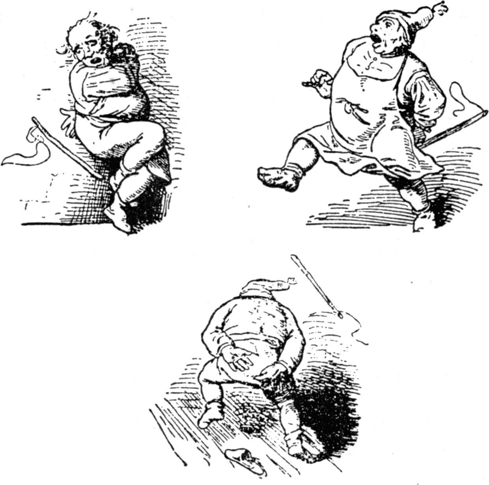

# 自己会开饭的小桌子、会吐金币的驴子、会从袋里跳出来的棍子

从前有一个裁缝，他有三个儿子，但只有唯一的一只山羊。它用自己的奶养活全家，它得吃好的饲料，每天被带到草地上去放牧。三个儿子依次轮流着干这事。一次大儿子把山羊牵到墓地上去放牧，那儿有最丰茂的青草，他让羊在那儿大嚼一顿，让它跳来蹦去。到了晚上应该回家的时候，他问道：“山羊，你吃饱了吗？”山羊回答说：

我吃得那么饱，

一张叶子也不要了，咩！咩！

“那么回家去，”大儿子说，抓起绳子，牵着它到羊棚里，把它牢牢地拴住。

“喏，”老裁缝说，“山羊吃饱了吗？”

“嗯，”大儿子说，“它吃饱了，连一张叶子也不要了。”

可做父亲的想亲自证实一下，他到羊棚里，抚摩这只可爱的牲口，问道：“山羊，你吃饱了吗？”山羊回答：

我用什么来吃饱？

我只是在墓穴上东蹦西跳，

可一张叶子也找不到，咩！咩！

“我听到什么啦！”裁缝叫道，奔到上面去对大儿子说：

“唉咿！你这骗人精，你说山羊吃饱了，可你让它挨饿了吧？”他怒气冲冲，从墙上拿下尺骨，把大儿子打跑了。

下一天轮到二儿子去放牧，他在花园篱笆旁找到一块地方，那儿长着茂盛的青草，山羊把草都吃光了。晚上，他想回家了，他问道：“山羊，你吃饱了吗？”山羊回答道：

我吃得那么饱，

一张叶子也不要了，咩！咩！

“那么回家吧，”二儿子说，把它牵回家，拴牢在羊棚里。

“喏，”老裁缝说，“山羊吃饱了吗？”

“哦，”二儿子说，“它吃得那么饱，一张叶子也不要了。”

老裁缝不相信，亲自下羊棚去问道：“山羊，你吃饱了吗？”山羊回答说：

我用什么来吃饱？

我只是在墓穴上东蹦西跳，

可一张叶子也找不到，咩！咩！

“这个该死的坏蛋！”裁缝叫道，“让这样一头善良的牲口挨饿！”他奔回屋里，用尺骨打二儿子，把他撵出家门。

如今轮到小儿子放牧了，他想做好这件事，他找了一个有最漂亮的园亭的灌木丛。晚上，他想回家去，他问道：“山羊，你吃饱了吗？”山羊回答道：

我吃得那么饱，

一张叶子也不要了，咩！咩！

“那么回家吧，”小儿子说，牵着山羊回羊棚，把它牢牢拴在羊棚里。

“喏，”老裁缝说，“山羊吃饱了吗？”

“喔，”小儿子说，“它吃得那么饱，一张叶子也不要了。”

老裁缝不相信，下楼到羊棚里问道：“山羊，你吃饱了吗？”那只恶毒的畜生回答：

我用什么来吃饱？

我只是在墓穴上东蹦西跳，

可一张叶子也找不到，咩！咩！

“哦，你这个撒谎的孽种！”老裁缝对小儿子大声叫道，“这么一个邪恶的、忘掉自己职责的家伙，跟其他两人一模一样！你们别想一直把我当傻瓜！”他气得控制不住自己，跳起身来，拿起尺骨朝可怜的小儿子的背上猛揍，揍得小儿子慌忙逃出门去。

如今只剩老裁缝和山羊在家里了。下一天早上他下楼到羊棚里，抚爱它，对它说：“来，我亲爱的小羊，我要亲自去给你放牧。”

他拿起绳子，牵它到绿篱笆那儿，到蓍草下面和其他山羊爱吃的植物的地方。

“现在你可以随心所欲地吃个饱了，”他对山羊说，一直让它在草地上吃到傍晚。他说：“山羊，你吃饱了吗？”山羊回答道：

我吃得那么饱，

一张叶子也不要了，咩！咩！

“那么回家吧，”老裁缝说，牵它到羊棚里，把它牢牢拴在那里。他走了不久，再折回来说：“现在你总算吃饱了吧！”可山羊对他也并不客气，它叫道：

我怎么会吃饱？

我只是在墓穴上东蹦西跳，

可一张叶子也找不到，咩！咩！

老裁缝一听，大吃一惊，方才明白自己把三个儿子赶走是没有理由的。

“你等着吧，”他叫道，“你这忘恩负义的东西，把你赶走，太便宜了你，我会给你颜色瞧，叫你不敢再在诚实的裁缝面前出现。”

他急急忙忙到屋里拿了一把剃须刀，再在山羊头上涂上肥皂，把山羊头上的毛剃得一干二净，像他的手掌一样光洁。因为尺骨太珍贵了，他拿了根鞭子，狠狠地揍它，揍得它暴跳着逃走了。

如今裁缝孤零零地一个人坐在家里，陷入极大的悲哀之中，他渴望着再和三个儿子生活在一起，但是没有人知道他们的下落。大儿子到一个细木工那儿去当学徒，因为他学习勤奋，从不偷懒，学徒期满以后，他就可以出去走码头，临走时师傅送他一张小桌子，这桌子的样儿并不怎样特别，也是用普通木头做的；但它有一种特性。如果把它放下地，说：“小桌子，开饭吧，”那么这张好桌子立刻铺上一块干净的小台布，上面放着碟子、刀和叉，碗里盛着白烧肉和烤肉，别的东西，一大杯红葡萄酒，闪闪发亮，这叫人见了心花怒放。

这个年轻的伙计心里想：“有了这桌子，你一辈子就不愁吃喝了。”他就高高兴兴去闯荡世界，他用不到担心旅馆好坏，是不是有东西吃。如果他高兴，他根本不用上旅馆，而在田野里、树林里、草地上，随手从背上拿下小桌子，摆在自己面前，说：“开饭吧！”那么他心里渴望的一切全有了。

最后他想到，他要回父亲那儿去，也许父亲的怒气会消除，他有这张会开饭的小桌子，父亲会乐意接受他。事情就这样发生了，他在回家路上，傍晚投宿一家客店，可店里已经客满，客人们欢迎他，邀请他坐到他们的桌上去和他们一起进餐，要不，他很难再获得别的饭菜。

“不，”这个初出茅庐的细木工说，“这一点儿东西我不愿从你们的嘴边拿走，还是让我来请你们吧。”

他们大笑起来，认为他跟他们开玩笑。可他把他的小木桌安放在房间中央，说：“小桌子，开饭吧。”

转眼之间，桌上摆满了饭菜，这样好的饭菜这家客店老板是从来无法采办到的。那股香味诱人地冲进客人们的鼻孔。

“你们拿来吃吧，亲爱的朋友们，”细木工说，那些客人见了这些饭菜，不等细木工第二次请他们，便坐到小桌子那边来，拿起刀子，起劲地取菜了。最使他们惊奇的是，一碗菜吃空以后，立刻另有一满碗菜自动地摆到空碗的地方。店老板站在一个角落里，一旁观看这样的奇事；他压根儿不知道，他该说什么才好，但他心里暗自嘀咕：“在你的店里需要这样的一个厨师。”

细木工和客人们一直吃喝到深夜方尽兴而散，最终他们躺下睡觉，那个年轻的细木工把那张小宝桌靠在墙边，也上床睡了。但是那个店老板还在左思右想，他忽然想起，他那垃圾间里有张旧桌子，样子和小宝桌相似。他偷偷地把那桌子搬来，和小宝桌调换。

下一天早上，细木工付了住宿费，收起桌子上路了，他根本没想到这是一张调了包的普通桌子。

中午时分，他来到父亲那儿，父亲喜出望外地接待了他。

“喏，我亲爱的儿子，你学到了什么东西啊？”父亲问他。

“父亲，我成了一个细木工。”

“这是一门好手艺，”老人赞赏说，“不过，你在走码头时带来了什么呀？”

“父亲，我带来的最好的东西是这张小桌子。”

老裁缝从各个方面打量这张小桌子，然后说：“这上面看不出是你的拿手杰作，这是一张破旧的小桌子。”

“但是这是一张会自己开饭的小桌子，”儿子回答说，“如果我把它放下地，对它说，开饭吧，那么桌上立即出现美味的饭菜，外加一瓶葡萄酒，这酒使人心花怒放。你尽管把所有的亲戚朋友请来，他们可以大吃大喝一顿，因为这小桌子可以使人人吃饱。”

当亲友们都请来以后，他把小桌子放在房间中央，说：“小桌子，开饭吧。”可这小桌子一动不动，和别的不懂这话的桌子一样，上面空空如也。这时这个可怜的细木工才发现小宝桌给人调了包，羞得满脸通红，像一个撒谎的人那样站在那里。

亲友们嘲笑他，他们只好饿着肚子回家。父亲仍然拿布来缝制衣服，儿子到一个师傅那儿去干活。

二儿子上一个磨坊主那儿去，在他那儿学手艺。满师以后，师傅说：“因为你人品不错，我送你一匹特别的驴子，它不拖车子，也不驮运一袋袋东西。”

“那它到底有什么用呢？”这个年轻的伙计说。

“它会吐金子，”磨坊主回答，“如果你把它放在一块布上，说：‘布里克莱布里特’，那么这头好牲口便会向你吐出金币，前前后后都是。”

“这是一桩美事儿，”这个年轻的伙计说，他谢过师傅，便牵着驴子走了。如果他需用金子，他只要对驴子说：“布里克莱布里特，”金币便如雨下，他只要把金币从地上捡起，不用费别的心了。无论到哪里，他都要最上等的东西，越贵越好，因为他一直带着满满一袋金子。他在各地转了好一阵之后，想道：“你得去探望你的父亲，如果你带着一头会吐金子的驴子回去，他会忘掉怒气，很好地接待你。”

于是，他回家去，落到同一家客店里，就是他哥哥的小桌子被调包的那家客店。他牵着驴子，客店主人想接过那头驴子，把它拴到厩里去，可那个年轻的伙计说：“您用不着操心，我自己会把驴子牵进厩里，也会亲自把它拴在那里，因为我必须知道它在什么地方。”

老板感到奇怪，他认为一个自己照顾驴子的人，肯定没有许多钱花在伙食方面；但是当这个新来的客人从袋里掏出两块金币，要老板尽量去给他买些好东西，老板就睁大了眼睛，赶快出去张罗他能张罗到的东西。饭后，客人问，他该付多少钱，老板起了黑心，要他加倍付钱，说他还得拿出几块金币来。这个客人摸摸口袋，可金币正好用完。他于是说：

“等一会儿，老板，我去把金子拿来。”说着他带走了一块台布。老板不知道他玩的什么名堂，心里觉得好奇，便偷偷地跟在他后面。客人进了厩门，随手把门闩上，这样老板通过门上的节疤洞偷看。客人把台布摊开在驴子的身下，大叫道：“布里克莱布里特，”片刻之间，驴子嘴里吐出了黄金，前后都是。

“啊咿，真了不得，”老板说，“一眨眼，就铸出了这么多金币！这样一头驴子可不坏！”

客人付了房金，倒头便睡。可店老板在夜间偷偷地进了厩房，牵走了铸造金币的驴子，把另一头驴拴在这个地方。

下一天早上一早，那个伙计牵走了这头驴子，他自己认为，他有一头会吐金子的驴子。中午他到了父亲那里，父亲见了他很高兴，热情地接待他。

“你学了什么东西呢，我的儿子？”老父问道。

“成了磨坊伙计，亲爱的父亲。”他回答道。

“你这次游码头回来，带来了什么东西？”

“别的没有，只有一头驴子。”

“驴子这儿有的是，”父亲说，“我宁愿你带只好山羊回来。”

“不错，”儿子回答，“但这不是一头普通的驴子，而是一头会吐金子的驴子：我只要说一声‘布里克莱布里特’，这头好牲口便会吐给你满满一摊金子。您可以让所有的亲友到这儿来，我可以叫他们都成为有钱人。”

“这个当然叫我高兴，”裁缝说，“这样，我就用不到受这针线的折磨了，”说罢，便亲自奔去请亲友前来。他们聚拢以后，磨坊伙计请他们各自坐下，然后摊开一块布，把驴子牵到房间里。

“现在请大家注意了，”他说，然后叫道：“布里克莱布里特。”但驴子并没有吐出金币，显然这只牲口根本不懂这种技巧，因为这样的事并不是每头驴子都能办到的。这么一来，可怜的磨坊伙计拉长了脸，看到自己受了欺骗，便请求诸亲好友原谅。他们都像来的时候那样一无所得地回去了。老裁缝没有别的办法，只好重新拿起缝针来干他的苦活，而他的儿子到一个磨坊老板那儿当伙计去了。

那个小儿子到一个车工那儿去当学徒，因为这是一种技巧丰富的手艺，他学习的年限最长久。他的两位哥哥在一封信中告诉他，他们都倒了楣，那个客店老板怎样在他们寄宿的最后一晚把他们的宝桌和宝驴调换了。如今这个小兄弟也满了师，他要出去走码头了，师傅因为他很守本分送他一个袋子，并且说道：“里面有一根棍子。”

“袋子我可以背着，这对我很有用处，可里面这根棍子有什么用呢？这只会加重我的负担。”

“这个我告诉你，”师傅回答。“如果有人要暗算你，那你只要说：‘棍子，从袋子里跳出来，’于是棍子从你的袋子里跳出来，跳到人们中间，在他们的背上快活地跳动，跳得他们有八天之久不能动弹；直到你说：‘棍子，回到袋子里去。’它才停止跳动。”

这个伙计向师傅表示了感谢，背上袋子，如果有人走近他，想打他的话，他就说：“棍子，从袋子里跳出来。”棍子马上就跳出来，不等对方脱下上衣或紧身袄，就一下又一下地在他背上乱打乱揍；它动作非常迅速，没等这个人发觉，就轮到别人了。

这个年轻的车工傍晚时分到达了他的两位兄长投宿过并受到欺骗的旅馆。他把背包往桌子上一放，就开始讲他在各个地方所见的种种稀奇古怪的事情。

“是的，”他说，“人们一定以为一张会自动开饭的桌子，一头会吐金币的驴子以及诸如此类的东西，一定很了不起，这些东西我也不轻视，但这些东西如果和我得到的放在袋子里的法宝一比，那就算不了什么。”

客店老板竖起耳朵谛听，他心里想：“这究竟是什么东西呢，他的袋子里大概装满了宝石；这东西大概也属于我的，因为好事总是成三的。”

到了睡觉时分，那新来的客人伸展四肢躺在长凳上，他把那只袋子当作枕头放在头下。店老板以为客人睡得很熟了，便走到客人身边，十分缓慢、十分小心地扯动那只袋子，看看是不是能抽走，再在客人头下换进另一个袋子。可这位车工伙计早就等着他来了，当客店老板正想把袋子抽出来时，客人便大声叫道：

“棍子，从袋子里跳出来。”

棍子马上从袋子里跳出来，在老板身上乱打乱揍，打得老板哀求饶命。但他的哀叫声喊得越响，棍子在他背上有节奏地打得越加厉害，直到他最后终于精疲力竭地倒在地上。

于是车工说：“只要你不把自己会开饭的小桌子和会吐金子的驴子交出来，棍子会重新在你背上跳舞。”

“啊，不，”老板低声下气地说，“我情愿把一切东西都交出来，只要让可恶的棍子重新爬进袋子里去。”

车工伙计接着说：“我可以饶你这一次，但你得当心加倍的惩罚！”于是伙计说：“棍子，回到袋子里去！”棍子这才罢休了。

下一天早上，这个车工伙计带着自己会开饭的小桌子和会吐金子的驴子回家见父亲。老裁缝见到小儿子，非常高兴，也问他说，他在外地学了点什么手艺。

“亲爱的父亲，”他回答说，“我已经成了个车工。”

“这是一项技巧高明的手艺，”父亲说，“你走码头回来带了些什么东西？”

“一样宝贵的东西，亲爱的父亲，”儿子回答说，“袋子里有一根棍子。”

“什么！”父亲大叫道，“一根棍子！这是不值得这么辛苦的！这玩意儿你在随便哪株树上都可以砍下一根。”

“但这不是一根普通的棍子，亲爱的父亲；我只要说：‘棍子，从袋子里跳出来，’那么棍子就跳出来了，在那些对我不怀好意的人身上乱打乱揍，直到把他们打倒在地上向我讨饶为止。你瞧，我用这棍子把那只自己会开饭的小桌子和会吐金子的驴子重又弄回家来。这两样东西是那个黑心的客店老板从我两位兄长身边偷去的。现在你派人把他们两人叫来，把所有的至亲好友请来，我要让他们吃，让他们喝，还要在他们的口袋里装上金子。”

老裁缝可不大相信，但还是把至亲好友请来了。于是车工把一块布摊在房间里，牵那头驴子进来，对他的二哥说：“现在你对驴子说吧，亲爱的二哥。”磨坊伙计说：“布里克莱布里特，”瞬息之间，金币如阵雨那样下到那块布上面，下个不停，直到多得大家拿不动了为止。（我看得出，你也一定愿意在场的吧。）

接着车工把小桌子拿出来说：“亲爱的大哥，现在你对它说吧。”

那个细木工刚说出：“小桌子，开饭吧，”桌子上就摆满了最漂亮的碗盏。一次宴请马上开始，这在善良的裁缝家里还是第一回，所有至亲好友都一起坐席吃喝，直到深夜，大伙儿都酒醉饭饱，尽兴而散。老裁缝把针线、尺子和熨斗都收进橱里，跟三个儿子生活在欢乐和愉快之中。

可是那头害得裁缝把三个孩子赶出家门的山羊如今上哪儿去了呢？这个我会告诉你。

它秃了头，很害臊，跑进一个狐狸洞，躲藏在里面。狐狸回家来时，山羊从黑暗中睁大一双火红的眼睛瞪着它，狐狸害怕了，连忙退了出来。熊碰到了狐狸，见狐狸神情沮丧、垂头丧气，便问狐狸：“狐狸老弟，你怎么啦，你的脸为什么这样难看？”

“啊，”狐狸说，“一只可怕的动物呆在我的洞里，用它忽闪忽闪的眼睛瞪着我不放。”

“我们马上去把它赶跑吧，”熊说，跟着狐狸到了它的洞边，朝洞里直望；熊一见到一对像火一样红的眼睛，也像狐狸一样害怕起来，不愿和这凶兽沾半点边儿，熊也逃走了。半路上蜜蜂碰到熊，它发现熊的样儿显得心里不高兴，便说：“熊啊，你的脸色非常难看，你那副高兴劲儿哪儿去了？”

“你说得有理，”熊回答说，“狐狸的家里坐着一只凶兽，两只眼睛火红火红，我们无法把它撵走。”

蜜蜂说：“我很同情你，熊，我是一个可怜的弱小的动物，平时你们在路上看也不看我一眼，但我还是相信，我能帮助你们。”

蜜蜂飞进狐狸洞，歇到山羊的秃头上，狠狠地刺它，刺得山羊直跳起来。

“咩！咩！”羊叫道，像发疯一样奔出洞去了；此刻谁也不知道它奔到哪儿去了。

（施种译）
