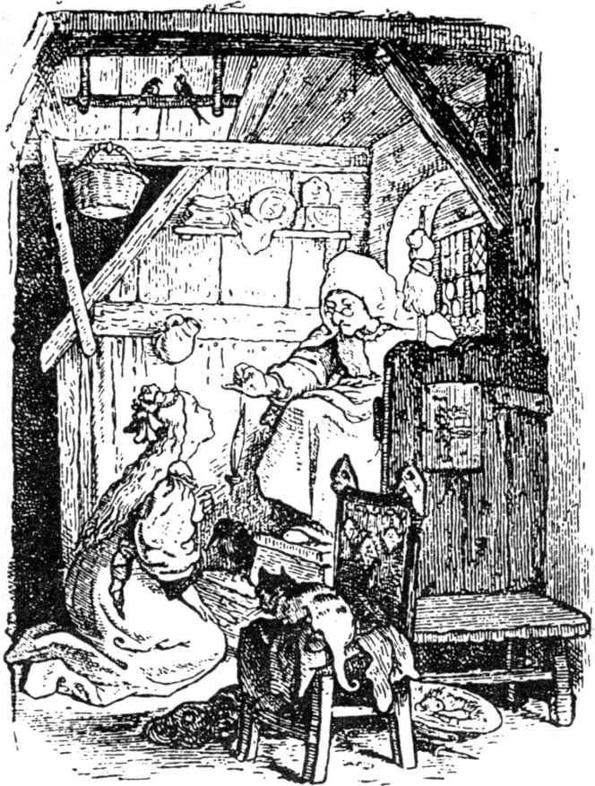
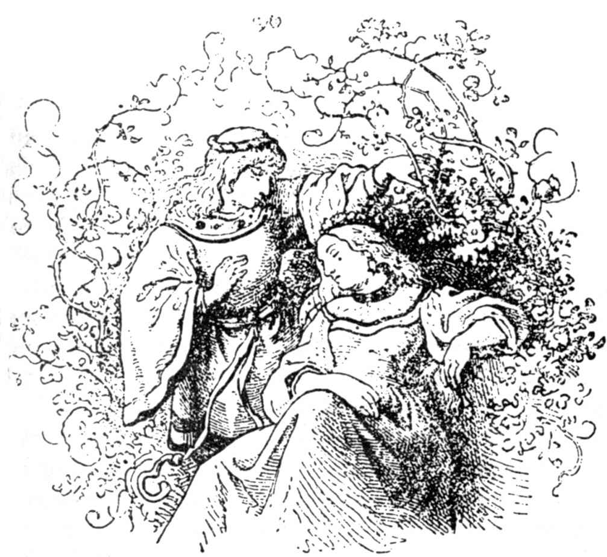

# 睡美人

从前有一个国王和王后，他们天天说：“啊，我们如果有个孩子就好了！”但是他们总是得不到孩子。

据说，有一回王后坐在浴池中，一只青蛙从水里爬上陆地，对她说：“不到一年，你的愿望将得到实现，你将会生下一个女孩。”

青蛙说的话，果然应验了。王后生下一个女孩，孩子是那么漂亮，国王高兴得不知道该怎样才好，他为此设了一次盛大的宴会，不仅邀请了他的亲友和熟人，而且也邀请了占卦婆前来参加，好让她们喜欢这个孩子，关照这个孩子。

这样的占卦婆在国内共有十三个，但因为国王只有十二只金碟给她们作餐具，所以她们中间有一个未被邀请，留在家里。

宴会盛况空前。宴会结束时，这些占卦婆各自赠给孩子奇异的祝福：这一个送“道德”，另一个送“美貌”，再一个送“财富”，总而言之，送给孩子世界上希望获得的一切东西。当第十一个占卦婆正巧说完她们的祝福时，那第十三个占卦婆蓦地闯进屋来。她因为未受到邀请，为此要作报复。她没跟谁打一声招呼，或者只望望别人，就提高嗓音叫道：“公主在十五岁上受锭子一刺，倒在地上死了。”她不再多说一句话，便转过身子，离开了大厅。

大伙儿都很惊惶，这时第十二个占卦婆过来了，她还没有给公主祝福，因为她无法消除前面那个恶毒的诅咒，而只能缓解一下，因此她说：“公主不是倒在地上死了，而是沉睡百年。”

那个乐意保护自己可爱的女儿免遭厄运的国王，发出一道命令，让人把全国所有的锭子统统烧掉。但是所有占卦婆的祝福都在公主身上得到了应验，公主长得漂亮、端庄、和蔼、懂事，谁见到了她，都会喜欢她。

到了公主正好十五岁时，有一天出事了。那天国王和王后都不在王宫里，公主一个人留在宫内。她在宫里到处走动，看了大小房间，兴致很浓，最后来到一个古老的钟楼。她沿着狭窄的扶梯盘旋而上，来到一扇小门边。门锁上插着一把生锈的钥匙，公主把钥匙一转，门开了，小房间里坐着一个老太婆，她拿着锭子在起劲地纺麻。

“你好，老奶奶，”公主说，“你在干什么？”

“我在纺麻，”老太婆说，同时点点头。

“这是一个什么样的东西？这样滑稽地不停跳动？”公主问，拿起锭子，也想纺麻了。她刚碰到锭子，魔咒就应验了，锭子刺进了她的手指。

就在这一刹那间，她感到什么东西一刺，就倒在床上了，从此就沉睡不醒，而且这种睡眠扩大到整个王宫。刚刚回家来的国王和王后一跨进大厅，也开始睡觉了，而整个宫里的人跟他们一起睡着了。接着马厩里的马、院子里的狗、屋顶上的鸽子、墙上的苍蝇，都睡着了。不错，连那原来在炉灶上乱窜的火焰也变得默默无声地睡着了；烤肉不再发出咝咝声，厨房里那个帮手因干事粗心大意，厨师正一把扭住他的头发，这时厨师也放开手睡着了。这时风已停息，王宫前树上的叶子纹丝不动。

王宫的四周开始长出有刺的玫瑰丛，每年长高一些，最后把整个王宫包围在内，然后再往四处蔓生，直至把整个王宫都掩盖住了，什么东西也看不见，连屋顶上的旗帜也不见了。但是整个国土上盛传着睡美人的传说，大家都这样称呼国王的女儿。

这样，从外地不时有王子想来访问王宫，他们打算穿过玫瑰丛进入里边。但是他们没法进去，因为那些有刺的玫瑰仿佛缚住了他们的手脚，他们都被这些植物缠住，无法脱身，最后悲惨地死去。

经过许多许多年，又有一个王子来到这片国土，他听一位老人讲到有刺玫瑰丛的故事，说在这些丛林后面有一座王宫，宫里有位绝色的公主，名叫睡美人，已经睡了上百年，和她一起睡着的有国王和王后以及整个宫里的人。老人还是从他爷爷那里听到这故事；从前有许多王子来过这里，想冲破玫瑰丛进入王宫，但他们一进丛林，便给枝条绊住，动弹不得，挂在那儿，可怜地死去了。

可这位王子说：“我不怕，我会摆脱有刺的丛林，看到睡美人。”善良的老人劝他不要去，但王子不听老人的劝告径自去了。

恰好这时已经过去一百年，睡美人醒来的那个日子来到了。当这位王子来到玫瑰丛时，这些有刺的植物怒放着美丽的大鲜花，而且自动向两边分开，让开一条路，使王子不受损伤地通过。他穿过以后，玫瑰丛又自动合拢，长得像一排篱笆。王子进入王宫院子，看见马匹和长着花斑的猎犬躺在地上睡觉，屋顶上的鸽子把小脑袋塞在翅膀底下。他走进屋子，只见苍蝇在墙上睡觉，厨房的厨师还高举着手，仿佛要抓住他那个干了错事的助手似的。女仆坐在黑母鸡前，好像正在拔毛。

王子再往前走，看见大厅里各式人等都躺在地上睡觉，上面王座上躺着国王和王后。他继续往前，四周都是静悄悄的，每个人都能听见自己的呼吸声。最后他来到钟楼那里，打开门，走进小房间，房间里躺着睡美人。她的容貌很美，他盯着她，连眼睛也不眨一下。他俯下身去，给了她一个吻。他的嘴一接触她的嘴唇，睡美人的眼睛便睁开来了，人也醒了过来，亲切地望着他。他们一起走下钟楼，国王和王后已经醒来，整个王宫里的人也都醒来，他们睁大眼睛你瞧着我，我瞧着你。院子里的马匹已经站起，摇摇自己的身体；猎狗跳起身来，摆动尾巴；屋顶上的鸽子从翅膀下伸出脑袋，向四周张望，然后飞到田野里去了；苍蝇在墙上向前爬动；厨房里的炉火已经冒起，不断地跳动，烧煮饭菜；烤肉重又发出咝咝的响声；厨师打了助手一记耳光，打得助手大叫起来；侍女已把母鸡的毛拔干净，王子和睡美人的婚礼即将举行，场面极其豪华阔绰，他俩幸福地生活着，白头到老。

（施种译）
