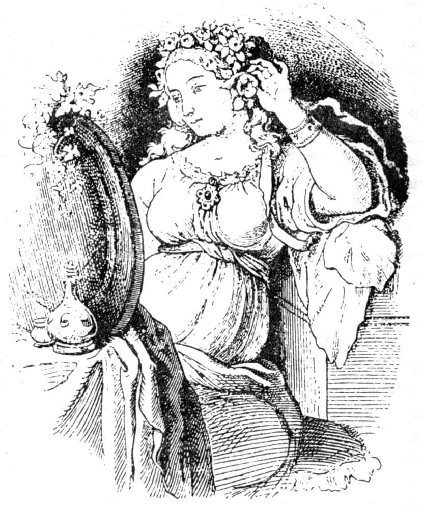
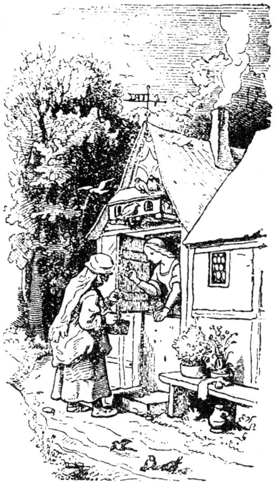
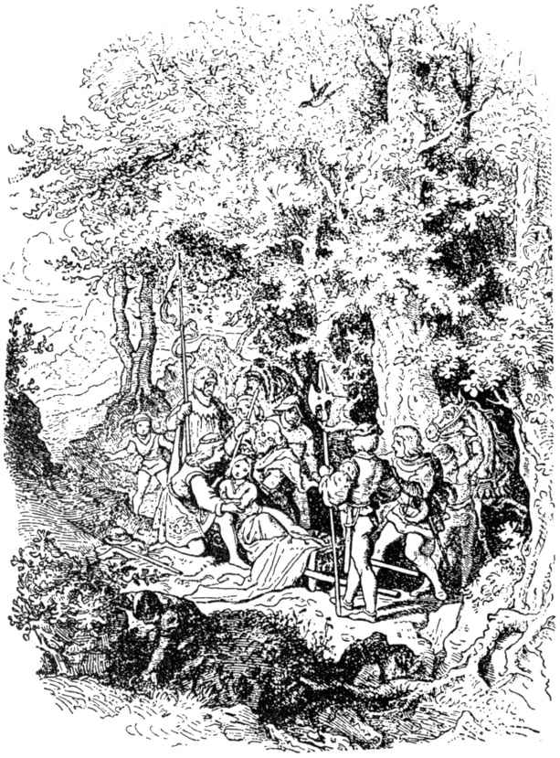
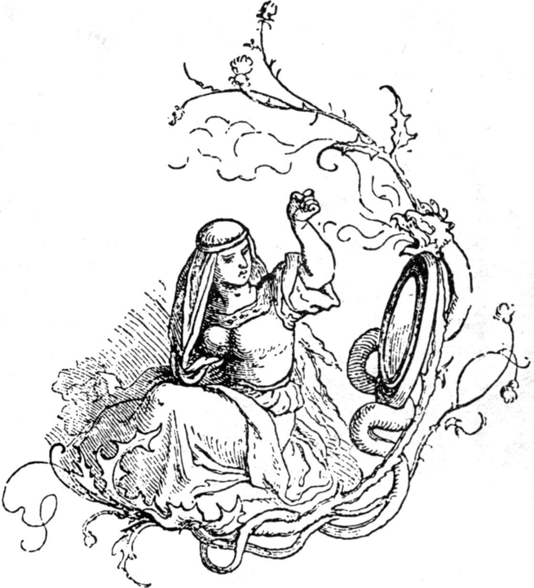

# 白雪公主

有一年冬天，雪花像羽毛般地从天空纷纷飘落下来。一个王后坐在窗边做针线活儿，窗框是用黑黑的乌檀木做成的。她一面做针线，一面抬头看看雪，针儿扎在手指头上，在雪里滴下了三滴血。红红的血在白白的雪里显得格外美丽，于是她暗暗想道：“要是我能有一个孩子，皮肤像雪那样洁白，嘴唇像血那样鲜红，头发又像乌檀木那样黑，那该多好啊。”

过了不久，她生下一个女孩儿，皮肤果然像雪那样洁白；嘴唇像血那样鲜红；头发又黑得像乌檀木一般，因而管她叫“白雪公主”。孩子出生以后，王后就去世了。

一年以后，国王又娶了一个妻子。她是一个美艳的女人，可是生性骄傲，又看不起别人，要是谁的美貌超过了她，她就会受不了。她有一面神奇的镜子，她走近镜子照脸时，就说：

“小镜子，墙上的小镜子，

全国要数谁最最美丽？”

镜子回答她：

“王后，全国要数你最最美丽。”

她听了很得意，因为她知道，镜子总是说真话的。

可是白雪公主慢慢长大了，而且越来越美丽。她七岁时已长得光彩夺目，十分动人，甚至比王后更美。有一回，王后又向镜子问道：

“小镜子，墙上的小镜子，

全国要数谁最最美丽？”

只听得镜子回答：

“王后啊，你在这里确实最美，

可是白雪公主比你美一千倍。”

王后听了大吃一惊，她因为妒忌，脸色气得铁青。从此以后，每当她看到白雪公主，心里总是翻来覆去，很不自在，对那女孩子恨之入骨。妒忌和傲慢像野草那样在她心里越长越高，因而日日夜夜不得安宁。

有一天，她叫来一名猎人，对他说：

“把那个女孩子带到森林里去，我不想再见到她。你一定要杀死她，把她的肝和肺带来做证据。”

猎人听从王后的话，把白雪公主带到野外。当他抽出长长的猎刀要去刺白雪公主天真无邪的心窝时，白雪公主哭了起来，一面说：

“唉，亲爱的猎人，别杀我吧，我会跑到荒野的森林里去，以后永远不再回家。”

猎人见她长得这么美，不禁同情起她来，于是说：

“逃吧，可怜的孩子。”

“野兽会马上把你吃掉的，”他想。他觉得心上的一块石头仿佛已落了地，因为他用不着杀死她了。恰好这时有一头小野猪蹦蹦跳跳地过来，他便一刀戳死了它，把它的肺和肝挖出后，带给了王后作证物。王后命令厨师把它们放盐煮了，这个狠心的女人就这样吃了起来，还以为吃下肚的是白雪公主的肺和肝呢。

这时可怜的女孩子孤零零地呆在大森林里，心里非常害怕。她眼巴巴地望着树上一片片叶子，不知该怎么办。不一会她奔跑起来，越过一块块尖棱棱的石头，穿过一丛丛荆棘，一些野兽从她身边跳过，但它们并没有伤害她。她跑了又跑，只要两只脚还能向前走。夜色快要笼罩下来的时候，她看到前面有一座小屋，就进去休息。

小屋里，什么东西都很小，但精致整洁得没法形容。屋子里有一张铺白布的小桌子，上面放着七只小盆子，每只小盆子边还有小调羹。另外还有七把小刀、七把小叉和七只小酒杯。墙边有七张排成一列的小床，上面铺着雪白的床单。白雪公主又饥又渴，于是在每只小盆子里吃一些蔬菜和面包，再在每一只小杯子里喝一口酒，因为她不想从一只盆子和一只杯子里把什么都吃光喝完。后来她非常疲倦，就躺在一张小床上，可是没有一张床合她的身，有的太长，有的太短，最后她试了第七张床：大小正好。她躺在上面，向上帝祷告一会后就睡着了。

天色完全黑下来时，小屋的主人回家了。他们是七个矮人，经常在山里开矿。他们点起七盏小灯，小屋一亮，他们就看出已有人来过，因为屋子里的一切东西已不像离开时那样井井有条了。

第一个矮人问：“谁坐过我的小椅子呀？”

第二个矮人问：“谁吃过我小盆子里的东西？”

第三个矮人问：“谁咬过我的小面包？”

第四个矮人问：“谁吃过我的蔬菜？”

第五个矮人问：“谁用过我的小叉儿？”

第六个矮人问：“谁动过我的小刀子？”

第七个矮人问：“谁在我的小杯子里喝过酒？”

第一个矮人向四周看了看，发现自己的床上有一个小窝，便说：

“谁在我的床上睡过觉？”

另外几个矮人也跑了过来，嚷道：

“我的小床上也有人睡过呢。”

第七个矮人往自己的床上一看，发现了白雪公主，她正躺在那儿呼呼入睡。于是他招呼别的矮人，他们急急忙忙跑了过来，惊异得大喊大叫。他们擎起了七盏小灯，照着白雪公主的脸。“哎，老天爷！哎，老天爷！”他们大声嚷嚷，“这个娃娃多漂亮啊！”他们非常快乐，不去叫醒她，让她在小床上继续睡觉。第七个矮人只好在他的同伴那儿挨次各睡上一小时。夜晚就这样过去了。

一清早，白雪公主醒来了，一眼看到七个矮人，不禁吓了一跳。可是他们对她十分亲切，齐声问道：“你叫什么名字？”

“我叫白雪，”她回答。

“你怎么上我们屋子里来的？”矮人们又问。

于是白雪公主告诉他们，她的后母本来想叫人杀死她，可是猎人放了她一条命，后来她整天奔跑，终于找到了这座小屋。七个矮人听了说：

“要是你愿意把咱们这个家里的事照管好，烧饭，铺床，洗衣服，缝衣服，还有织补，而且把一切安排得有条有理，干干净净，那么你就能跟咱们住在一块儿，你什么也不会缺少的。”

“好，”白雪公主说，“我打心眼儿里感到高兴。”于是她就和他们住在一起了。

她把整座屋子收拾得井井有条。一早，七个矮人上山去找矿石和金子，晚上回来时，吃的东西都已准备好了。白天，家里只有小姑娘一个人，好心的矮人们就关照她：“要小心你那后母，她很快就会知道你在这儿，别让任何人进来。”

再说那个王后。她在自以为吃掉了白雪公主的肺和肝以后，心里再也没有牵挂，认为自己又是天下第一美人了。一天，她走到魔镜前面说：

“小镜子，墙上的小镜子，

全国要数谁最最美丽？”

只听得镜子回答：

“王后啊，您在这儿最最美，

可是白雪公主在对面山里，

跟七个小矮人住在一块儿，

她比你还要美一千倍。”

王后听了大惊失色，因为她知道魔镜从来不说假话，还知道猎人欺骗了她，白雪公主现在还活着。现在她又在左思右想，应当怎样把小姑娘杀死才好。只要她一天不是全国最美丽的女人，她的妒忌一天也不会消释。

最后她终于想出一条计策：她给自己的脸涂抹了一下，打扮成一个卖杂货的老太婆，别人谁也认不出来。装扮成这副模样后，她越过了七座山，来到七个矮人的小屋前。她一面敲门，一面大声喊道：

“卖好东西喽！”

白雪公主从窗口探出头来问：

“您好，老奶奶，您卖的是什么东西？”

“好东西，漂亮货，”她答道。“各种颜色的带子。”说罢，她取出一条用五彩缤纷的丝线织成的带子。

“看来我可以让这个老实的女人走进屋里来，”白雪公主想。于是她打开了门，买了一条漂亮的带子。

“孩子，”老太婆又说，“看你多漂亮呀！来吧，我要给你好好系上。”白雪公主天真无邪地站在她的面前，让她系上那条新的带子，可是老太婆缚得又快又紧，白雪公主连气也透不过来，倒在地上像死去一般。“现在你可不再是最美的人了，”她一面说，一面赶快走出门。

不久，天色晚了，七个矮人回到家里。他们看到可爱的白雪公主在地上躺着，不由大惊失色。她一动也不动，仿佛死了一般。他们把她抱了起来，看到她已被缚得太紧了，就把这条带子一刀剪断。不一会，她开始微微呼吸起来，后来又慢慢恢复了生命的活力。当矮人们听了她讲的故事后，他们说：“卖杂货的女人决不是别人，而是那个恶毒透顶的王后。你可要小心，当我们不跟你在一块儿时，别让任何人走进屋来。”

那个可恶的妇人回到家里后，又走到那面魔镜前问道：

“小镜子，墙上的小镜子，

全国要数谁最最美丽？”

只听得镜子像过去那样回答：

“王后啊，您在这儿最最美，

可是白雪公主在对面山里，

跟七个小矮人住在一块儿，

她比你还要美一千倍。”

她听了这话，不由热血沸腾。知道白雪公主依旧活着，她心里非常害怕。“现在我要想出一个办法，”她说，“非得让你彻底完蛋不可。”

于是她用她所通晓的巫术做成一把有毒的梳子。她把自己乔装打扮成另一个老婆子，越过七座山，来到七个矮人家。她敲敲门，提高嗓门喊起来：“卖好东西喽！”

白雪公主往外面看了一下，说：“去你的吧，我谁也不让进来。”

“看一看货色总是可以的喽，”老太婆一面说，一面拿出有毒的梳子，把它举得高高的。

白雪公主看到这样的梳子非常高兴，不由被它迷住了，就把门儿打开。

当她们把这笔买卖讲定以后，老太婆说：“现在让我好好梳一梳你的头发。”

可怜的白雪公主什么也没有提防到，让那老太婆任意摆布。可是梳子一碰到头发，毒性就发作起来。孩子立刻倒在地上，不省人事。

“你这标致透顶的丫头，”恶毒的女人说，“现在让你尝尝滋味，”说罢扬长而去。幸而天色不久就黑下来，七个矮人回屋来了。

当矮人们看到白雪公主躺在地上像死去一般时，他们马上疑心到这是后母干的事，便东寻西找，结果发现了那把有毒的梳子。他们刚把它拔出，白雪公主就苏醒过来，把刚才发生的事一五一十告诉他们。矮人们又一次警告她要谨慎小心，谁来了都不要开门。

王后回家后，又站在魔镜面前问道：

“小镜子，墙上的小镜子，

全国要数谁最最美丽？”

只听得镜子像过去那样回答：

“王后啊，您在这儿最最美，

可是白雪公主在对面山里，

跟七个小矮人住在一块儿，

她比你还要美一千倍。”

王后听到镜子说这些话，气得浑身发抖。“白雪这小丫头非死不可，”她尖声嚷道，“即使要拿我自己的性命作代价，我也不在乎。”

于是她走到一间非常秘密、谁也没有进去过的房间，做一个毒性很强的苹果。苹果的外形很美，一半白，一半红，每个人见了都会十分喜欢，可是只要谁咬它一小口，他就准会死去。苹果做好以后，她把脸涂抹了一下，打扮成一个农妇模样，又越过了七座山，来到七个矮人家。

她敲敲门，白雪公主从窗口探出头来说：

“我谁也不让进来，七个矮人不准我开门呀。”

“这跟我没有什么关系，”那个农妇说，“我的苹果嘛，我很快就要卖光了。瞧，我可以送你一个。”

“不，”白雪公主说，“我什么也不能拿。”

“你怕里面有毒吗？”农妇说。“你瞧，我现在把那苹果切成两半，你吃红的一半，我吃白的一半。”

原来那苹果做得非常巧妙，只在红的一半放了毒药。

白雪公主很欢喜那个美丽的苹果，她看到农妇在吃，再也忍不住了，就伸出手去，把有毒的那一半苹果拿在手里。可是她只吃了一口，就倒在地上死了。王后狠狠地瞪了她几眼，纵声大笑，接着说：

“像雪那样洁白，像血那样鲜红，像乌檀木那样黑！这一回，那些矮人就没有办法再让你醒过来了。”

回家后，她又问起魔镜来：

“小镜子，墙上的小镜子，

全国要数谁最最美丽？”

镜子终于这样回答：

“王后呀，你是全国最美的人儿。”

如果说一颗妒忌的心能有平静的时候，那么她那颗妒忌的心现在总算平静下来了。

当七个矮人晚上回到家时，发现白雪公主在地上躺着，停止了呼吸：她真的死了。于是他们把她抱了起来，看看能不能找到什么有毒的东西，再解开她的带子，梳梳她的头发，用水和酒擦洗她的身体，可是什么都没有用。那个可爱的姑娘真的死了，再也活不过来了。他们把她放在尸架上，七个人一起坐在旁边，放声痛哭，一连哭了三天之久。现在他们想把她葬了，可是她的脸色仍是那么鲜艳，好像活人一般，腮帮儿依旧美丽而红润。他们说：“我们不该把她埋在黑黑的泥土下面，”于是托人做了一口透明的玻璃棺材，让人们可从四面八方看到她。他们将她放在棺材里，在上面用金字写着她的名字，还表明她是一位公主。然后他们将棺材抬出去，放到山上，由矮人们一个个轮流站在她的身边看守。飞禽也纷纷赶来为白雪公主哭泣，先是一只猫头鹰，后来是一只乌鸦，最后是一只小鸽子。

白雪公主在棺材里躺了很久、很久，不但没有腐烂，而且看去仿佛睡着一般，因为她的皮肤仍旧像雪那样洁白，嘴唇仍旧像血那样鲜红，而头发仍旧像乌檀木那样黑呢。

一天，有一个王子来到林间，向七个矮人的屋子走去，准备过夜。他在山上看到了这口棺材，见到美丽的白雪公主躺在里面，还看出写在棺盖上的金字。于是他对矮人们说：

“把这口棺材让给我吧，至于报酬方面，你们要什么，我就给什么。”

可是矮人们这样回答他：

“即使把世界上全部金子给我们，我们也不愿让给你！”

王子接着说：

“那就把她送给我吧，因为见不到这位白雪公主，我就不能生活下去。我会把她看成是最亲爱的人儿，尊敬她，好好照料她。”

善良的矮人们听他这么说，不由产生同情心来，只得把这口棺材给了他。

王子吩咐侍从们把棺材扛在肩上，把它抬走。不料他们在一棵矮树上绊了一跤，由于震动，白雪公主吃下的毒苹果的残渣从喉咙里一骨碌滑了出来。不一会，她睁开眼睛，顶开棺材盖，坐了起来：她复活了。

“哎，天哪，我在哪儿呀？”她大声问。

王子非常高兴地说：

“你在我的身边呢。”

他把刚才发生的事全都告诉了她，又说：

“对我来说，你比世界上任何东西都珍贵，跟我一起到父王的宫殿里去吧，你将做我的妻子。”

白雪公主对王子的印象很好，便跟着他一起走了。宫里的人们十分隆重热烈地准备起他们的婚礼来。

白雪公主举行婚礼时，那个狠心的后母也接到邀请的通知。妇人穿好漂亮的衣服，又站在魔镜的面前问道：

“小镜子，墙上的小镜子，

全国要数谁最最美丽？”

只听得镜子答道：

“王后啊，您在这儿固然最最美，

可是那个年轻的王后，比你还美一千倍。”

听了这话，那个可恶的女人狠狠诅咒起来，她终日心惊胆战，真不知如何是好。起初她根本不想参加婚礼，可是她的心情怎么也平静不下来，终于不得不去，看看年轻的王后究竟是怎样一个人。她一进门就认出了白雪公主，于是惶恐万状，站在那儿一动也不能动。只见炭火上放着一双铁拖鞋，人们用一把火钳夹了进来，放在她的面前。她只得穿上那双烤得红炎炎的鞋子跳舞，一直跳到倒在地上死去。

（钱鸿嘉译）
