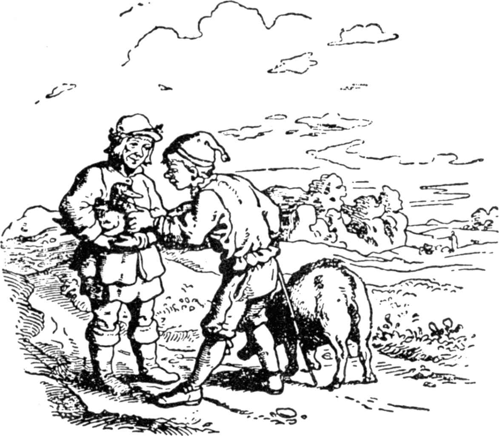

# 幸运儿汉斯

汉斯在他的主人那里干了七年的活儿，有一天他对主人说：“先生，我干活的期限已经满了，现在我想回到母亲那里去，请把工钱给我吧。”

主人回答说：“你对我又忠心又诚实，根据你干的活儿，应该有工钱，”说完，主人给了他一块金子，这金子比汉斯的头还要大。

汉斯从口袋里掏出一块布，把金块裹起来朝肩膀上一搭，然后放开脚步朝回家的路上走了。

他就这么朝家里赶，两条腿不停地往前迈；这时，忽然有一个人骑着马走到他跟前，这人精神抖擞、满面春风地骑着马儿小跑着。

“嗨，”汉斯放开嗓门叫道，“骑马有多带劲啊！骑在上面就好像坐在靠背椅上，脚不会让石子磕着，又省鞋，这走路的滋味你是不知道的。”

骑马的人听到他说话，便勒住马叫道：“哎，汉斯，你怎么还步行跑呢？”

“我不能不跑呀，”他回答说，“因为我有一块金子要拿回家去；这玩意虽然是金的，可我又不能直接提在手上，只能扛在肩膀上。”

“你知道什么呀，”骑马人说，“让我们交换好了：我把我的马给你，你把你的金块给我。”

“那太好了，”汉斯说，“不过我告诉你，你一定要扛着走路。”

骑马人下了马，接过金子，帮助汉斯上了马，让他把缰绳紧紧抓住，然后说：“如果你要它跑得快，那么就要不断地叫‘驾，驾’。”

汉斯坐到马上，驾驭自如地往前骑去，心里真是乐不可支。骑了一段路后，他脑子里忽然闪出一个念头：这马应该走得再快些；于是，他就连连喊“驾，驾”。

没等汉斯准备好，那马就拼命地跑了起来，结果把他从马背上摔了下来，他摔倒在一条农田和公路之间的沟里，要不是一位农夫正好赶着一条母牛从那儿经过，挡住那马的去路，恐怕它早就逃跑了。

汉斯从沟里爬起来，缓了缓四肢。这时他心情很不好，对农夫说道：“骑这种马简直就是一种恶作剧，尤其是骑这种老瘦马，它横冲直撞，非把你摔下来不可，把你的脖子都能摔折；我再也不骑它了。我真羡慕你的母牛，你可以在后面逍遥自在地赶着它走，而且每天还可以吃到牛奶、黄油和奶酪。唉，我要是有一条这样的母牛该多好啊！”

“这么吧，”农夫说，“你既然这么有兴趣，那么我就用我的牛同你换这匹马吧。”

汉斯高兴极了，一千个同意；农夫一跃上了马，飞快地骑走了。

汉斯一边笃悠悠地赶着牛，一边回想着这笔走运的交易。“我只要有一块面包（当然这决不会缺少的），那么，我随时都可以吃到黄油和奶酪；我渴了，就挤牛奶喝。人哪，你还想奢望什么呢？”

当来到一家酒店时，他歇下了，兴致勃勃地把带在身边中午吃的面包和晚上吃的面包吃了个精光，还用最后几个赫勒要了半杯啤酒。吃饱了喝足了后他又赶着牛上路，一直朝他母亲的村子走去。

天气火辣辣的，越到中午越热；汉斯走在原野上，他大概还要走一个小时才能到家。这时他觉得热极了，嘴巴渴得要命。“有办法了，”汉斯想，“现在我要给这母牛挤奶，用牛奶当水喝。”

他把牛拴到一棵干枯的树上，他没有桶，于是就把皮帽子接在下面，可是不管他怎么费劲，就是不见一滴牛奶滴下来。他在挤奶时由于动作笨拙，那畜生不耐烦了，用后腿对准他的头部就是一脚，踢得他跌跌撞撞地倒在地上，好长一段时间晕头晕脑，连自己在什么地方都不知道。

这时候，幸亏有一个杀猪的正好从这里走过，他推着的一辆手推车上躺着一头小猪。“你这是搞的什么名堂！”他叫道，一边把好心的汉斯扶起来。

汉斯向他述说了刚才发生的事。那个杀猪的把自己的酒瓶递给他，说：“喝一口缓口气。这头牛看来挤不出奶了，这是一头老畜生，最多还可以拉拉车，要么干脆宰了。”

“哎，哎，”汉斯说，一边抓了抓头发，“这主意不错！如果能把这头牛牵回家去杀了，这简直太好了，这会有多少肉啊！不过我对牛肉兴趣不大，这玩意儿对我来说不够味。是啊，要是有这么一头小猪崽那该多好啊！这味儿就不一样了，还可以做腊肠。”

“我说，汉斯，”杀猪人说道，“我倒挺愿意同你换的，就让这头猪换你那头牛吧。”

“谢谢你的好意，”汉斯说，然后把母牛交给他，让他从手推车上解下小猪，把拴猪的绳子交到他手里。

汉斯又接着赶路，一边反复思索着，所有的事都称心如意，尽管一再碰到不顺心的事，可是都马上又圆满地得到了解决。

这时，有一个小伙子同他并肩走到了一块儿，这人胳膊底下夹着一只美丽洁白的鹅。他们在一起走了一段时间后，汉斯便对他谈起自己的好运来，谈了他总是占便宜的交换。那小伙子也对他说，他带这鹅是去参加一个儿童的洗礼宴会。

“你提一下，”那小伙子接着说，一边抓住鹅的翅膀，“它多么重啊，八个星期了，每天都把它喂得饱饱的。烤好以后，谁咬一口就得擦一下嘴角两边的油。”

“是啊，”汉斯说，一边掂了掂鹅，“它是有点儿分量，不过我的猪也不赖。”

这当儿，那小伙子满怀疑虑地朝四周张望了一下，甚至还摇了摇头。“我说，”他开始说道，“赶着这么头猪看来不大对劲儿。我刚才路过一个村子，那儿村长的猪圈里正好被人偷去一头猪。我怕，我担心他们现在可能掌握住了线索。他们已经派了好多人四处寻找，如果他们刚巧碰上你赶着这头猪，那么你就要倒霉了；最起码你会被关起来。”

心地善良的汉斯害怕起来：“哦，上帝，”他说，“帮我摆脱困境吧，这一带你熟悉，把我的猪拿去，把鹅让给我吧。”

“好吧，我只好冒一次风险了，”小伙子回答说，“不过，如果你遭到什么不幸的话，我可不负责！”

说完，他接过绳子，赶着猪，很快就在旁边一条路上消失了；而好心的汉斯也以为解脱了烦恼，高兴地走了，他把鹅夹在胳膊下朝家里赶。“如果我考虑得没错的话，”他自言自语道，“这次交换我还占了便宜呢：首先这可以烤成味道很好的烤鹅，烤好后会渗出好多油，这些油够我吃三个月的鹅油面包；其次，那些漂亮洁白的羽毛还可以用来塞枕头，这样我就能高枕无忧地睡觉了。我母亲将会多么高兴啊！”

当他路过最后一个村子时，看到一个磨刀匠站在那儿，他的手推车上，砂轮在嗡嗡地响，他唱道：

“手磨剪刀，砂轮飞转，

我看风使舵，见机行事。”

汉斯站住了，注视着他；过了一会儿他终于开口对他说道：“看来你过得不错啊，连磨剪刀都这么快活。”

“是啊，”磨刀匠说，“这项手艺是个金饭碗。一个正当的磨刀匠不管开销多大，兜里始终是有足够的钱。对了，你这只漂亮的鹅是哪儿买来的？”

“这只鹅不是买的，是我用我的猪换来的。”

“那么猪呢？”

“那头猪是我用牛换的。”

“那么牛呢？”

“那头牛是我用马换的。”

“那么马呢？”

“那匹马是我用一块金子换的，那块金子比我的头还大。”

“那么金子呢？”

“唉，那块金子是我干了七年活儿的工钱。”

“你总是挺有办法，”磨刀匠说，“这么下去你会交好运的，往后你一起身，兜里的钱就会哗啦啦地响。”

“那么我现在该怎么办呢？”

“你一定要做个磨刀匠，和我一样；除了一块磨刀石外，就不需要任何东西了，其他东西自然都会有的。我这儿有一块磨刀石，尽管有一点破损，但我只要换你的鹅，其他什么都不要；您愿意不愿意这么做？”

“这你还用问吗，”汉斯回答说，“我成了这个世界上最幸福的人了；我有钱，只要有大把大把的钱，我还有什么事需要牵挂呢？”说着他把鹅递过去，接下了那块磨刀石。

“这么吧，”那磨刀匠说，一边从身旁捡起一块又平常又沉重的石头，“你再带上一块好点的、经得起敲打的石头，你可以在上面把旧铆钉敲直。拿去，好好保管起来。”

汉斯扛着石头，心满意足地继续往前走；他两只眼睛高兴得闪闪发光：“我脱胎换骨，要走红运了，”他大声叫了起来，“我就像一个星期日出生的孩子，一切都称心如意。”

> **注 1**　在德国，相传星期日出生的婴儿是幸运儿，以后会交好运。

由于天一亮他就两脚不停地赶路，因此他开始觉得累了；再说，他换了牛后，一时高兴把所有的干粮都吃了，现在肚子也饿得咕咕叫了。到最后他只能拼命地往前赶，而且还常常不得不停下来休息；与此同时，那两块石头也压得他喘不过气来。这时他一个劲儿地在想：如果现在用不着扛石头，那该多好啊。

他像个蜗牛似的慢吞吞地来到田野中的一口水井边，他想休息一下，喝一点儿清凉的井水提提精神；为了坐下时不把那两块石头弄坏，他小心谨慎地把它们放到水井的边沿上，然后坐了下来；他想弯下腰来喝水，可是不小心碰了一下两块石头，于是两块石头掉到井里去了。他眼睁睁地看着它们沉到水底下，然后他高兴得跳了起来，接着又跪下来，两眼泪汪汪地感谢上帝，这是上帝恩赐他的结果，让他用这么一个好办法，不需要自我谴责地从沉重的石头底下解脱出来，要不然这两块石头还要给他造成更多的痛苦呢。

“我多么幸运啊，”他大声叫道，“天底下没有比我更幸运的人了。”他一跃而起，心情舒畅、轻松愉快地往前跑去，一直跑回家，跑到了母亲的身边。

（裴胜利译）
