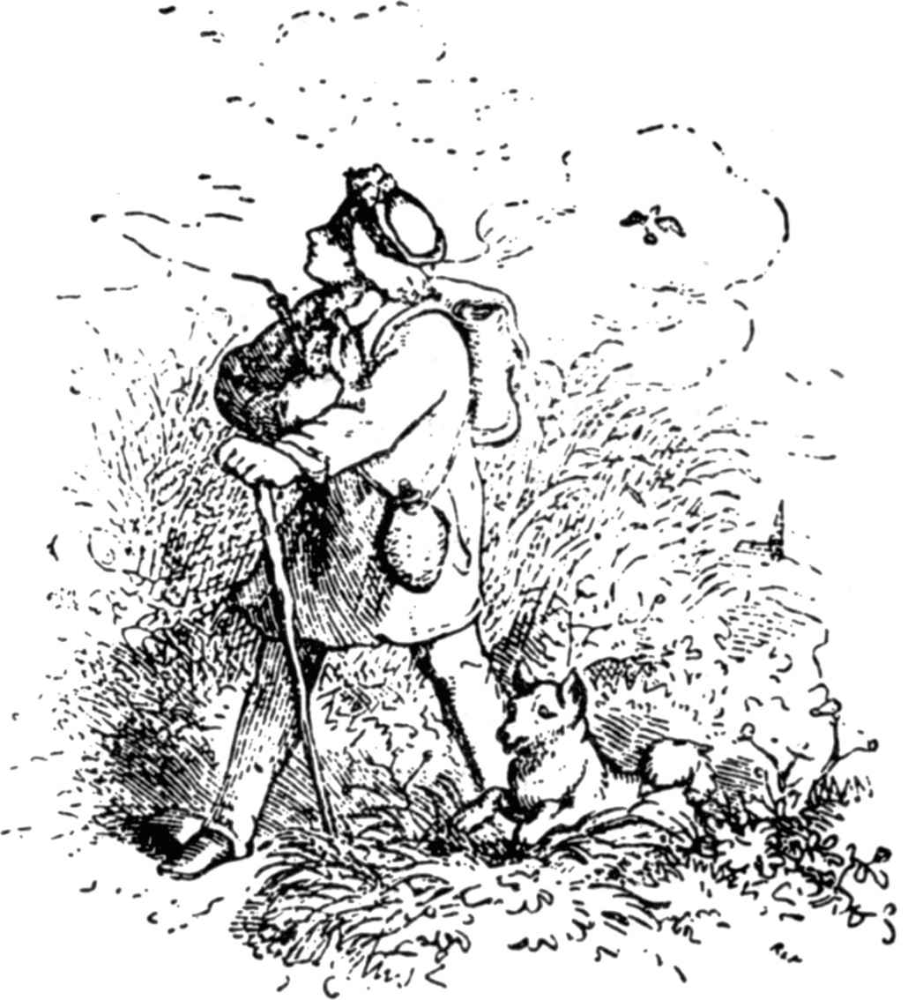

# 两个旅行家

山岭和峡谷并不相遇，但是好人和坏人会碰在一起。所以，有一次，一个鞋匠和一个裁缝在旅行时来到一起了。裁缝是一个瘦小、漂亮的小伙子，他总是高高兴兴，乐呵呵的。他看见鞋匠从对面走来，看到他的背包，知道他是干什么手艺的，就向他唱了一支嘲笑的歌曲。

“给我缝鞋帮，

给我抽鞋线，

左右两边都涂上些沥青，

敲呀，把钉子给我敲敲紧。”

可是，鞋匠是受不了嘲笑的，他拉长了脸，仿佛喝下了酸醋，又装出一副要去抓小裁缝脖子的姿势。小伙子却笑了起来，把自己的酒瓶给了他，说道：

“我这不是恶意，喝一口，消消气吧。”

鞋匠喝下了一大口，脸上的乌云开始消散了。他把酒瓶还给裁缝，说道：

“我正正经经对你说，酒喝多了，话就多，渴极了可不一样。我们就一起旅行好吗？”

“我同意，”裁缝回答，“只消你有兴趣到一个不缺少工作的大城市去。”

“我正想去那种地方，”鞋匠说，“小地方挣不到钱，乡下人宁愿赤脚走路。”

于是他们一起继续旅行，总是一只脚印在前，一只脚印在后，好像黄鼠狼在雪地里一样。

他们两人有的是时间，但是缺少东西下肚。他们来到一个市镇，各人自去拜访自己的同行，由于小裁缝总是高高兴兴，生气勃勃，又长了一副红红的漂亮脸蛋，大家都乐意把活计交给他做，如果他运气好，离开的时候，师傅的女儿还会在门廊底下给他一个吻。当他和鞋匠重新相逢时，他的包袱里的东西总是比较多。脾气怪僻的鞋匠做了个鬼脸，心里想：“愈是无赖，福气愈大。”可是裁缝堆起了笑容，唱着歌，把他得到的东西统统和他的伙伴共享。如果他的口袋里有几枚硬币叮当响，他就叫下好酒好菜，快活地敲着桌子，震得杯子也跳了起来，他就是这种人：“赚得容易，花得痛快。”

他们旅行了一段时间，来到一座大森林的跟前，到京城去的道路是通过森林的。不过，有两条小路通往那里，一条要走七天，一条只要走两天，他们都不知道哪一条是近路。这两个旅行家坐在一棵橡树底下商量，看看应该做些什么准备，需要带上多少天的面包。

“不论做什么事，事先应该想得远一些，我要带上七天吃的面包，”鞋匠说。

“什么？”裁缝说，“我干吗要背着七天的面包，像头驮东西的畜生似的，没法向周围观看？我依靠上帝，什么也不在乎。我口袋里的钱，不论在夏天或冬天，都一样好，可是，面包在天热时会干掉的，而且还要发霉。我的上衣也容易破掉。我们为什么不找一条正确的道路？只带两天的面包，这样足够了。”

于是，每人各自买了面包，然后听天由命，走进了森林。

森林里非常静，像在教堂里那样。没有风的吹拂，没有溪流的潺潺声，也没有鸟儿的歌唱，连阳光也透不过绿叶浓密的树枝。鞋匠不说一句话，沉甸甸的面包压在他的背上，汗水从他那不快的阴沉沉的脸上淌了下来。但是，裁缝却生气勃勃，他跳跳蹦蹦，拿一片树叶当哨子吹，或者唱起一支小曲，心里想：“天上的上帝看到我这么快活，一定很高兴。”

这样走了两天，但是，到了第三天，森林还没有个尽头，裁缝的面包已经吃光了，他的心也就下沉了一尺。不过，他还没有丧失勇气，还依靠着上帝和他的幸运。第三天晚上，他饿着肚子躺在一棵树底下，下一天早晨起身，仍旧饿着肚子。第四天也是这样度过，当鞋匠坐在一根倒下的树干上进餐的时候，裁缝只能在旁边看着。

裁缝向鞋匠乞讨一小块面包，鞋匠就嘲笑着说：

“你总是那么快活，现在你可以体验一下不快活的时候是什么滋味；早晨叫得太早的鸟，晚上就要遭到老鹰的袭击。”

总之，他没有一点怜悯心。但是，第五天早晨，可怜的裁缝再也站不起来了，他虚弱乏力，简直一句话也说不出来；他的脸色苍白，眼睛红红的。这时，鞋匠对他说：

“今天我愿意给你一块面包，不过，我要挖掉你的右眼睛。”

不幸的裁缝只想保存自己的性命，他没有别的办法，两只眼睛哭泣了一阵，然后把它们献出去。那个鞋匠，他有着一颗铁石般的心，用一把锋利的刀子把他的右眼睛挖了出来。

裁缝想起从前在食品贮藏室里偷吃东西时，妈妈曾经对他这样说：“吃得下多少，就吃多少，避免不了的事，就得忍受。”他吃完了代价昂贵的面包后，又迈开一双腿走路了，忘记了自己的不幸，安慰着自己，心里想：我用一只眼睛，照样看得见。

可是，到了第六天，饥饿又降临了，几乎把他的心都要吃掉了。晚上，他在一棵树旁倒了下来，第七天早晨，他虚弱得没法站起来，死神已经骑在他的脖子上了。

于是，鞋匠说道：

“我愿意表示我的慈悲心肠，再一次给你面包；不过，不能让你白拿，我要挖掉你的另外一只眼睛。”

这时候，裁缝才认识到自己的生活是多么轻率，他祈求亲爱的上帝宽恕。他说：

“你要怎么干，就怎么干吧，避免不了的事，我会忍受的。不过，你要记住，我们的上帝并不是每时每刻都在审判，时间一到，你对我做的种种坏事将会得到报应，我可没有做什么对不起你的事呀。我在好日子里，曾经把我的东西分给你一起享用。我的手艺是那种一针紧赶着一针的活计，如果我没有了眼睛，没法再干针线活，那我只好去讨饭。只是，如果我的眼睛瞎了，不要让我一个人躺在这里，否则，我只好活活饿死。”

但是，那个已经把上帝从心中赶走了的鞋匠，拿起了刀子，又把他的左眼挖了出来。然后，给他吃了一块面包，递给他一根棍棒，牵着他向前走。

太阳落下的时候，他们走出了森林。森林外面的旷野上，竖立着一座绞刑架。鞋匠引着瞎眼的裁缝朝那里走去，然后，叫他躺下，自己却走掉了。这个不幸的人由于疲劳、疼痛和饥饿，他睡着了，睡了整整一夜。当天色破晓时，他醒了，但是不知道自己躺在什么地方。

绞刑架上吊着两个可怜的罪犯，每人的头上都站着一只乌鸦。其中一个说起话来：“兄弟，你醒了吗？”第二个回答：“是的，我醒了。”第一个又说：“我告诉你，今天夜里从我们头顶的绞刑架上掉下来的露水，如果有谁用它来洗脸，失明的眼睛也会恢复。如果瞎子们知道这件事，那么，很多人就能够恢复他们的视力了，尽管他们以为办不到。”

裁缝听到这些话，他拿出手帕，放在草上按了几下，等到手帕被露水润湿了，用它擦洗自己的眼窝。绞刑架上那个人说的话立刻应验了，一双明亮健康的眼睛填满了眼窝。没有多久，裁缝看见太阳从山后面升起，他面前的平原上，躺着伟大的京城，有着宏伟的城门和成百座尖塔，塔顶上的金色圆球和十字架开始闪闪发光。他能够辨别树上的每一片叶子，看得见飞过去的鸟和飞舞在空中的蚊子。他从口袋里取出一根缝针，当他能够像以往一样灵巧地把线穿过针眼时，他的心高兴得狂跳起来。他双膝下跪，感谢上帝显示了他的仁慈，做了晨祷。他也没有忘记为那两个可怜的罪犯祈祷，他们吊在那里，像钟摆一样，在风中互相碰撞。然后，他背起行囊，很快就忘掉心中遭受到的痛苦，唱着歌，吹着口哨，向前走去。

他最先遇到的是一匹棕色小马，小马自由自在地在田野里蹦跳，他一把抓住马的鬃毛，要跳上马背，骑着他往城里去。但是，小马恳求他放他走：

“我还太小，”他说，“哪怕像你这样身体轻轻的裁缝也会把我的背脊压断的，放我走吧，等我的身体长得结实。也许将来有机会能够报答你的。”

“跑吧，”裁缝说，“我看你还只是个顽皮的小家伙。”

他用树枝在小马的背上抽了一下，小马高兴得蹶起后腿，跳过篱笆和沟渠，跑进旷野中去了。

可是小裁缝从昨天起就没有吃过东西。他说：“虽然阳光洒满了我的眼睛，却没有面包填满嘴巴。我只要一碰见勉强可以吃的东西，就一定把它吞下肚去。”

这时候，一只仙鹤十分庄重地在草地上向他走来。

“站住！站住！”裁缝嚷道，抓住他的腿，“我不知道你是不是可以吃，但是，我实在饿得很，没有多大的选择余地，我只得砍下你的脑袋，拿你烤来吃。”

“不要这样做，”仙鹤回答说，“我是一只神圣的鸟，我给人类带来很大的好处，没有人伤害我。你饶我的性命吧，将来我会报答你的。”

“那就走吧，长腿兄弟，”裁缝说。

仙鹤向上飞去，吊着两条长腿，从容地飞走了。

“该怎么办呢？”裁缝自言自语，“我饿得愈来愈厉害了，肚子也愈来愈空了，路上碰见的东西，现在都失掉了。”

他看见池塘里有几只小鸭，向他这边游来。

“你们来得正是时候，”他说，抓住了其中一只，正要扭断她的脖子。藏在芦苇里的一只老鸭开始大声叫喊，张开了嘴游过来，恳求他饶了她亲爱的孩子。她说：

“你没有想到，如果有人要带走你，把你弄死，你的母亲该是何等的悲伤？”

“不要说了，”好心肠的裁缝说，“你的孩子就留在你的身边吧。”

他把捉到的俘虏重新放回水里。

他转过身体，耸立在他的面前的是一棵老树，树干里面已经空了一半，他看见野蜂飞进飞出。

“我做了好事，马上在这里找到了报酬，蜂蜜会恢复我的精力，”裁缝说。

可是，蜂王出来恐吓他道：

“如果你碰一碰我的人民，毁坏我的窝，那么，我们的刺就像一万支炽热的针，刺进你的皮肤里。不过，如果你让我们安安静静，走你自己的路，我们有机会一定要为你服务。”

小裁缝看到这里没有什么指望，便说：“三只碗是空的，第四只碗里也是没有东西，这是一顿糟糕的伙食。”他拖着饿瘪了的肚子走进城里，这时正好敲响中午十二点，客栈里已经给他做好饭菜，他可以马上坐到桌子旁边去吃。他吃饱后说：“现在我要去干活了。”

他在城里到处寻找一个师傅，很快就找到一个很好的职位，由于他精通自己的手艺，不久就出了名，大家都要这个小裁缝给自己做新衣服。他的名声一天天大起来，他想：“我的技术没法再改进了，然而境况却一天比一天好。”最后，国王委派他做宫廷裁缝。

正是无巧不成书。在同一天，他以前的伙伴，那位鞋匠，也成了宫廷鞋匠。

鞋匠一眼见到裁缝，看见他又有了一双健全的眼睛，他的良心折磨着他。

“在他向我报复以前，我必须给他挖一个陷阱，”他心里想。

但是，谁给别人挖陷阱，自己也会掉进去。

傍晚收工后，天色已经昏暗，他蹑手蹑脚地来到国王的跟前，说道：

“国王陛下，裁缝是一个傲慢的人，他狂妄大胆，说他要把古时候失掉的金王冠重新找回来。”

“这样我很高兴，”国王说。

第二天早晨，他把裁缝叫到跟前，命令他把王冠找回来，否则就永久离开这个城市。

“哎呀，”裁缝想，“一个促狭鬼挖空心思想出的花招。如果这乖戾的国王要我做任何人都做不到的事，我何必再等到明天，还不如今天马上离开这个城市。”

于是，他捆好行囊，向城外走去，当他走出城门时，不禁难过起来，因为他不得不放弃幸福，离开这座使他过着好日子的城市。

他走到他和鸭子相识的池塘边，恰巧老鸭正坐在岸旁，用嘴梳理着羽毛，他曾饶赦她的孩子们的命，所以老鸭马上认出了他，问他为什么垂头丧气。

“如果你听了我的遭遇，你就不觉得奇怪了。”裁缝回答道，并把他的情况讲给她听。

“如果没有别的事，那我们可以想想办法，”鸭子说，“王冠掉进水里去了，躺在池塘底上。我们马上把它取上来。你只消把手帕摊开在岸上就行。”

她带着十二只小鸭潜入水里，五分钟后，她上来了，王冠搁在她的翅膀上，十二只小鸭在周围游动，把嘴放在下面，帮助抬王冠。他们游到岸边，把王冠放在手帕上。你想像不到这王冠是多么精美，当阳光照着它的时候，它就闪闪发光，好像十万颗红宝石。裁缝扎住了手帕的四只角，把它献给国王，国王非常高兴，拿出一根金项链，套在裁缝的脖子上。

鞋匠看到这一个花招失败了，又想出了第二个花招。他来到国王面前，说道：

“国王陛下，裁缝又狂妄起来了，说他能够用蜡把整座王宫做成个模型，包括王宫里所有的东西，可以移动的和不可移动的，里面的和外面的，一件不缺。”

国王派人把裁缝叫来，命令他用蜡把整座王宫做成个模型，包括王宫里所有的东西，可以移动的和不可移动的，里面的和外面的，一件不缺，如果他做不成，或者墙上缺少了仅仅一枚钉子，就把他关在地牢里，终身监禁。

裁缝想：“愈来愈使人生气，没有人受得了。”

他背起行囊走掉了。当他来到那棵空心的老树旁时，坐了下来，低垂了脑袋。蜜蜂飞了出来，蜂王问他为什么斜着脑袋，是不是因为得了个歪脖子的疾病。

“哦，不是，”裁缝回答，“因为有别的事逼着我，”于是谈起国王要他做的那件事。

蜜蜂开始嗡嗡地叫着，蜂王说：

“现在你回家去吧，明天这个时候再来，带一块很大的布来，一切都会顺利解决的。”

于是，他转身重新回去了。蜜蜂朝王宫飞去，正巧从敞开的窗户飞进去，爬满了所有的角落，非常仔细地察看着一切。然后，他们飞回去，用蜂蜡做王宫的模型，他们做得如此迅速，转眼之间长大了许多，到了晚上，一切都完成了。第二天早晨，裁缝来的时候，那里已耸立着一座精美绝伦的建筑物，连墙上的钉也没有缺少一枚，屋顶上的瓦也没有缺少一片，精致，雪白，散发着蜂蜜一样香甜的气味。裁缝把它小心地包在布片里，献给了国王。国王简直是惊讶极了，把它陈列在最大的厅堂里，赏赐给裁缝一幢很大的石屋。

但是，鞋匠还不罢休，他第三次来到国王的跟前，对他说：

“国王陛下，裁缝听说王宫的院子里不会涌出水来，他就夸下海口，说是院子中央将会喷出一人高的泉水，清澈得像水晶一样。”

于是，国王派人找来了裁缝，说道：

“如果明天我的院子里没有像你所说的那样喷出一股清泉，那么，刽子手就要在那里砍掉你的头颅。”

可怜的裁缝并没有花多长时间考虑，飞速地跑出城门，因为这一次对他来说是有关生死的事，泪水从脸上滚落下来。

他正非常悲伤地走着时，曾经被他放了生的那匹小马跳跳蹦蹦地跑了来，现在，他已长成一匹漂亮的棕色马了。他对裁缝说：

“我能够报答你恩惠的时刻来到了，我已经知道你缺少什么，我要马上帮助你，骑上来吧，我的背脊载得起两个像你这样的人。”

裁缝的勇气又恢复了，他一下子跳上马背，马迈开大步，跑进城里，直到王宫的院子里。他在那里转了三圈，快得好像闪电，到了第三圈，他倒了下去。一瞬间，发出一声可怕的轰响，院子中央弹起一块泥土，好像一颗弹丸射向空中，从王宫上面飞出去了。这时，马上喷出一股清泉，有骑在马上的人那样高，这股清泉洁净得像水晶，阳光开始在上面跳舞。国王看见了，惊讶得站了起来，他走过去，当着众人的面拥抱了小裁缝。

可是，好运道并没有保持多久。国王有很多女儿，一个比一个美丽，可惜没有儿子。坏心肠的鞋匠第四次来到国王的跟前，说道：

“国王陛下，裁缝没有放弃他狂妄的脾气，现在他夸口说，如果他愿意，他能够给国王陛下从空中送一个儿子来。”

国王派人叫来了裁缝，说道：

“如果你在九天之内给我送来一个儿子，我就把大女儿嫁给你。”

小裁缝心里想：报酬确实很大，使人愿意为它出力，不过，对我来说，樱桃挂得太高了，如果我爬上去采摘，脚下的树枝一断，我会掉下去的。

他走回家去，盘着腿坐在工作台上，考虑该怎么办。

“这样不行，”最后他嚷出声来，“我要离开，反正在这里我也没法安安静静过活。”

于是，他捆好行囊，赶快朝城门走去。当他来到草地上时，瞥见他的老朋友——那只仙鹤——在那里走来走去，活像一个哲学家。有时候，他静悄悄地站着，仔细端详一只青蛙，终于把它吞下肚里。

仙鹤走过来向他问候。

“我看见你背着背包，你为什么要离开这个城市？”他说。

裁缝把国王要他做的事告诉了他，说他无法完成，正在悲叹自己的不幸。

“不要为了这件事长出白头发来，”仙鹤说，“我会帮助你解除困难。很久以来，我把一些襁褓中的婴儿送到城里，我也可以从井里取出一个小王子来。回家去吧，安安静静地等着，到了第九天，你就到王宫里去，到时候我会来的。”

> **注 1**　西方民间故事中的传说，婴儿是仙鹤送来的。

小裁缝回了家，在约定的时候来到王宫。没有多久，仙鹤飞来了，敲着窗，裁缝开了窗，长腿兄弟小心翼翼地跨了进来，它在光滑的大理石地面上走着庄严的步子，嘴里衔着一个婴儿，这个婴儿美丽得像一个天使，向王后伸出了小手。他把孩子放在王后的怀里，她抱着他，吻他，真有说不出的高兴。仙鹤飞走前，从翅膀上取下它的旅行袋，递给王后。袋里装着一些小纸包，包里是些五颜六色的糖豌豆，她把糖豌豆分给了小公主们。大公主没有分到糖豌豆，却得到了个快活的裁缝做丈夫。

“我觉得，”裁缝说，“我好似中了个头彩。妈妈说得很对，她常常说：谁相信上帝，就只会交好运，永不失败。”

鞋匠不得不给小裁缝做婚礼舞会上穿的鞋子，然后，他得到命令，要他永远离开这个城市。通往森林的道路把他引到绞刑架的跟前。他心中恼怒，天气又热，疲倦得倒在地上。他闭着眼睛，正要睡去时，两只乌鸦从绞刑犯的头顶上俯冲下来，一面大声鸣叫，一面啄掉了他的两只眼睛。他发疯了，奔进森林里，一定在里面饿死了，因为从此没有人再见到他，也没有人听到他的消息。

（侯浚吉译）
