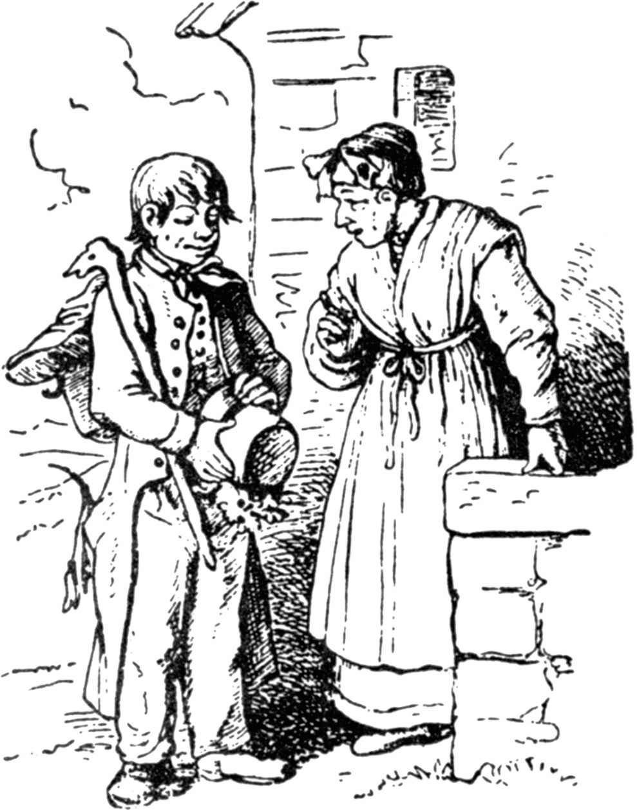

# 蓝光灯

从前，有一个兵士，给国王忠心耿耿地服役了很多年，战争结束的时候，因为受了多处伤，不能继续服役了，国王就对他说：

“你可以回家去了，我不再需要你了，你也不能再拿到钱，因为，只有给我服役的人，才给他发饷。”

兵士不知道应该用什么来维持生活，忧心忡忡地离开了。他走了整整一天，到了傍晚，走进了一座森林。当暮色来临的时候，他看见了灯光，就往灯光那里走去，来到一所房屋旁，屋里住着一个女巫。

“给我一个过夜的地方吧，”他对她说，“还给我一点点吃喝的东西，要不，我快要饿死了。”

“哎呀！”她回答，“谁会给一个迷路的兵士吃喝？不过，我是慈悲心肠，只要你照我的吩咐做事，我就接纳你。”

“要我做什么事？”兵士问她。

“明天，你把我园子里的地掘松了。”

兵士同意了，第二天，他用尽力气干活，可是，到了晚上，还是不能完工。

“我看，”女巫说，“今天你不能再干了，我仍留你一夜，明天，你要给我劈一车木柴，劈得小小的。”

兵士干了整整一天，到了晚上，女巫向他提出，还让他住一夜。

“明天，只要你给我干一件小事，我的房屋后面有一口破旧的枯井，我的灯掉在里面了，这盏灯亮着蓝色的光，永不熄灭，你去给我取上来。”

下一天，老巫婆领他走到井旁边，让他坐在一只篮子里，把他放到井里去。他找到了蓝光灯，发了个信号，要她拉他上去。她的确把他拉上来，可是，当他接近井口时，她伸下手去，要从他的手里取走蓝光灯。

“不行，”他说，发觉了她的坏心思，“等到我的两只脚站到了地面上，我才把灯给你。”

女巫发怒了，又把他放下去，让他掉在井里，自己却走掉了。

可怜的兵士掉在潮湿的井底，幸亏没有受伤，蓝色的灯光仍旧亮着，但是，对他有什么用呢？他看到自己这次不会逃脱死神的魔掌了。

他忧郁地坐了一会儿，无意中把手伸进口袋里，摸着他的烟斗，里面还装着半个烟斗的烟草。

“这将是我的最后一点享受，”他想，取出烟斗，凑在蓝色的火焰上点着，开始吸起烟来。当烟雾在井里弥漫时，突然，在他的面前，站着一个黑黑的小人，问道：

“主人，你有什么吩咐？”

“我有什么好吩咐你的？”兵士吃惊地回答。

“我必须完全听从你的吩咐去做，”小人说。

“好，”兵士说，“那你先帮我出了这口井。”

小人牵着他的手，领着他经过一条地道，他也没有忘记带着那盏蓝光灯。中途，小人把女巫收集了藏在那里的珍宝指给他看，兵士尽自己力气带走许多金子。当他到了地面时，对小人说：

“现在，你去把老巫婆捆起来，送她上法院。”

不多久，她坐在一只野猫的身上过来了，一面发出可怕的叫喊，快得像一阵风似的奔过那里。又过了不久，小人回来了，说道：

“一切都办好了，女巫已经在绞刑架上吊死了。”

“主人，你还有什么吩咐吗？”小人又问。

“暂时没有，”兵士回答，“你可以回家去了，只是，如果我叫你，你立刻就到。”

“用不着这样，”小人说，“你只要把你的烟斗在蓝色的火焰上点着，我会立刻站在你的面前。”

话刚说完，已经在他的眼前消失了。

兵士回到他原来的城镇。他走进一家最好的旅馆，定做了一身漂亮的服装，然后吩咐店主，给他安排一个房间，这个房间要布置得尽可能富丽堂皇。安排停当，兵士住了进去，把那个黑小人召来，说道：

“我忠心耿耿地替国王当差，他却把我遣散了，让我挨饿，因为这个缘故，我要对他报复。”

“你要我做什么呢？”小人问。

“到了半夜，等国王的女儿躺在床上睡着的时候，你就把她带到这里来，让她给我当女仆。”

“对我来说，”小人回答，“这是一件轻而易举的事，不过，对你却是一件危险的事，要是泄露出去，那你就糟糕了。”

钟敲十二下，房门打开了，小人把国王的女儿扛了进来。

“啊哈，你来了吗？”兵士嚷道，“好好干活！去把扫帚拿来，打扫房间。”

她扫完后，他叫她到他的沙发椅这边来，两只脚对着她伸过去，说道：

“给我把靴子脱下。”

他把靴子掷到她的面前，她只得拾起来，揩干净，擦得发亮。凡是他吩咐的，她都做了，不反抗，不作声，眼睛半睁半闭。第一声鸡叫的时候，小人把她扛回王宫，放在她的床上。

第二天早晨，国王的女儿起身后，走到她父亲那里，告诉他，她做了一个奇怪的梦：

“我被人像闪电般飞快地扛着穿过街道，带到一个兵士的房间里，他要我给他当女仆，侍候他，打扫房间，擦靴子，干所有低贱的粗活。这只是一个梦，然而我非常疲劳，仿佛我真的做了这些事。”

“这个梦也许是真的，”国王说，“我给你出一个主意，你在口袋里装满了豌豆，袋上弄一个小洞，如果你又被带走，豌豆掉落下来，就在街上留下了踪迹。”

国王这么说的时候，小人正站在旁边，别人看不见他，他却把一切听得清清楚楚。

夜里，国王的女儿睡熟时，她又被带着穿过街道，虽然从口袋里掉落下一些豌豆，不过，它们不能作为踪迹，因为狡猾的小人预先在所有的街道上撒下了豌豆。国王的女儿仍旧做着女仆的差使，直到鸡叫为止。

另一天早晨，国王派人出去寻找踪迹，可是白费了力气，因为所有的街道上都坐着些穷孩子，正在那里捡豌豆，他们说：

“昨天夜里像下雨一样落下了豌豆。”

“我们必须想想别的办法，”国王说，“你穿着鞋子上床睡觉，你从那里回来以前，把一只鞋子藏在那里，我会找到它的。”

这个主意被黑小人听见了，到了晚上，兵士要他再把国王的女儿带来，他劝告兵士，说自己没有办法对付这种诡计，如果在兵士那里找到了鞋子，那他就要糟糕了。

“我叫你做什么，你就去做！”兵士回答。

于是，在第三个晚上，国王的女儿又得像一个女仆那样干活，在她被扛回去以前，她把一只鞋子藏在床底下。

下一天早晨，国王派人在全城搜寻他女儿的鞋子，他们在兵士那里找到了，兵士听从小人的请求，逃出城外，可是，不久就被抓住，关进了监狱。他在逃跑时，忘了他的最好的财宝，那盏蓝光灯和金子，口袋里只带着一枚金币。当他拖着脚镣手铐站在监狱的窗前时，看见他的一个伙伴走过。他敲敲窗玻璃，那位伙伴向他走过来，他说：

“请你做做好事，把我的小包拿来，它放在我住过的旅馆里，我会给你一枚金币。”

那位伙伴奔过去，把他要的东西带来了。当他只有单独一个人的时候，他马上点燃了烟斗，把黑小人召来了。

“别怕，”他对主人说，“他们带你到哪里，你就去哪里，只要带着蓝光灯，不论发生什么事都不要紧。”

下一天，法庭审讯兵士，尽管他没有做过坏事，法官还是把他判处死刑。他被带出去时，他请求国王赐给他最后一个恩惠。

“什么恩惠？”国王问。

“准许我在路上抽一次烟斗。”

“你可以抽三次，”国王回答，“不过，不要认为我会饶你的性命。”

兵士取出烟斗，凑在蓝光灯上点燃了，两三个小小的烟圈升了起来，小人已经站在面前，手里拿着一根小棍子，说道：

“我的主人，你有什么吩咐？”

“给我把那些混蛋法官和他们的差役打翻在地，还有那个虐待我的国王，也不要饶过他。”

于是，小人像闪电般的跳到东，奔到西，谁挨上他的棍子，马上跌倒在地，再也不敢动一下。国王害怕了，他苦苦哀求，只求保全性命，他把国家交给兵士，还把女儿给他做妻子。

（侯浚吉译）
