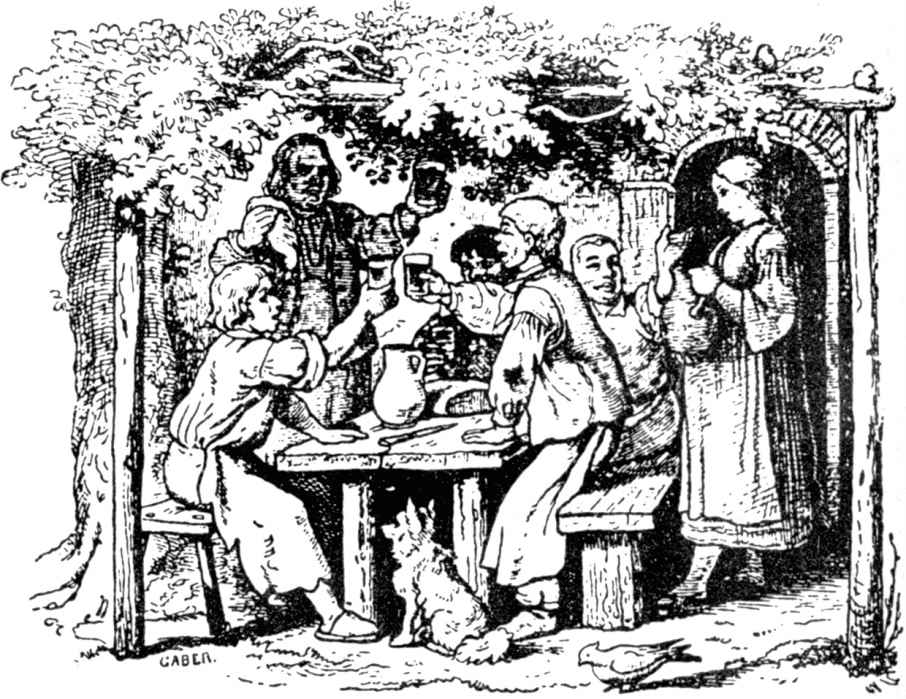

# 三兄弟

从前有一个人，有三个儿子，他没有什么财产，只有一所自己居住的房屋。每个儿子都巴不得在他去世后得到这所房屋，可是做父亲的对他们都同样疼爱，他不知道应该怎么办，才不至于伤了哪一个的心；他也不愿意把房屋卖掉，因为它是祖上传下来的产业，否则的话，可以把钱分给他们。最后，他想出了一个主意，对儿子们说：

“你们都出门去碰碰运气，每个人学习一门手艺，然后回来，谁的技艺最高明，就可以得到这所房屋。”

儿子们都同意了，老大要想做马掌匠，老二要想做理发师，可是老三要想做击剑师。他们决定，到了一定时候，再聚在一起，一同回家。然后各自出发了。

说来也巧，每人都找到一个本领高强的师傅，学到了真正的技艺。

马掌匠替国王的马匹钉掌，他心里想：“现在你有了真本领，可以得到那所房屋了。”理发师替王公显贵们修面，也以为那所房屋准是他的了。击剑师很多次被击中，但是他咬紧牙关，决不退缩，因为他想：“如果挨了一剑就害怕，那你休想得到那所房屋。”

约定的日子到了，他们一起回到父亲那里，但是他们不知道怎样才能找到最好的机会，显一显自己的本领。他们于是坐在一起商量。

正这样坐着的时候，忽然有一只兔子窜过田野，向他们这边奔来。

“好啊，你来得正是时候，”理发师说。

他拿着脸盆和肥皂，弄了很多泡沫，直等兔子跑到跟前，然后，他在兔子全速奔跑的时候给它擦上肥皂，又在它全速奔跑的时候给它剃了一个短胡子，没有割破一点皮，也没有损伤一根毛。

“我真高兴，”父亲说，“如果别人没有你的本领强，房屋是你的了。”

没有多久，来了一位先生，他坐在一辆疾驰的马车里。

“爸爸，现在请你看看我的本领，”马掌匠说。

他向马车冲去，把那疾驰中的马匹的四只马蹄铁扯下，给它钉上四只新的，马还在奔跑。

“你真是好样的，”父亲说，“你的手艺和你弟弟一样高明，我不知道应该把房屋给谁。”

老三于是说道：“爸爸，也让我试一下吧。”

这时候天开始下雨，他抽出宝剑，在头顶上飞舞，没有一滴雨水落在他的身上；雨愈下愈大，最后成了倾盆大雨，他的剑也舞得愈来愈快，身上始终是干的，似乎他是坐在四壁之内，屋顶底下。父亲看见了，十分惊讶，说道：

“你有了最好的绝技，房屋是你的了。”

两个哥哥对这个决定都满意，正像以前赞美过的那样，他们是那样相亲相爱，三个人仍旧一起住在这所房屋里，从事他们的手艺；因为他们学到了那么出色的本领，又是那么熟练灵巧，所以挣了很多钱。他们愉快地生活在一起，一直到老，后来一个生病死了，另外两个非常悲伤，也生了病，不久就死了。由于他们都精通手艺，又是那么相亲相爱，三个人就葬在一个坟墓里。

（侯浚吉译）
