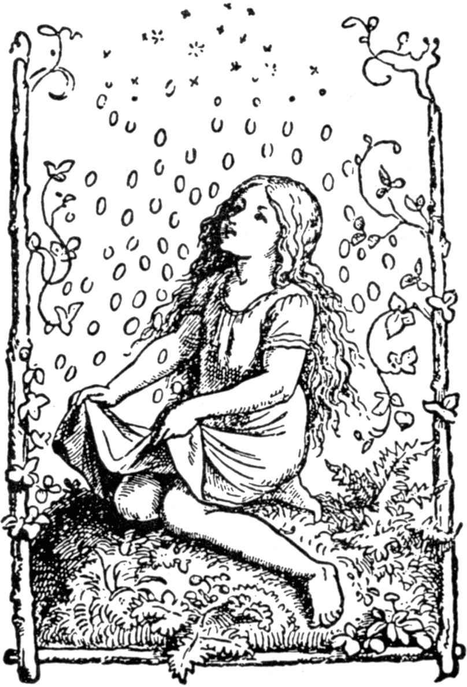

# 星星银币

从前有一个小姑娘，她的父母亲早已去世。她很穷，没有一间小屋可以让她住下，没有一张小床可以让她躺下，后来，她除了身上的衣服和手里一小块面包，别的什么也没有了，这块面包还是一个有同情心的人给她的。

可是，她却非常善良和虔诚。因为，她即使得不到大家的救济，独自来到田野上，对敬爱的上帝却仍然十分信仰。

这时候，她碰到了一个穷人，穷人对她说：“唉，给我一点儿吃的吧，我饿得受不了。”

她立刻把整块面包递给了他，同时说道：“上帝会保佑你的！”说罢她继续走了。

后来，又来了一个孩子，他苦恼地说：“我的脑袋冻得吃不消啦，给我些什么，让我可以遮挡一下吧。”

她立刻脱下小帽，双手递给了孩子。

她继续走了一段路，对面又来了个孩子，他没穿背心，浑身冻得发抖，她就把自己的背心送给了他。

她又走了一会儿，又有个孩子向她要上装，她从身上脱了给他。

最后，她进入了一座树林里，天色已经很晚了，对面却又走来了一个孩子，向她讨一件衬衣。

虔诚的姑娘心想：“天色反正黑了，没有人能看得见你，你完全可以把衬衣脱给人家。”

想着，她脱下了衬衣，递给了孩子。

当她站在那儿，身上一点也没穿什么的时候，谁知天上的星星，一下全都掉落下来，原来这些星星，都是又亮又硬的银币。

她虽然把自己的衬衣送给了别人，自己的身上这时却又穿上了一件崭新的衬衣，它是用非常细的亚麻布做成的。

这时候，她把所有的银币统统收集拢来，在往后的日子里，她过得很富裕。

（王克澄译）
