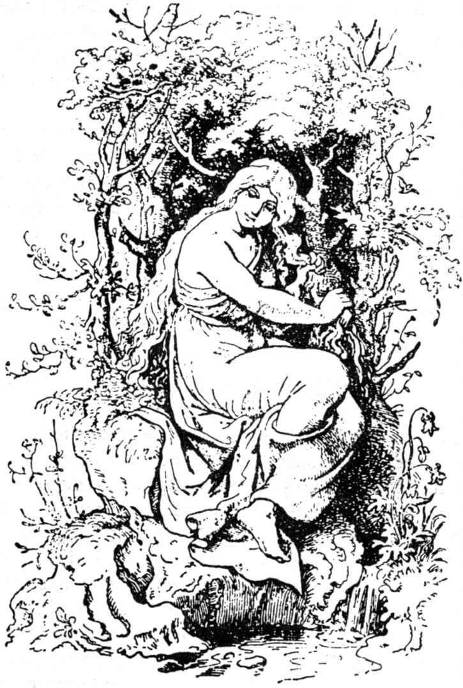

# 池中水妖

从前有一个磨坊主，他同他的妻子过着美满的生活。他们有钱又有财富，而且他们的生活一年比一年富裕。

可是灾难突然降临了：他们的财富像增长时的速度一样，一年比一年减少，最后就连磨坊都要保不住了；他住在磨坊里计算着他的财产。他满怀忧愁，每天干完活儿躺在床上辗转反侧，不得安宁。

一天早上，天还没亮他就起床了，走到外面，心想：该轻松一下才好。于是他越过磨坊前的河堤往前走；这时朝霞刚刚露出天际，他似乎听到池塘里有什么声音。他转过身来，看到一个美丽的女人，正从水里慢慢升起；只见她细嫩的手握着她那长长的头发，头发披在肩膀上，从两边垂下，遮着了她那雪白的身体。他看得很清楚，这正是池中水妖；他非常害怕，不知道应该离开呢，还是应该站住不动。

可是水妖却以温柔的嗓音唤了他的名字，并问他为什么这样忧愁。

磨坊主开始没吭声，可是当他听到她说话那么和蔼可亲，就放下心来，并告诉她，他原来生活幸福，财产丰富，可是现在却变得很穷，简直要六神无主了。

“别急，”水妖回答说，“我愿意使你变得比以前更富裕更幸福，只要你答应：把你们家最年轻的生物给我。”

“除了一只小狗或者一只小猫外，”磨坊主想，“其他还会有什么呢？”于是他答应了她的要求。水妖又潜入到水里。

他信心十足地朝磨坊跑去，他还没有到家，女佣就走出房门朝他喊道：他应该高兴高兴了，他的妻子生了一个男孩。

磨坊主一听，如同遭雷击似的站住了，他这才恍然大悟，原来那个狡猾的水妖已经知道这件事，把他骗了。

他垂头丧气地来到妻子的床前；妻子问他：“我们有了这么一个漂亮的孩子，你怎么不高兴呢？”

于是，他把遇到的事情以及答应水妖的事儿告诉了她。“如果我失去了亲生孩子，”他补充道，“那么幸福和财富对我有什么用呢？”

前来祝贺的亲朋好友对此也不知所措。

不久以后，幸福又回到了磨坊主的家里。他做什么事都很顺利，家里的箱箱柜柜似乎也自然而然地满了起来，柜橱里的钱也一下子多起来了。没多长时间，他的财富就超过了从前。

尽管这样，他却高兴不起来，内心无法平静：他对水妖作的许诺时时刻刻在折磨着他。他常常一经过池塘，心里就感到害怕，生怕那水妖会突然出现，向他索取所欠的债。

平时他不让男孩自己呆在池塘边上：“小心点，”他对男孩说，“你要是碰到河水，河下面就会伸出一只手来抓住你，把你拉下去的。”

可是一年又一年过去了，水妖没有再出现，因此磨坊主心情也渐渐地平静下来。

男孩长成一个小伙子了，这时他向一位猎人学习狩猎。当他学成之后，成了一个能干的猎人，村长雇用他干活。

在这个村子里有一个美丽而又诚实的姑娘，小伙子挺喜欢她，村长知道了这事后，便送给他一座小房子；他们举行了婚礼，两人心心相印，生活得平静而又幸福。

有一天，年轻的猎手追赶一头小鹿。那畜生跑出森林，在广阔的田野上逃窜，他紧紧追赶，最后一枪把它撂倒了。他跑过去，竟然走近了那危险的小池塘都没有发觉，他取出小鹿的内脏，然后走到池塘边想洗一洗血迹斑斑的手。可是他刚把手浸到水里，那水妖就从水里冒了出来，她狞笑着，一边用湿淋淋的胳膊一把搂住他，把他拖下去，一眨眼池中的波浪便吞没了他。

夜幕降临的时候，猎人没有回家，于是他的妻子害怕起来。她走出家门去寻找他。她曾听他说过，他要提防水妖追踪他，决不能冒险到池塘边上去。因此她现在预感到那件事已经发生了。

她匆匆忙忙来到池塘边，看到岸边放着丈夫的狩猎袋，这下她不再怀疑他遭到不幸了。她放声痛哭，一边绝望地呼唤着她爱人的名字，但是无济于事；她跑到池塘的另一边又呼喊起来。她用粗野的话痛骂水妖，可是毫无结果。镜子般的水面风平浪静，只有露出半个脸的月亮从水里无动于衷地注视着她。

这可怜的妇人并不离开池塘。她一刻不停地围着池塘奔跑，一会儿默不作声，一会儿放开喉咙猛喊，一会儿又轻声哭泣。后来她终于精疲力竭，倒在地上睡着了，她睡得很沉，不一会儿便做了一个梦：

她恐惧不安地在两个很大的岩石之间往山上爬行；荆棘和藤蔓缠住了她的双脚，雨点打在她的脸上，风儿吹拂着她那长长的头发。当她爬到高处后，呈现在眼前的完全是另一种景象：天空蓝蓝的，空气温和，土地渐渐往下倾斜，低处是一块绿油油、长着五彩缤纷的花儿的草地，草地上兀立着一座整洁的茅屋。她走上前去，推开门，只见屋里坐着一个白发苍苍的老太太，老太太亲切地朝她招了招手。

就在这时候，这可怜的妇人醒了。她睁开眼睛一看，天色已经破晓；她决定马上按照梦境去做。

她艰难地朝山上爬去，一路上遇到的一切完全如同夜里梦见的一样：那个老太太亲切和蔼地接待她，拿给她一张椅子，让她坐下来。“你一定是遭到什么不幸了，”老太太说，“因此你才找到我这所孤独的茅屋里来。”

猎人的妻子眼泪汪汪地向她叙述了她遇到的事情。

“放心吧，”老太太说，“我愿意帮助你：你把这把金梳子拿去，等到月亮圆的时候，你到池塘边，坐在岸上，用它梳你这乌黑的长发；你梳好头发后，再把它放在岸边，然后你就会看到发生什么事情的。”

这妇人回去了，她等着月圆；觉得时间过得很慢。后来天空中终于出现了皎洁的圆月，于是她走出房门来到池塘边，在岸边坐下用金梳子梳起她那长长的乌发；她梳好头发，把梳子放到池塘边上；不多一会儿，只见池水深处往上冒水泡，接着又翻滚起一股水波，波涛朝池边涌来，把梳子卷跑了。就在梳子沉到池底的一刹那间，平静的水面裂开一个口子，随即猎人的头冒了出来；他没有说话，只是以忧郁的目光注视着妻子。也就是在这一刹那，池中涌起了第二股波浪，把猎人的头淹没了。接着一切都消失了，池水也同刚才一样地平静了，只有月亮的脸盘儿在水面上粼粼闪烁。

猎人的妻子失望地回去了，然而睡梦又把她带到了老太太的茅屋里。

第二天一早，她又跑到老太太那儿，向这位先知先觉的妇人诉苦。老太太这回儿给她一根金笛子，并对她说：“等月亮再圆的时候，你拿着这根笛子坐到岸边，吹一首好听的曲子，吹完后把它放在沙滩上，然后你会看到发生了什么事情的。”

她按照老太太说的去做了。当她刚把笛子放到沙滩上，就看到池水深处冒起了水泡，接着便掀起一股水波，波浪向沙滩涌来，卷走了笛子，紧接着水面又分开了，这次从水里冒出来的不光是猎人的头，还有他的半个身体；他满怀希望地向她展开双臂，但是第二股浪头翻滚上来，盖过他的头顶，他又被拉下去了。

“哦，这叫我怎么办呢，”这个不幸的女人叫道，“难道我只能看亲爱的人一眼，又得重新失去他吗？”

她心里又充满了悲伤，可是睡梦第三次把她带到老太太的茅屋里。第三天早晨她起来后，来到那位先知先觉的老太太那里，老太太给了她一架金纺车，并安慰她道：“事情还没完呢；等满月的时候，你带上这架金纺车坐到池塘边，等你纺满卷筒后，你就把纺车放在靠近池水的地方，然后你就会看到发生了什么事情。”

猎人的妻子一丝不苟地照她说的做。月亮一圆她就把金纺车搬到池塘边，勤奋地纺起纱来，一直到亚麻纺完，卷筒上缠满纱线时才把纺车放到池岸边，刚放下，只见池塘底下冒出一股比前两次都要大的水泡，不一会儿便翻起一股巨浪，把纺车卷跑了。紧接着猎人的头和整个身子随着一股喷出的水柱升出水面。这时猎人急忙往岸上一跳，一把抓住妻子的手，逃离了池塘。

可是，当他们刚刚跑出一小段距离，整个池塘就沸腾起来，水泡翻滚，巨浪凶猛地冲向广阔的田野。这两个逃跑的人眼看就要被大水淹没，猎人的妻子也吓得直喊那个老太太救她；在这千钧一发的紧急关头，他们一下子变了模样，她变成一只蛤蟆，猎人变成一只青蛙。浪潮赶上他们，但不能置他们于死地，不过却把他俩冲开了，使他们相隔很远。

当大水退去后，两人又踏上了干燥的土地，重新恢复了人的形貌。不过，他们谁也不知道另外一个人在什么地方；他们处在一群陌生人中间，大家都不知道他们的家乡在哪里。

高山和深谷横在他们中间，为了维持生活，他们只好去为别人放羊。他们长年累月赶着羊群过田野，穿森林，心里充满着忧伤和思念。

有一年，当春天重回大地时，两人有一天同时赶着羊群出去，碰巧朝一个方向走来。猎人一眼看到远处一个山坡上有一群羊，便赶着自己的羊朝那个山坡走去。他们在一个山谷里相遇了，可是他们互相都不认识了，不过两人仍然很高兴，因为不再像从前那样孤独了。

从这天以后，他们每天把各自的羊群赶到一块儿；他们说话不多，可是都觉得这也是一种安慰。

有一天晚上，当一轮圆月挂在天空，羊儿都已安息时，牧羊的小伙子从口袋里取出笛子，吹起一首动听而又凄楚的曲子来。他吹完后，发现那个牧羊女在悲伤地哭泣。

“你怎么哭了？”他问道。

“哦，”她回答说，“我上次吹这首曲子时，我亲爱的人从水里露出头来，当时月亮也是这么圆。”

他注视着她，忽然觉得眼前似乎有一层薄膜，他认出了自己的爱妻；而当她仔细端详他的时候，月光正好照在他的脸上，她也认出了他。他们拥抱亲吻起来。

他们是不是幸福，那就用不到问了。

（裴胜利译）
