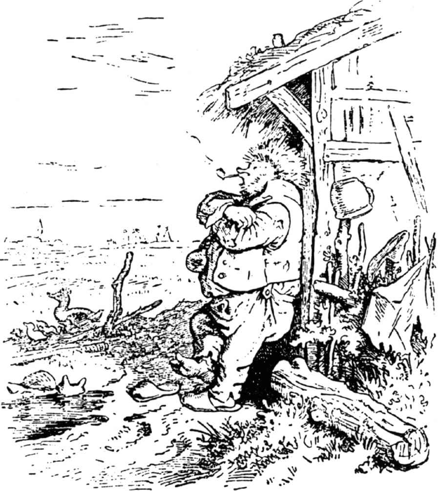
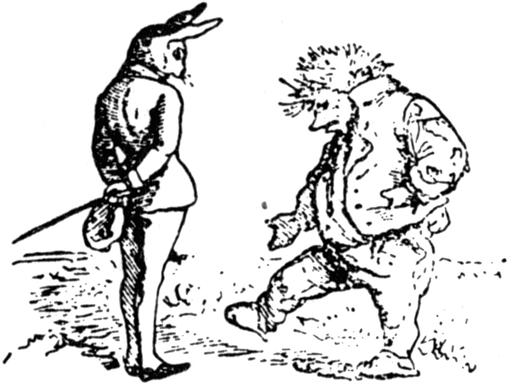
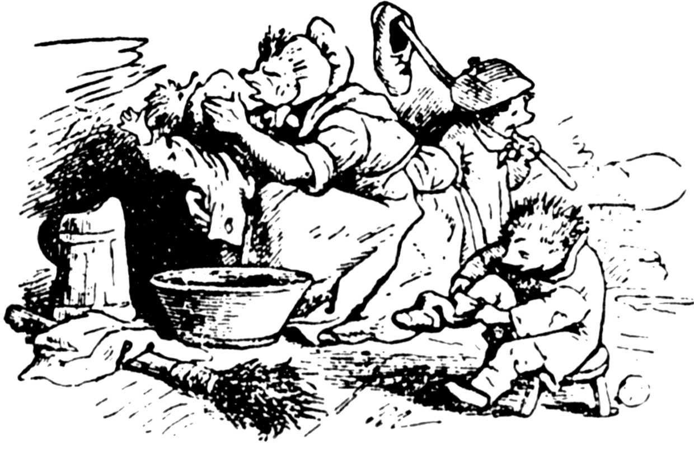
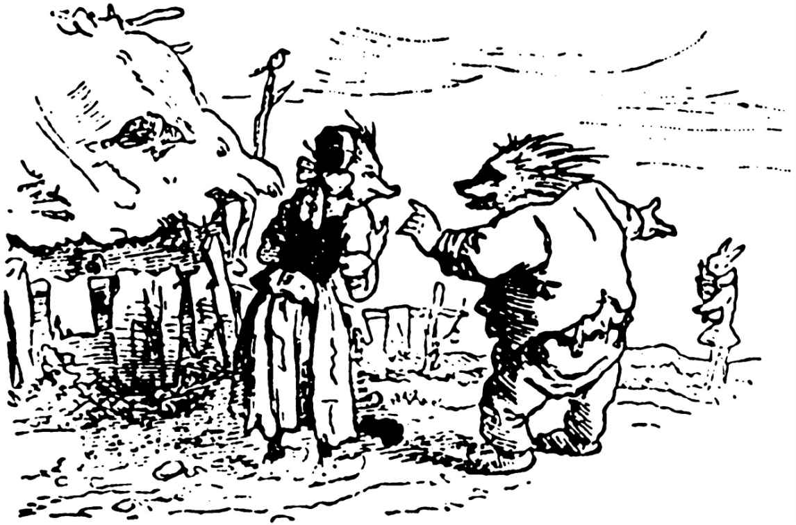
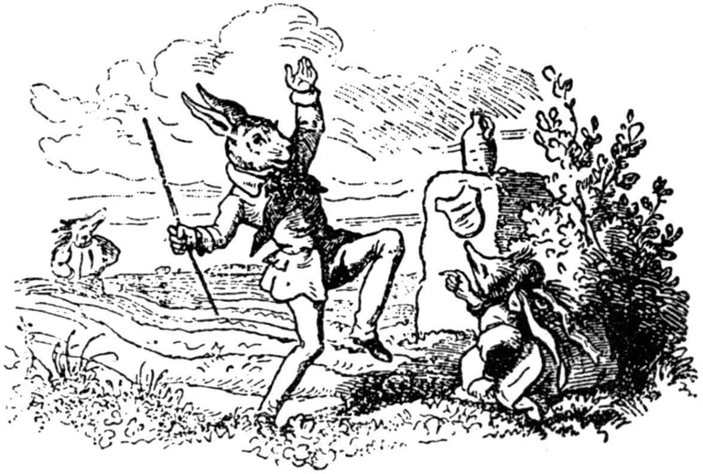

# 兔子和刺猬

孩子们，这个故事听起来似乎让人难以相信，可是它确是真事，因为对我讲这个故事的祖父，每次愉快地讲完后总是说：“我的孩子，这可是真的哟，要不然别人就不会这么讲了。”

这个故事是这样的：

这是一个秋天的星期日早上，这个时节荞麦正在抽穗；太阳悬挂在天空，显得格外灿烂；晨风阵阵，暖洋洋地吹拂着收割过的田野；百灵鸟在空中啁啾啼鸣；小蜜蜂在荞麦间嗡嗡地飞舞；人们身着漂亮的假日衣服去礼拜堂：人世间的一切生物都显得非常高兴。就连刺猬也一样。

刺猬站在自己的房屋门前，双臂交叉着放在胸前，一边观赏晨风微微吹拂着的大地的景致，一边在哼着一首小曲，他哼得不好也不坏，完全同一只在美丽的星期日早晨哼小曲的刺猬一样。

他正这样无所事事地哼着小曲，脑子里忽然闪出一个念头：趁现在妻子给孩子们洗脸穿衣服的时候，他可以到田野里去转转，看看萝卜长得怎么样了。

那块萝卜地离他们家不远，他常常带着全家去那里痛快地吃一顿，那块地似乎成了他的私有财产。

说干就干。刺猬关上屋门，朝田野里走去。他刚走到一个离家不远的地方，想绕过一片田野边的野蔷薇，朝萝卜地走去时，迎面却碰上了兔子。兔子也是因为差不多的原因，出来走走，想去看看白菜的。

刺猬看到兔子，便亲切地招呼他，说“早上好”。兔子自以为他是一个高贵的先生，态度非常傲慢，不但对刺猬的问候理都不理，反而摆出一副不屑一顾的样子，对刺猬说：“怎么回事，你一大早在田野里逛来逛去的？”

“我在散步呢，”刺猬说。

“散步？”兔子笑道，“我觉得，你应该把你的腿用在适当的地方。”

兔子这样回答让刺猬挺不高兴，他什么话都不在乎，就是不愿意别人笑话他的腿，因为他的腿生来就是弯曲的。

“那么你觉得，”刺猬对兔子说，“你的腿就很强吗？”

“我想是的，”兔子说。

“关于这个问题我们可以试一试，”刺猬说，“我敢打赌，如果我们赛跑的话，我一定会跑在你的前面。”

“你是个弯腿，还想跟我赛跑，这简直是笑话，”兔子说，“不过，你既然有兴趣这么做，那么我就跟你赛赛吧。你想赌什么呢？”

“就赌一枚金币和一瓶白兰地吧，”刺猬说。

“可以，”兔子说，“我们说好了，马上开始吧。”

“不，别这么着急，”刺猬说，“我肚子还是空的呢；我要先回去吃早饭，半个小时以后我再上这儿来。”

刺猬说完就走了，兔子也随他的便。

刺猬走到半路上，心想：这个兔子自以为他的腿长，可是我一定要赢。尽管他是个体面的先生，可是也是个笨蛋，他一定会输的。

刺猬回到家，对他老婆说：“老婆子，快穿衣服，你得跟我一起到田里去一趟。”

“究竟出什么事了？”老婆问。

“我和兔子打赌了，赌一枚金币和一瓶白兰地；我要和他赛跑，你应该在场。”

“哦，天哪，老头子，”刺猬的老婆向他叫道，“你疯了吗？你脑子完全不正常了吧？你怎么会想起和兔子赛跑的呢？”

“别多说了，女人，”刺猬说，“这是我的事儿。男人的事用不着你来管，快穿上衣服跟我走。”

刺猬的老婆拿他有什么办法呢？不管她愿意不愿意，她只好顺从。

当他俩来到半路上，刺猬对他的老婆说道：“我说的话你要好生听着。你看那块长长的耕地，我们就要在那儿赛跑。兔子在这条垄沟里跑，我在那条垄沟里跑；我们从那上面起跑。你没别的事，就在这条沟里站着，等兔子从他那条沟里跑过来时，你就朝他喊：‘我早就跑到这里了。’”

他们说完这些话就来到了耕田上，刺猬给他老婆安排了她该站的位置，然后就朝耕田的那一头走去。

当他到达起跑点时，兔子已经等在那里了。

“现在可以开始吗？”兔子说。

“可以，”刺猬说。

“那就准备吧！”

这时他们各自在垄沟里站好。兔子数道：“一、二、三，”他刚数完，就风也似地朝另一头奔去。

可是，刺猬大概只跑了三步路，就往沟下面一蹲，坐在那儿休息了。

当兔子跑到耕田的另一头时，刺猬的老婆便冲他喊了起来：“我早就跑到了。”

这下兔子吃惊不小，他觉得冲他喊话的除了刺猬外不会是别人，因为大家都知道，刺猬老婆的长相同她的丈夫是一模一样的。

不过，兔子还是不明白：“这事儿一定有什么不对的地方。”他喊道：“回去，再跑一次！”

接着，他又开始像风也似地奔跑，跑得他耳朵都似乎从头上飞起来。而刺猬的妻子却很笃定地呆在原来的地方。

当兔子跑到那一头，刺猬却冲他喊了起来：“我早就跑到这里了。”

兔子气疯了，叫道：“回去，再跑一次！”

“我不要紧，”刺猬说，“你愿意跑几次就跑几次。”

就这样，兔子跑了七十三次，而刺猬老是站在原来的地方。兔子每次跑到头，刺猬或他的老婆就说：“我早就跑到这里了。”

兔子在跑第七十四次的时候却跑不到终点了。他在耕田中间倒下了，鲜血从脖子上流出来，再也没起来。

可是刺猬却取了赢到手的金币和白兰地，把他老婆从垄沟里叫出来，两人一起心满意足地回家去了；如果他们没死的话，那么现在还在世呢。

这就是在布克斯特胡德尔原野上，刺猬同兔子赛跑，结果兔子跑死的故事。从那以后，就再也没有兔子敢和布克斯特胡德尔的刺猬赛跑了。

这个故事告诉我们：第一，谁也不能骄傲自大，看不起一个普通的、微不足道的人，哪怕是一个刺猬也不行；第二，如果一个人要结婚，那么最好是找一个相貌和地位同自己相等的人做妻子。譬如说：如果谁是刺猬，那么他就要找一个刺猬做妻子，依此类推。

> **注 1**　德语中，“刺猬”（Igel）又有“带刺的、难以相处的人”的意思。

（裴胜利译）
