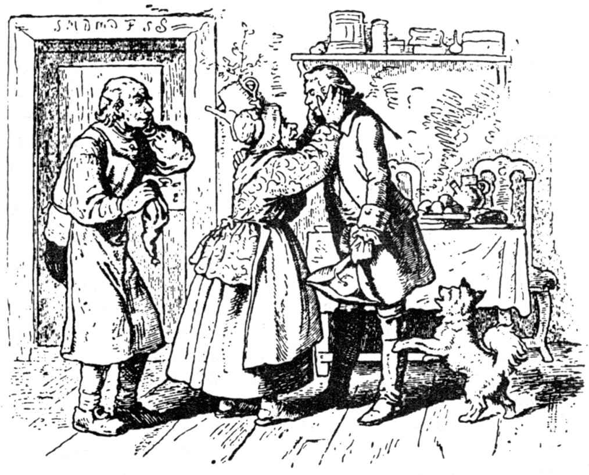

# 贼王

有一天，一个老头儿同他的老伴儿在一座简陋的房子前坐下，他们干完了活儿想歇一歇。这时，突然有一辆豪华的四驾马车急驶而来，接着从车上下来一个衣着阔气的先生。那老农夫站起身，走到那先生跟前，问他可要点什么，或者需要他帮点什么忙。

那个陌生人向老头儿伸出手说道：“我什么都不要，只想吃一顿乡村风味的饭。按照你们的吃法，去给我准备些土豆，我要坐在你们的桌子边痛痛快快地吃一顿。”

老农夫笑道：“看来您是一个伯爵或者侯爵，甚至也许是一个公爵，你们贵人时常会心血来潮，冒出这么一种雅兴来；好吧，您这个愿望会得到满足的。”

老农夫的妻子走进厨房开始洗土豆，然后捣碎做成农夫们平时吃的那种土豆丸子。在她干这一切活儿时，农夫对陌生人说：“劳驾你和我一起到园子里去一下，我还有些活儿要干。”

在园子里，老农已经挖好一些坑，现在想把树栽上。

“你没孩子吗？”陌生人问道，“他们怎么不帮帮你？”

“没孩子，”老农回答说，“不过我曾经有过一个儿子，可是他早就远走高飞了。他是个不成器的孩子，虽然聪明伶俐，可是不学无术，干尽了坏事；最后他离开我跑掉了，打那以后我没有听到他任何消息。”

老农取了一棵树苗插入树洞，在边上打上一根木桩；接着又培上土踩实，在树干的上、中、下三个部分用草绳绑好，然后紧紧拴在木桩上。

“可是，请告诉我，”那位先生说，“你为什么不把那边角上的一棵有节疤的、几乎要弯到地上的树，也像这棵一样扎扎好呢，这样不就能使它长得好吗？”

老农笑了笑，说道：“先生，您只知其一，不知其二；看来您对园艺还不太懂。那边的那棵树老了，长了许多节疤，谁也不能把它弄直了；要使树木长得好，就得在它小的时候培育好。”

“这也跟你的儿子一样啊，”陌生人说，“如果你在他小的时候教育好他，那么他也就不会离家出走了；现在他已经长结实了，身上也有许多节疤了。”

“可不是嘛，”老农回答说，“他走了已经好多年，恐怕早就变样了。”

“如果他现在来到你的面前，你还能认出他来吗？”陌生人问。

“从相貌上看就难说啰，”老农回答说，“不过他身上有一个记号，在他的肩膀上有一颗胎痣，看上去同一颗豆儿一样大小。”

等他说完后，陌生人脱去上衣，露出肩膀给老农看那豆儿一般大小的胎痣。

“天哪，”老农叫道，“你确实是我的儿子，”对儿子的爱恋之情震动了他的心。“可是，”他接着说，“你怎么会是我的儿子呢？你成了一个大人物，产业丰厚，生活富裕。你是通过什么途径达到现在这个程度的？”

“哦，父亲，”儿子回答说，“幼树不绑在木桩上就要长弯曲；现在它太老了，它再也长不直了。这一切我是怎么得来的吗？我成了一个贼。不过你别害怕，我是一个贼王。对我来说，既没有什么锁，也没有什么门闩；我想要什么，什么就是我的。你别以为我像普通的小偷那样偷窃，我只偷富人的浮财。穷人尽管放心，我决不拿他们的半点东西，反而时常很乐意地给他们一点。甚至连那些不花力气、不动脑子、不亲自动手而能得到的东西，我也不屑一顾。”

“哦，我的儿子，”父亲说，“尽管这样我也不乐意，贼总归是贼；我告诉你，这样下去不会有好结果的。”

老农把儿子领到他母亲那里；当她听说，这就是她儿子时，高兴得哭了；可是当老农对她说，儿子是一个贼王时，她的眼泪像两股泉水似的淌满了整个脸膛儿。最后她说道：“尽管他成了一个贼，但毕竟是我的儿子，我总算又看到他了。”

他们在桌子边坐下，做贼的儿子同父母一起又吃起这顿他好久没吃过的粗饭。

父亲这时说道：“如果我的主人，住在山上城堡里的伯爵知道你是谁以及你是干什么的，那么他是不会像在洗礼盆前那样抱住你摇晃，而是要让人把你拴在绞刑架上摆动的。”

“别担心，亲爱的父亲，他不会把我怎么样的，因为我是有一手的。今天我还要亲自上他那儿去一下。”

暮色苍茫时分，贼王驾着马车朝城堡驶去。伯爵殷勤地接待了他，因为他把他看成一个高贵的人了。

可是当陌生人作了自我介绍后，他脸色一下子苍白起来，好长时间不吭一声。后来他终于说道：“你是我的教子，因此我愿意赦免你，对你作宽大处理。你自称是贼王，那么我想考考你，看你有多大能耐，你要是通不过，那么你就要被绞死，乌鸦的叫声就是你的哀乐。”

“伯爵先生，”贼王回答说，“你尽管想出三件最难的事，如果我解决不了，那么就随便你处置。”

伯爵沉思了片刻，然后说道：“好吧，第一件事，你要从马棚里偷走我的马；第二件，在我们睡着的时候，你要让我们毫无知觉地从我和我太太身底下拿走床单，同时还要把我太太手指上的结婚戒指取走；第三件，也就是最后一件事，你要为我偷走教堂里的牧师和司事。你要好好注意，因为这些事对你来说都是性命攸关的。”

贼王来到附近的一个城里着手准备。他在那里向一位老农妇买了一套衣服穿上。然后他把自己的脸涂成褐色，又描了几道皱纹，这样人们便完全认不出他了。最后他打了满满一小桶匈牙利陈酒，在酒里掺了一种烈性安眠药。

他把小酒桶放在一个背篓里背在身上，接着就不慌不忙、摇摇晃晃地朝伯爵的城堡走去。当他走到那里时，天已经黑了。他在城堡院子里的一块石头上坐下，开始咳嗽起来，活像一个身患肺病的老太婆；他搓着手，像是很冷似的。

在马棚的门前，有几个士兵围着一个火堆躺着；其中一个发现了这个老太婆，向她喊道：“走近点，老妈妈，到我们这儿来暖和暖和吧。你一定是没有过夜的地方，就在这儿找个地方睡吧。”

老太婆急忙迈着小步走过去，请他们替她把背篓从背脊上拿下来，然后在他们旁边坐下烤火。

“老婆子，你这个小桶里是什么东西？”有一个士兵问。

“是一点好酒，”她回答说，“我是靠做买卖过日子的，你们给点钱，说些好话我也愿意给你们喝一杯。”

“拿过来，”一个士兵说，接着便尝了一杯，然后叫道：“真是好酒，我要多喝一杯，”说着他又让老太婆倒了一杯，其他士兵按他的样喝了。

“喂，伙计们，”一个士兵朝坐在马棚里的那些士兵叫道，“这儿有个老妈妈，她有好酒，酒的年份和她的年岁一样大，你们也喝一杯暖和暖和吧，这比我们烤火还管用呢。”

老太婆背着酒桶走到马棚里。一个士兵坐在备有马鞍的马背上，另外一个手里握着笼头，还有一个抓着马尾巴。

她斟上酒去，管他们喝个够，直到酒桶干了为止。不多一会儿，那个士兵放了手里的笼头倒下了，并开始打起呼噜来；另外一个也松了马尾巴躺下了，呼声还要响；坐在马鞍上的那个，尽管仍坐在上面，可是他已经弯下了身子，脑袋都快要耷拉到马脖子上，也睡着了，嘴里还一边像风箱似地吐着气。

马棚外面的那些士兵也早就睡着了，他们躺在地上一动不动，活像一块块石头。

贼王看到眼下时机成熟了，便拿来一根绳子塞在握着笼头的那个士兵手里，又将一把草扫帚给那个抓着马尾巴的士兵握住；可是对那个坐在马背上的士兵该怎么办呢？他不打算把他推下去，否则的话他醒了后会叫喊的。

不过他灵机一动，想出了个好主意来。他解开马鞍肚带，用那几根挂在墙上圈子里的绳子紧紧扎着马鞍，再把那个睡着的士兵连同马鞍悬在空中，然后用绳子在柱子上绕几圈拴得紧紧的。

接着他赶紧把马从链条上解下来，不过，要是从石子路面的院子里走过的话，那么马蹄声就会传到城堡里。于是他事先用旧布头把马蹄包住，然后才小心翼翼地牵着马走出马棚，接着便翻身上马骑走了。

天刚亮，贼王就骑着偷来的马朝城堡飞奔而来。这时伯爵刚刚起床，他正站在窗前朝外张望。

“早上好，伯爵先生，”贼王朝他喊道，“瞧这匹马，我有幸把它从马棚里牵出来了。你去看看，你的那些士兵躺在那里睡得正香呢；只要你愿意到马棚里去一下，那么就会看到，你的岗哨是多么的舒服。”

伯爵只好报以微笑，然后说道：“第一个回合你赢了，不过第二个回合你不会这么走运的。我警告你，你要是作为小偷让我撞见了，那么我也要像对待一个小偷一样对待你。”

到了晚上，当伯爵夫人上床睡觉时，把结婚戒指紧紧地握在手心里，而伯爵说道：“所有的门都锁上和闩上了，我守着，打算等他一夜；只要他跳窗进来，那么我就一枪打死他。”

夜深人静时，贼王来到野外的绞刑架前，把一个吊在上面的可怜的罪人放下来，割断绳索，然后背着这个死人朝城堡跑去。

他来到城堡跟前，把一架梯子靠在伯爵的卧室旁边，然后让死人骑在自己的肩膀上，朝窗户上爬去。当他爬到一定的高处，使死人的头出现在窗户前，伯爵正在床上全力以赴地等待着，一见有个人头便立刻扣动了扳机；贼王连忙让那个可怜的罪人倒了下去，自己随后迅速跳下梯子，藏在一个角落里。

月色溶溶，贼王透过夜幕可以清楚地看到伯爵爬出窗户，从梯子上爬下去，把死人背到花园里。他开始在那里挖坑，打算把死人埋进去。

“现在，”贼王想道，“好机会到了，”他敏捷地从躲藏的角落里窜出来，爬上梯子，径直来到伯爵夫人的卧室里。

“亲爱的夫人，”他装成伯爵的声音说道，“那个小偷死了，不过他毕竟是我的教子，也并不是什么坏蛋，只是一个捣蛋鬼罢了；我不想当众羞辱他，况且我也很同情他那可怜的父母。在天亮之前，我要亲自把他埋在花园里，免得传出去让别人知道。你把被单给我，我想裹尸体，总不能像一条狗似的草草埋掉。”

伯爵夫人把被单交给他。

“你听我说，”贼王接着说，“我忽然觉得应该宽大为怀，你还是把戒指给我吧；这个不幸的人为了它而不惜丢了性命，那么就让它随他一起进坟墓去吧。”

她不敢违背伯爵的意愿，尽管她很不愿意这么做，但还是把戒指递给了他。

贼王拿了这两件东西离去了，在伯爵还没干完他的埋葬死人的活儿以前，他已经平平安安地回到了家里。

第二天早上，当贼王带着被单和戒指来到时，伯爵的脸都拉长了。“难道你会变魔术？”他对贼王说，“我亲自把你埋进了坟墓，是谁把你挖出来，并且使你重新活过来的？”

“你埋入坟墓的不是我，”贼王说，“而是绞刑架上那个可怜的罪犯，”接着他详细地述说了事情的经过；伯爵不得不承认，他确是一个头脑灵活、手段巧妙的贼。

“不过你的事情还没完呢，”他补充道，“你还应该解决第三件事情，如果这第三件你完不成的话，那么前功尽弃，什么都帮不了你的忙了。”

贼王微微一笑，并不作回答。

天黑以后，他身上背着一只长口袋，胳膊底下夹着一个包袱，手里提着灯笼朝村子里的教堂走去。他在口袋里放着螃蟹，在包袱里放着短蜡烛。

他在教堂的墓地上坐下，取出一只螃蟹，把一支短蜡烛黏在螃蟹的背上，然后点燃蜡烛，再把螃蟹放到地上，让它爬行。接着他又取出第二只，按照同样的方法办了，直到口袋里的最后一只螃蟹取出放了为止。

他做完了这些后，便穿上一件黑长袍，这长袍看上去就像一件道袍，接着在下巴上黏上一把花白的胡子。当他装扮得面目全非以后，就拿起刚才还放着螃蟹的口袋走进教堂里，来到布道坛上。

这时塔楼大钟刚好打十二下；当最后一下钟声刚消失，他用又大又尖的嗓门叫道：“听着，你们这些罪人哪，万物的末日来到了，世界的末日来临了；你们听着，你们听着，谁愿意跟我一起进入天国，那么就爬到口袋里来吧。我是开天国大门的彼得。你们看，外面教堂墓地上死去的人在行动了，他们正在收集他们自己的骨骼。来吧，来吧，爬进口袋，世界就要毁灭了。”

这叫喊声传遍整个村子。牧师和司事住得离教堂最近，他们最先听到；当他们看到在教堂墓地上闪烁的灯光时，觉得一定是发生了什么不寻常的事，于是他们就来到教堂里。他们仔细听了一会儿这个人的说教，这时司事推了一把牧师，说道：“要是我们利用这个机会，在末日来到之前，一起这么轻而易举地到天国里去，这倒也不坏。”

“可不是嘛，”牧师回答说，“我也是这么想的；你如果有兴趣这么做，那么我们就一块儿走吧。”

“好吧，”司事回答说，“不过，牧师先生，您走在前面，我跟在您后面。”

于是牧师就在前面走，他来到布道坛上，贼王在那里张开口袋。牧师先爬了进去，接着司事也爬了进去。贼王马上把袋口扎紧，抓着鼓鼓囊囊的口袋，从布道坛上往下拖；那两个笨蛋的脑袋瓜子不断地磕在台阶上，而贼王却叫道：“现在已经过了高山。”

后来他用同样的方法把他们拉过了村子；当他们穿过水坑时，他就喊：“现在我们已经穿过潮湿的云层了，”当他终于把他们拖上城堡的台阶时，他就喊道：“现在我们在上天国的台阶，我们马上就要到天国的前院了。”

他终于到达城堡上面时，就把口袋推进鸽棚里；鸽子扑棱棱地飞起来，他就说：“你们听，天使们多么快乐，他们正拍打着双翼呢。”然后他就关上鸽棚的门走了。

下一天早上，他来到伯爵那里，对他说，第三个任务他也已经完成，把牧师和司事从教堂里偷来了。

“你把他们放在哪里了？”伯爵问。

“他们正躺在上面鸽棚的一只口袋里，不过他们还以为自己是在天国里呢。”

伯爵亲自跑到城堡上面，深信他说的是真话。当他把牧师和司事从口袋里放出来后，对贼王说道：“你真是一个窃贼大王，这件事你也赢了。好吧，这次我就饶了你，不过你要离开我的国家，如果你再踏进这个国家一步，那么你就准备上绞刑架吧。”

于是，这个窃贼大王便告别了他的父母，又到很远很远的地方去了。从此以后就再也没有人听到他的任何消息。

（裴胜利译）
